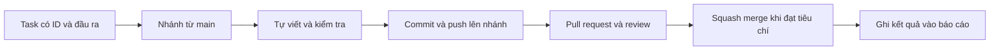

# Cách đóng góp cho BTL 26118

Hướng dẫn đề xuất cho giai đoạn Linh chuẩn bị repo và sau đó làm nhóm ba người. Trạng thái thiết lập thực tế và checklist nằm trong [kiểm tra GitHub](docs/Thiet-lap-GitHub-26118.md).

Minh và Khánh bắt đầu tại [hướng dẫn thành viên](docs/Huong-dan-thanh-vien.md): clone riêng, làm PR thử, nhận issue, review và báo tiến độ. [Sổ tay GitHub của nhóm](docs/So-tay-GitHub-nhom.md) có thêm phần thiết lập thành viên, board và đăng lesson. [Mục lục lesson](docs/lessons/README.md) là chỗ đọc chung; ghi chú học không tự thay thế task có owner và đầu ra.

## Luồng một công việc



Commit lưu thay đổi trong Git local. Push đưa commit lên GitHub. PR là đề nghị ghép nhánh vào main. Squash merge tạo một commit trên main cho kết quả PR. Một phần có thể gồm nhiều commit nhỏ trên nhánh trong lúc học/sửa, nhưng PR cần có một mục tiêu rõ.

1. Kiểm tra working tree, cập nhật main khi đã xử lý phần đang làm, rồi mở nhánh ngắn theo task. Ví dụ `codex/linh-p02-percpu-state` hoặc `codex/docs-github-workflow`.
2. Ghi trước trách nhiệm, input/output, API/caller, ownership/lifetime và khóa/ngắt liên quan.
3. Mỗi tác giả tự viết C theo chặng nhỏ. Assistant giải thích/review, không viết implementation thay khi chưa được yêu cầu rõ.
4. Review diff và chạy kiểm tra phù hợp. Tài liệu cần kiểm tra link/nội dung; code cần build/test tương ứng. Ghi rõ phần chưa chạy.
5. Tự stage đúng file/hunk, commit rồi push nhánh. Không stage repo tham khảo lồng hoặc file ngoài task.
6. Mở PR, điền mẫu, gắn task và evidence. Sửa theo review và kiểm tra lại phần bị ảnh hưởng.
7. Khi đạt điều kiện mới squash merge; công việc mới dùng nhánh mới từ main cập nhật. Ghi commit main/PR vào báo cáo và dùng lại ID task ở TODO.

Các bước Git ghi ở đây do thành viên thực hiện. Assistant không tự stage/commit/push hoặc viết lại lịch sử chỉ vì đang hướng dẫn.

## Review khi chỉ có một người và khi có nhóm

Ảnh Linh cung cấp ngày 19/10 đã hiển thị hai tài khoản với nhãn Collaborator. Lần đọc ruleset trước đó ghi số approval bắt buộc bằng 0 cho giai đoạn solo; chưa kiểm tra lại setting sau ảnh này. Mỗi người cần thử clone/push/PR và review; sau khi có reviewer sẵn sàng, Linh tăng required approvals lên 1. Assistant không được tính như một thành viên đã approve trên GitHub.

Khi Minh/Khánh tham gia và đã có quyền review phù hợp, mỗi PR cần một người khác tác giả review trước merge. Linh review các tầng để hiểu toàn bộ; PR của Linh do Minh hoặc Khánh review. Kết quả thuật toán vẫn cần test, không chỉ approval.

## Tên commit và nội dung PR

```text
docs(team): define weekly reporting responsibilities
feat(page): add locked free-page counting
style(kernel): align learning changes with clang-format
ci: separate formatting from Linux tests
```

Một commit có thể mang code và tài liệu giải thích trực tiếp cho cùng thay đổi. Khi một bài học mới, một quy trình nhóm và một tính năng kernel là ba mục tiêu riêng, tách chúng thành các phần review riêng. Không dùng `.` làm message; PR title phải mô tả kết quả sẽ vào main.

Mẫu PR ghi rõ: vấn đề, hành vi sau thay đổi, API/caller, ownership/khóa, kiểm tra đã chạy, phần chưa chạy và link log. Nếu nhiều người thật sự cùng viết, ghi đóng góp/co-author đúng thực tế. Tài liệu/code học trước của Linh không tự trở thành đóng góp của cả nhóm W1.

## Chú thích và kiểm tra

Chú thích là gợi ý khi giúp hiểu quyết định; không là điều kiện bắt buộc hoặc việc phải làm thêm để chốt một mốc đã đạt. Với code, vẫn giữ invariant/ownership/khóa đúng và tuân theo formatter; tài liệu chỉ cần review nội dung và link phù hợp. Tôn trọng `.clang-format` và `.gitattributes` hiện có.

Trước chốt phần code, xem diff, tự chạy kiểm tra phù hợp và ghi kết quả thật. Build thành công không đồng nghĩa đã boot/test; test chức năng không đồng nghĩa có kết quả benchmark. Sau một mốc có ý nghĩa, tác giả tự commit rồi push với message đúng phạm vi.

## Tài liệu liên quan

- [Quy trình kỹ thuật và ranh giới module](docs/Quy-trinh-nhom-26118.md).
- [Backlog và các đầu ra khởi động](docs/Ke-hoach-va-backlog-26118.md).
- [Báo cáo tuần và cách nối TODO](docs/bao-cao/README.md).
