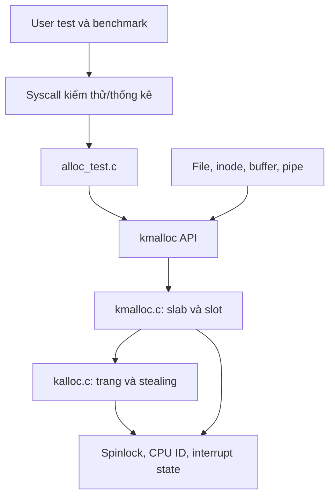

# Cấu trúc dự án C cho đề tài 19

Ngày: 13/10/2026. Thiết kế dành cho kernel xv6, với yêu cầu cấu trúc vừa đủ và dễ học.

## 1. Quyết định kiến trúc

Chọn **các module C theo trách nhiệm trong cấu trúc xv6 hiện có**. Giữ API nhỏ, ẩn dữ liệu nội bộ và quy định rõ module nào gọi module nào.

Clean Architecture tập trung vào tách trách nhiệm và hướng phụ thuộc; sơ đồ gốc không bắt buộc đúng bốn tầng. [Bài viết của Robert C. Martin](https://blog.cleancoder.com/uncle-bob/2012/08/13/the-clean-architecture.html).

Với đồ án này, áp dụng nguyên tắc tách API khỏi phần triển khai và tách công cụ thực nghiệm khỏi allocator. Chưa cần tạo các project hoặc thư mục `Domain`, `Application`, `Infrastructure`, repository pattern hay một cơ chế dependency injection chung. Kernel allocator trực tiếp làm việc với trang vật lý, spinlock và trạng thái CPU; những phụ thuộc này là một phần của nhiệm vụ đang học.

Một lời gọi qua `.h` sang module `.c` đủ thể hiện ranh giới ban đầu. Chỉ thêm function-pointer interface khi có một nhu cầu cụ thể, chẳng hạn cùng một thuật toán thực sự phải chạy trên nhiều backend.

## 2. “Solution” tương ứng với gì trong dự án này?

| Trong dự án C# quen thuộc | Trong dự án xv6/C này |
|---|---|
| Solution `.sln` | Thư mục dự án và workspace VS Code |
| Project `.csproj` | Các target và danh sách object trong Makefile |
| Class cung cấp chức năng | Module `.c` với các hàm và struct liên quan |
| Public API | Hàm, kiểu dữ liệu được khai báo trong `.h` |
| Chi tiết private | Hàm/biến `static` và struct nội bộ trong `.c` |
| Build solution | Cross-compile và link kernel/user programs theo Makefile |

Không cần mỗi module trở thành một thư viện riêng. Các object file của kernel được link chung thành binary kernel. Nếu dùng Visual Studio, có thể cấu hình làm giao diện cho Make, nhưng bản thiết lập hiện tại chọn VS Code + WSL 2 + Make để theo sát tài liệu môn xv6. [Repo xv6 chính thức](https://github.com/mit-pdos/xv6-riscv), [MIT tools](https://pdos.csail.mit.edu/6.1810/2025/tools.html).

## 3. Những file đã dựng và cây mã dự kiến

Đã dựng thực tế:

```text
BTL/
├── BTL.code-workspace
├── README.md
├── .gitignore
├── AGENTS.md
├── Makefile
├── kernel/                   # source xv6 gốc đã nhập
├── user/                     # source xv6 gốc đã nhập
├── mkfs/                     # source xv6 gốc đã nhập
├── agent/                    # bộ nhớ dự án
├── .vscode/
│   └── tasks.json
└── docs/
    ├── Kien-truc-du-an.md
    └── Nghien-cuu-de-tai-19.md
```

Cây dưới đây là **cấu trúc đích của đề tài**. Các module xv6 gốc đã được nhập; file C đánh dấu bổ sung chưa được tạo:

```text
BTL/
├── BTL.code-workspace
├── README.md
├── .gitignore
├── .vscode/tasks.json
├── Makefile                  # giữ build system của xv6
├── kernel/
│   ├── kalloc.c              # mã gốc: trang, per-CPU lists, stealing
│   ├── kmalloc.c             # bổ sung: slab và cấp phát object
│   ├── kmalloc.h             # bổ sung: API object allocator
│   ├── alloc_test.c          # bổ sung khi bắt đầu kiểm thử kernel
│   ├── file.c                # tích hợp cấp phát động
│   ├── fs.c                  # tích hợp in-memory inode động
│   ├── bio.c                 # tích hợp buffer động
│   ├── pipe.c                # bước thử tích hợp đầu tiên
│   ├── spinlock.c            # giữ cơ chế khóa của xv6
│   └── ...                   # các file gốc khác
├── user/
│   ├── alloctest.c           # bổ sung: điều khiển kiểm thử
│   ├── allocbench.c          # bổ sung: điều khiển benchmark
│   └── ...                   # các chương trình gốc
├── mkfs/                     # mã gốc: tạo filesystem image
├── docs/                     # thiết kế và báo cáo
├── scripts/                  # tạo khi có bước tự động hóa thực tế
└── results/                  # tạo khi có dữ liệu đo
```

Giữ các file mới cạnh module xv6 liên quan trong `kernel/`; chưa chuyển toàn bộ mã gốc vào một cây `src/` mới. `scripts/` và `results/` xuất hiện khi có nội dung sử dụng, không cần tạo các thư mục rỗng cho đủ sơ đồ.

## 4. Trách nhiệm của từng module

| Module | Trách nhiệm | Dữ liệu nội bộ |
|---|---|---|
| `kernel/kalloc.c` | Lấy/trả trang, local lists, chuyển trang giữa CPU | Free lists, lock và counter theo CPU |
| `kernel/kmalloc.c` | Chọn size class, tạo slab, lấy/trả slot, reclaim slab rỗng | Slab header, bitmap/free slots, cache lists |
| `kernel/kmalloc.h` | Công bố API cho client | Chỉ prototype và kiểu thực sự cần dùng bên ngoài |
| `kernel/alloc_test.c` | Chạy các ca kiểm thử và thao tác đo ở kernel | Workload, dữ liệu kiểm tra và bộ đếm của test |
| `kernel/file.c`, `fs.c`, `bio.c` | Quản lý lifetime của object nghiệp vụ kernel | Refcount, registry, trạng thái và các khóa vốn có |
| `user/alloctest.c`, `allocbench.c` | Nhận tham số, gọi syscall, in kết quả | Tham số user và bản sao thống kê |
| `scripts/` | Lặp cấu hình QEMU và thu dữ liệu khi cần | Công cụ chạy trên máy host |

Counter đơn giản nằm cùng module sở hữu dữ liệu. Chưa tạo `stats.c`, `bitmap.c`, `policy.c` hoặc `allocator_manager.c` chỉ vì một nhóm hàm nhỏ có tên riêng.

Khi chính sách stealing có nhiều biến thể đủ lớn, mới cân nhắc tách `steal_policy.c/.h`. Khi slab chứa nhiều phần độc lập khó đọc, mới tách `slab.c/.h` và để `kmalloc.c` làm phần chọn size class. Buddy được thêm thành module sau khi bắt đầu làm stretch goal.

## 5. Hướng gọi giữa các module



Đây là hướng gọi chức năng của bản đầu, không phải sơ đồ đầy đủ của mọi include trong xv6.

Client gọi API và quản lý lifetime của object. Client không sửa bitmap hoặc đi vào danh sách slab. Slab biết cần xin/trả trang nhưng không cần biết chi tiết danh sách trang của từng CPU.

Test gọi allocator; allocator không gọi test. Syscall là lớp điều khiển kiểm thử và sao chép dữ liệu thống kê, không cấp con trỏ kernel trực tiếp cho chương trình user.

Nếu bổ sung page-allocation failure hook để reclaim slab sau này, đó là một tương tác ngược cần thiết kế riêng: chỉ gọi sau khi thả page locks, giới hạn retry và bảo đảm slab subsystem đã khởi tạo. Không thêm hook này ở mốc cấu trúc ban đầu.

## 6. Quy tắc viết module C

Một module thường gồm `.h` công bố cách dùng và `.c` chứa cách làm. Những module xv6 gốc đã có prototype trong `defs.h` có thể giữ theo quy ước gốc; không cần tạo header mới cho mọi file.

Ví dụ khai báo API ban đầu, theo quy ước `uint64` của xv6:

```c
// Caller đã include types.h theo quy ước của xv6.
#ifndef XV6_KMALLOC_H
#define XV6_KMALLOC_H

void kmalloc_init(void);
void *kmalloc(uint64 size);
void kmfree(void *ptr);
void kmalloc_dump(void);

#endif
```

Đoạn này minh họa thiết kế header; chưa là API đã được triển khai.

Trong `.c`, các hàm chỉ dùng nội bộ như `find_available_slab`, `slab_create`, `slot_alloc` và `slot_free` nên là `static`. Các struct biểu diễn slab/cache cũng ở nội bộ nếu client không cần truy cập chúng.

Quy tắc thực hành:

- Include header thay vì include file `.c`; Makefile biên dịch các `.c` và linker ghép các `.o`.
- Không đặt định nghĩa biến global dùng chung trong header. Chọn một nơi sở hữu dữ liệu; dùng API để truy cập.
- Đặt tên diễn tả tầng quản lý: page, slab, slot và cache.
- Dùng spinlock/atomic đúng cơ chế xv6; `volatile` không thay thế đồng bộ.
- Kernel dùng các tiện ích sẵn có của xv6; không gọi `malloc/free` của libc để triển khai allocator của kernel.
- Khai báo hành vi khi size bằng 0, hết bộ nhớ, pointer null và alignment trong API.
- Không `printf` trong vòng đo hoặc giữ khóa chỉ để in dump; lấy snapshot rồi in khi phù hợp.
- Chỉ trừ địa chỉ slot hoặc tính page base sau khi kiểm tra pointer thuộc vùng và loại allocation hợp lệ.

## 7. Hai loại free và lộ trình đặt tên API

`kfree` của xv6 gốc trả một trang 4 KB. `kfree` trong mô tả object allocator lại trả object nhỏ. Không được vô tình thay ngữ nghĩa của hàm gốc trong khi các call site vẫn trả trang.

Để học và tích hợp từng bước, đề xuất:

| Giai đoạn | Tầng trang | Tầng object |
|---|---|---|
| Bản đầu | Giữ `kalloc/kfree` gốc | Thêm `kmalloc/kmfree` |
| Chốt API theo catalogue nếu yêu cầu đúng tên | Đổi page free thành `kpage_free`, cập nhật mọi call site | Object API là `kmalloc/kfree` |

Tên giai đoạn cuối phù hợp với đề xuất trong bản nghiên cứu. Khi có starter/rubric, chốt theo quy định môn học. Chưa đưa một hàm `kfree` “đoán loại pointer” vào bản đầu.

Thứ tự khởi tạo tổng quát: tầng trang sẵn sàng → khởi tạo slab metadata/cache → khởi tạo các client cần cấp phát động. Không để chính `kmalloc_init` phụ thuộc vào một `kmalloc` chưa hoạt động.

## 8. Build system vừa đủ

Giữ Makefile xv6. Kernel và chương trình user được cross-compile cho RISC-V; binary kernel và filesystem image dùng với QEMU. [xv6 Makefile được khảo sát](https://raw.githubusercontent.com/mit-pdos/xv6-riscv/4ded343d5d9d40d4e9dcf4867ca45b14170bf364/Makefile).

Khi tạo `kmalloc.c`, thêm `$K/kmalloc.o` vào danh sách object kernel. Khi tạo kernel test, thêm object tương ứng. Khi tạo `alloctest`/`allocbench`, bổ sung chúng vào danh sách user programs và đăng ký syscall theo đúng starter.

Chưa thêm CMake, thư viện thứ hai hay một allocator chạy Windows song song. Nếu về sau có nhu cầu kiểm thử một thuật toán độc lập trên host, thêm target test hẹp; kết quả đó không thay thế kiểm thử locking và lifetime trong kernel.

Các task đã tạo dùng `type: process` và truyền arguments riêng. Trên Windows, gọi `wsl.exe --cd <workspace> --exec make ...`; trong phiên VS Code WSL/Linux, gọi `make` trực tiếp. Điều này giữ đường dẫn có dấu cách thành một đối số. [VS Code Tasks](https://code.visualstudio.com/docs/debugtest/tasks).

## 9. Thiết lập môi trường theo thứ tự

Máy hiện có VS Code, Git và lệnh WSL nhưng chưa có distro Linux. Chưa cài phần mềm trong lượt dựng khung này.

1. Cài Ubuntu 24.04 trên WSL 2. Trong PowerShell có thể dùng:

   ```powershell
   wsl --install -d Ubuntu-24.04
   wsl --list --verbose
   ```

   Hoàn tất khởi tạo user Linux và xác nhận distro dùng version 2.

2. Trong terminal Ubuntu, cài bộ công cụ MIT đề xuất:

   ```bash
   sudo apt-get update
   sudo apt-get install git build-essential gdb-multiarch qemu-system-misc gcc-riscv64-linux-gnu binutils-riscv64-linux-gnu bc perl
   ```

3. Source đã được nhập vào root BTL từ bản Exercise được kiểm tra tại [Nguon-xv6.md](<D:/2. FullStack/2026.1/Hệ điều hành/BTL/docs/Nguon-xv6.md>), cùng LICENSE và metadata phiên bản. Dùng bản BTL để học và code. Nếu về sau có starter chính thức khác, so sánh và hợp nhất file trùng thay vì ghi đè mù quáng.

4. Mở workspace trong VS Code. Sau khi WSL và extension đã sẵn sàng, chọn `WSL: Reopen Folder in WSL` hoặc mở thư mục từ terminal WSL bằng `code .`.

5. Build và boot **xv6 gốc** trước khi thay allocator:

   ```bash
   make kernel/kernel fs.img
   make qemu CPUS=1
   ```

   Khi có shell xv6, chạy `usertests -q` nếu bản starter hỗ trợ. Thoát QEMU bằng `Ctrl+A`, rồi `X`.

6. Ghi baseline commit và môi trường, rồi bắt đầu thêm module.

Tài liệu nền tảng: [MIT tools và WSL 2](https://pdos.csail.mit.edu/6.1810/2025/tools.html), [Microsoft WSL commands](https://learn.microsoft.com/en-us/windows/wsl/basic-commands), [VS Code WSL](https://code.visualstudio.com/docs/remote/wsl).

Các task hiện tại giả định `Makefile` nằm ở root BTL. Nếu starter bắt buộc nằm trong thư mục con, sửa working directory đồng thời trong task Linux và argument `--cd` của task Windows.

## 10. Thứ tự viết code để tránh mở rộng sớm

| Mốc | Phần làm | Tiêu chí hoàn thành |
|---|---|---|
| 0 | Starter và toolchain | xv6 gốc build/boot được |
| 1 | `kalloc.c` per-CPU lists, stealing đơn giản | Trang được bảo toàn, không cấp trùng |
| 2 | `kmalloc.c/.h`, một size class | Cấp/free nhiều object đúng, tái dùng slot |
| 3 | Nhiều size class, counter và dump | Kiểm tra boundary/alignment/OOM |
| 4 | Pipe, rồi file/inode/buffer | Lifetime và rollback đúng; đủ yêu cầu chuyển động |
| 5 | User test, syscall, benchmark | Đo và kiểm tra trên 1/2/4/8 CPU |
| 6 | Reclaim, policy variants, buddy | Thêm từng cơ chế với đối chứng rõ |

Không tạo interface cho các policy chưa tồn tại. Không tách từng struct thành một file. Việc tách module tiếp theo cần được thúc đẩy bởi trách nhiệm độc lập, khả năng đọc hoặc khả năng kiểm thử.

## 11. Tiêu chí cấu trúc hợp lý

Một người mới vào dự án cần xác định được: tầng trang nằm ở đâu; tầng object nằm ở đâu; API nào dành cho client; ai sở hữu object; test gọi vào đâu; và Makefile build những gì.

Với bản đầu, `kalloc.c` + `kmalloc.c/.h` là ranh giới chính của allocator. Test và công cụ đo được thêm khi bắt đầu làm thực nghiệm. Cách tổ chức này đủ rõ để học C/kernel và có chỗ mở rộng khi có bằng chứng cần thêm module.
