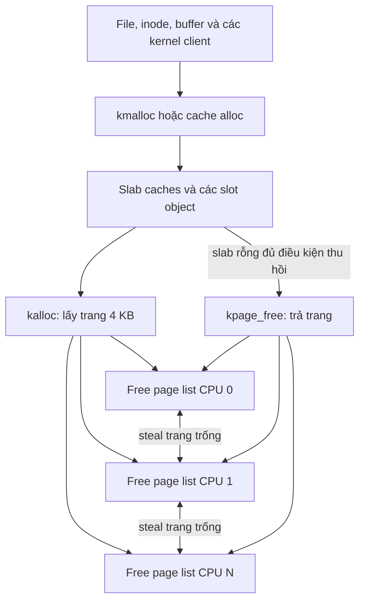

# Nghiên cứu đề tài 19: Slab allocator and per-CPU free lists

Ngày cập nhật: 13/10/2026, múi giờ Asia/Saigon.

Mục tiêu: triển khai đúng đề tài 19 trên xv6, kế thừa tư duy quản lý bộ nhớ từ BaoKhoaHoc/VstHelper và xây dựng một hướng thực nghiệm có thể phát triển thành NCKH sinh viên.

**Trạng thái:** đã đối chiếu catalogue, mã C# trên máy, mã nguồn xv6 chính thức và tài liệu nghiên cứu. Đây là đề cương và thiết kế đề xuất; chưa triển khai allocator, chưa chạy benchmark và chưa có kết quả hiệu năng.

## 1. Kết luận và phạm vi nên chọn

Giữ tên đề tài được giao: **Slab allocator and per-CPU free lists**.

Tên dùng cho báo cáo mở rộng:

> Thiết kế và đánh giá bộ cấp phát slab kết hợp danh sách trang theo CPU trong xv6.

Trọng tâm nghiên cứu đề xuất:

> Kích thước lô stealing ảnh hưởng thế nào đến thông lượng, độ trễ đuôi và khả năng phân phối trang trống khi tải giữa các CPU không cân bằng? Một chính sách điều chỉnh lô đơn giản có thích nghi tốt hơn các lô cố định trên những tải đã xác định hay không?

Làm phần bắt buộc trước, xây dựng baseline có thể đo, rồi mới thêm chính sách thích ứng. Thu hồi slab rỗng là phần mở rộng hữu ích để đánh giá bộ nhớ; buddy allocator là stretch goal trong catalogue và nên được triển khai sau khi hệ thống cơ bản ổn định.

Không cần ghép mọi kỹ thuật vào bản đầu tiên. Tăng số tính năng làm tăng phạm vi tích hợp, nhưng giá trị nghiên cứu đến từ câu hỏi, đối chứng và bằng chứng.

## 2. Yêu cầu thực tế trong catalogue

Đã đọc phần mở đầu và kiểm tra trực quan toàn bộ trang 6 của [Project catalogue](<C:/Users/KimSakota/Downloads/Project catalogue.pdf>).

| Nhóm | Yêu cầu của đề tài 19 | Bằng chứng cần chuẩn bị |
|---|---|---|
| Chức năng | Slab caches phục vụ `kmalloc/kfree` | Kiểm thử cấp phát, giải phóng và tái sử dụng object |
| Chức năng | Free page lists theo CPU, có stealing | Kiểm thử local hit, local miss, chuyển trang và thiếu bộ nhớ |
| Tích hợp | Ít nhất 3 cấu trúc kernel được chuyển sang cấp phát động | Nêu cấu trúc, đường cấp phát, lifetime và đường giải phóng |
| Sản phẩm | Allocator và statistics | Dump cache, object, slab, free pages và steal counters |
| Đánh giá | Throughput, fragmentation và leak tests | Dữ liệu thô, cấu hình chạy và biểu đồ |
| Demo | Throughput trên 1–8 CPU so với `kalloc` gốc; slab usage dump | Kịch bản lặp lại được và kết quả theo số CPU |
| Mở rộng | Buddy allocator | Kiểm thử split, merge và cấp phát khối nhiều trang |

Catalogue còn nói tất cả đề tài phải nộp common deliverables trong Overview. Chưa có nội dung Overview trong tài liệu đã kiểm tra, nên bảng này chưa thay thế checklist nộp bài đầy đủ của môn học.

Catalogue không giải thích tiêu chí phân sao. Không thể từ nhãn 2 sao suy ra đề tài dễ hoặc thiếu tiềm năng nghiên cứu. Việc đổi nhãn chính thức phụ thuộc quy định môn học và giảng viên.

## 3. Hai tầng bộ nhớ phải phân biệt

**Tầng trang:** quản lý các trang vật lý 4 KB. Một lần `kalloc` lấy một trang; free list theo CPU phân phối các trang còn trống.

**Tầng object:** lấy trang từ tầng dưới, chia thành slot cho object nhỏ. Một slab có thể phục vụ nhiều object cùng kích thước.

Ví dụ minh họa tự tính: giả sử một trang 4.096 byte dành 64 byte cho metadata và mỗi slot dài 32 byte, trang chứa `floor((4096 - 64) / 32) = 126` slot. Kích thước metadata thực tế phải tính lại sau khi chốt struct, bitmap, alignment và chế độ debug.



Sơ đồ thể hiện thiết kế đề xuất. Per-CPU object cache/magazine, nếu thêm sau này, nằm phía trên slab và là một tối ưu riêng.

Ba trạng thái cần đo riêng:

| Trạng thái | Ý nghĩa | Cách xử lý |
|---|---|---|
| Trang đang ở free list của CPU | Vẫn là trang trống, có thể cấp phát qua stealing | Phân phối lại khi CPU khác cần |
| Slot trống trong slab còn object sống | Không thể trả cả trang ngay | Tái sử dụng slot; theo dõi occupancy |
| Slab hoàn toàn rỗng nhưng còn được giữ | Trang chưa trở về tầng trang | Chính sách giữ lại hoặc reclaim |

**Chuyển trang trống giữa CPU không tự làm tăng lượng RAM đã cấp phát.** Vì vậy, số trang trên free list của một CPU không được gọi là memory leak hoặc slab fragmentation. Chính sách stealing ảnh hưởng đến phân bố, tranh chấp và thời gian lấy trang; chính sách slab ảnh hưởng đến lượng trang mà object allocator giữ.

## 4. Kế thừa BaoKhoaHoc ở mức nào?

Đã kiểm tra trực tiếp [Memory.cs](<D:/2. FullStack/20252/BaoKhoaHoc/VstHelper/Memory/Memory.cs>) và [AllocatorBenchmark.cs](<D:/2. FullStack/20252/BaoKhoaHoc/Test/AllocatorBenchmark.cs>).

| Mã hiện có | Kiến thức kế thừa | Thiết kế trên xv6 |
|---|---|---|
| `MemorySlotHeader` | Metadata và tìm lại chủ sở hữu từ pointer | Slab header hoặc bảng descriptor theo trang |
| `MemoryPool.Rent` | Làm tròn size, chọn bin | `kmalloc` chọn size class |
| `MemoryPage.FreeSlots` | Bitmap trạng thái slot | Bitmap nhiều word hoặc freelist phù hợp số slot |
| `MemoryPage.TryRent/Return` | Chiếm và trả slot trong điều kiện đồng thời | Bản đầu dùng spinlock; tối ưu sau khi có baseline |
| `MemoryPageGroup` | Quản lý nhiều vùng cùng size | Danh sách slab partial/full/empty |
| `Marshal.AllocHGlobal` | Lấy backing memory | Lấy trang vật lý qua `kalloc` |
| `AllocatorBenchmark` | So sánh các cách cấp phát | Kernel microbenchmark và workload thực tế |

Những điểm phải đọc theo hành vi mã thay vì comment:

- `Rent` làm tròn theo lũy thừa của 2, tối thiểu 16 byte; điều kiện `required >= (8 << 10)` chuyển sang `AllocateHuge`. Một số comment mô tả ngưỡng 2 KB không khớp đường chạy này.
- `MemoryPage` mặc định có 64 slot, mỗi slot còn có header 16 byte. Vùng dữ liệu được xin theo `(slotSize + headerSize) * 64`; tên “Page” trong C# không có nghĩa là trang vật lý 4 KB của xv6.
- Ví dụ slot payload 4.096 byte tạo vùng dữ liệu `64 * (4096 + 16) = 263.168` byte, chưa tính struct quản lý.
- Đường thuê slot hiện tại có CAS, nhưng đường tìm hoặc tạo page trong `MemoryPageGroup.Rent` có khóa. Chưa có cơ sở gọi toàn bộ allocator là lock-free hoặc mọi lần cấp phát đều O(1).
- `MemorySlot.Clear` hiện có phần thân xử lý bị comment. Benchmark không nên mặc định coi các phương án có cùng chi phí zeroing.
- Trong các file allocator đã kiểm tra, chưa thấy free list theo CPU hoặc stealing. Đây là phần cần thiết kế mới cho xv6.

Benchmark C# hiện đo cặp thuê/trả ngay và chưa thể hiện tải nhiều CPU hoặc nhiều object cùng sống. Tái sử dụng cách tổ chức đối chứng và phân nhóm kích thước; không chuyển số nano giây trên Windows/.NET thành kết quả kỳ vọng của xv6.

## 5. Những gì tài liệu gốc đã làm

Các mô tả sau là kết quả đọc tài liệu; những thiết kế ở phần tiếp theo là đề xuất cho đồ án.

| Nguồn | Nội dung liên quan | Bài học cho đề tài |
|---|---|---|
| Bonwick, 1994 | Object caching, phản ứng với memory pressure, thống kê và debug | Slab có lịch sử lâu dài; cần đánh giá bản triển khai cụ thể |
| Bonwick & Adams, 2001 | Magazine theo CPU và điều chỉnh kích thước dựa trên tranh chấp depot lock | “Cache thích ứng” đã xuất hiện từ lâu |
| Hoard, ASPLOS 2000 | Per-processor heaps, global heap; phân tích memory blowup và producer/consumer | Kiểm thử cấp phát và giải phóng ở CPU khác nhau |
| MIT xv6 lock lab 2025 | Per-CPU page lists, stealing; CPU ID cần bảo vệ bằng tắt ngắt | Nền tảng trực tiếp cho phần page allocator |
| TCMalloc, tài liệu hiện hành | Điều chỉnh dung lượng cache theo CPU, size class và miss rate | Không tuyên bố thích ứng là một ý tưởng hoàn toàn mới |
| mimalloc, tài liệu hiện hành | Sharding free lists, phân biệt local/concurrent free và purge vùng rỗng | Gợi ý thêm workload remote free và burst |
| Linux slab guide | Sanity checks, poisoning, red zones, slab statistics | Gợi ý chế độ debug và cách trình bày dump |

Nguồn hỗ trợ từng hàng: [Bonwick 1994](https://www.usenix.org/conference/usenix-summer-1994-technical-conference/slab-allocator-object-caching-kernel), [Magazines and Vmem](https://www.usenix.org/legacy/publications/library/proceedings/usenix01/full_papers/bonwick/bonwick_html/index.html), [Hoard](https://people.cs.umass.edu/~emery/hoard/asplos2000.pdf), [MIT lock lab](https://pdos.csail.mit.edu/6.1810/2025/labs/lock.html), [TCMalloc tuning](https://google.github.io/tcmalloc/tuning.html), [mimalloc](https://microsoft.github.io/mimalloc/index.html), [Linux slab guide](https://docs.kernel.org/admin-guide/mm/slab.html).

Bài Magazines and Vmem, mục 3.4, đã tăng magazine size khi tranh chấp vượt ngưỡng và đặt kích thước tối đa. TCMalloc mô tả điều chỉnh dung lượng giữa các CPU theo mức sử dụng. Đây là lý do cần sửa cách diễn đạt trong hướng nghiên cứu trước: **thích ứng là cơ chế để khảo sát, chưa phải bằng chứng về tính mới**. [Magazines and Vmem](https://www.usenix.org/legacy/publications/library/proceedings/usenix01/full_papers/bonwick/bonwick_html/index.html), [TCMalloc tuning](https://google.github.io/tcmalloc/tuning.html).

Khảo sát này đủ để xác định nền tảng và tránh một số tuyên bố sai, nhưng chưa phải systematic literature review và chưa xác lập khoảng trống nghiên cứu mới trên toàn bộ lĩnh vực.

## 6. Phạm vi chia theo các mốc hoàn thành

| Mốc | Phạm vi | Điều kiện đi tiếp |
|---|---|---|
| A: hoàn thành yêu cầu | Slab, page lists theo CPU, fixed stealing, 3 cấu trúc chuyển sang động, thống kê và kiểm thử | Đúng chức năng, không rò rỉ, có baseline |
| B: đánh giá sâu | So sánh nhiều batch size; tải cân bằng/lệch/burst/thiếu trang; reclaim slab rỗng | Dữ liệu lặp lại được, giải thích được trade-off |
| C: nghiên cứu chính sách | Heuristic điều chỉnh batch và ablation | So với fixed baseline đủ mạnh trên cùng trace |
| D: stretch | Buddy allocator; sau đó mới cân nhắc object magazine theo CPU | Không làm hỏng mốc A–C; đo riêng tác động |

Tên đóng góp phù hợp khi chưa có kết quả: “thiết kế, triển khai và đánh giá thực nghiệm”. Chỉ dùng từ “cải thiện” trong kết luận sau khi kết quả hỗ trợ.

## 7. Thiết kế API và slab ban đầu

### 7.1. Tránh xung đột tên `kfree`

Trong xv6 gốc, `kfree` giải phóng **nguyên trang**, còn catalogue dùng `kmalloc/kfree` cho object. Mã chính thức xác nhận `kalloc/kfree` quản lý trang 4 KB. [xv6 kalloc.c](https://github.com/mit-pdos/xv6-riscv/blob/4ded343d5d9d40d4e9dcf4867ca45b14170bf364/kernel/kalloc.c).

Đề xuất API cuối cùng:

```c
void *kalloc(void);                      // một trang vật lý
void kpage_free(void *page);             // trả nguyên trang
void *kmalloc(uint64 size);              // object hoặc buffer kernel
void kfree(void *object);                // trả object do kmalloc cấp

void *kmem_cache_alloc(struct kmem_cache *cache);
void kmem_cache_free(struct kmem_cache *cache, void *object);
```

Khi triển khai, đổi tất cả call site giải phóng trang sang `kpage_free`, rồi kiểm tra bằng tìm kiếm toàn repo. Nếu bản starter của môn học quy định API khác, áp dụng tên của starter nhưng vẫn tách ngữ nghĩa. Không cho object pointer đi vào hàm poison cả trang.

### 7.2. Lựa chọn cho bản đầu

- Size classes tổng quát: 16, 32, 64, 128, 256, 512, 1.024 và 2.048 byte.
- Object cố định có thể dùng cache riêng theo `sizeof(struct ...)`, với stride đã căn chỉnh; không bắt buộc làm tròn từng typed cache lên lũy thừa 2.
- Slab nhỏ dùng một trang, có metadata và bitmap; tính số slot thực tế thay vì cố định 64.
- Cache descriptor và bảng loại trang tối thiểu được bootstrap bằng bộ nhớ tĩnh hoặc tầng trang. Metadata không gọi đệ quy lại chính `kmalloc` đang khởi tạo.
- Bản đầu dùng một lock cho mỗi cache, bảo vệ danh sách và bitmap. Đây là baseline correctness dễ phân tích, không phải lời hứa scalability tối đa.
- Hỗ trợ `kmalloc(0) = 0`, `kfree(0)` không làm gì. Khai báo rõ alignment và range size hỗ trợ.
- Yêu cầu 2.049–4.096 byte có thể dùng nguyên một trang với descriptor ngoài trang. Trên 4.096 byte trả lỗi trong bản đầu; chỉ mở rộng khi có cơ chế khối nhiều trang.
- Không giả định nhiều lần gọi `kalloc()` tạo ra các trang liền nhau.

Với slab một trang, từ object có thể lấy page base bằng `PGROUNDDOWN`. Trước khi đọc slab header, cần kiểm tra pointer nằm trong vùng quản lý và page descriptor thuộc loại slab. Tiếp đó kiểm tra offset, alignment, slot index và trạng thái đã cấp phát. Với dedicated page, pointer và descriptor được kiểm tra theo đường riêng.

### 7.3. Fast path, slow path và reclaim

`kmalloc` chọn cache, lấy lock, chọn slab còn slot, đánh dấu slot rồi trả object. Nếu không có slab phù hợp, thả cache lock, xin trang và khởi tạo slab riêng, sau đó lấy lock để đưa vào cache. Tránh gọi tầng trang khi đang giữ cache lock.

`kfree` xác định slab, lấy cache lock, kiểm tra slot và đánh dấu trống. Nếu slab đủ điều kiện reclaim, gỡ nó khỏi mọi danh sách khi còn giữ lock, rồi thả lock mới trả trang xuống tầng dưới. Không được để thread khác tìm thấy slab đã được gỡ.

Bản đầu có thể giữ tối đa một slab rỗng trên mỗi cache để tái sử dụng, còn dư thì trả về tầng trang. Chính sách này là giả thuyết thiết kế cần đo. Nếu thêm object magazine sau này, phải drain cả những object còn nằm trong magazine trước khi quyết định một slab an toàn để thu hồi.

Nếu thêm reclaim khi `kalloc` không tìm thấy trang, hook reclaim chỉ chạy sau khi đã thả mọi page-list lock. Hook cơ bản chỉ thu hồi slab có tất cả slot đã free; không tự lấy lại object còn do file/inode/buffer cache sở hữu, dù client refcount đang bằng 0. Giới hạn số lần retry để tránh vòng reclaim/cấp phát không kết thúc, và bảo đảm khởi tạo allocator không gọi hook trước khi slab subsystem sẵn sàng.

Poisoning chỉ là hỗ trợ debug. Phải cập nhật trạng thái đúng khóa, kiểm tra double free và bảo đảm lifetime; không coi mẫu byte poison là bằng chứng tự động phát hiện mọi use-after-free.

### 7.4. Buddy allocator ở giai đoạn stretch

Thiết kế đề xuất: mỗi order quản lý các khối `2^order` trang. Allocation chọn khối đủ lớn, split xuống order cần; free chỉ merge khi buddy tương ứng cùng order và thực sự đang free. Khởi tạo vùng quản lý bằng các khối có căn chỉnh phù hợp, không đưa trang kernel hoặc metadata vào free pool.

Với các khối được căn chỉnh theo page frame number, có thể tính buddy PFN bằng XOR bit của order; phải kiểm tra buddy nằm trong cùng arena hợp lệ. Bảng descriptor ghi loại trang, đầu khối, order và trạng thái. Pointer ở giữa khối không được dùng như đầu khối khi free.

Buddy và page lists theo CPU phải dùng chung ownership model. Không để một order-0 page vừa ở per-CPU list vừa thuộc một khối buddy free cấp lớn. Một cách tích hợp là coi per-CPU lists như cache order-0, refill/drain qua buddy backend, đồng thời vẫn có stealing giữa CPU; đo cấu hình này thành biến thể riêng. Các trang còn ở local cache chưa thể coalesce cho đến khi được drain.

Kiểm thử riêng: split nhiều cấp, merge sau khi free theo thứ tự khác nhau, allocation lúc còn đủ tổng trang nhưng không đủ khối liên tục, reclaim/drain trước retry, và bảo toàn số trang. Khi đánh giá PA/P1, giữ backend giống nhau để tránh nhầm tác động của buddy với tác động của batch stealing.

## 8. Chọn và chuyển ít nhất 3 cấu trúc kernel

Mã xv6 dùng bảng tĩnh cho file, inode và buffer; pipe hiện đã lấy bộ nhớ qua `kalloc`. [file.c](https://github.com/mit-pdos/xv6-riscv/blob/4ded343d5d9d40d4e9dcf4867ca45b14170bf364/kernel/file.c), [fs.c](https://github.com/mit-pdos/xv6-riscv/blob/4ded343d5d9d40d4e9dcf4867ca45b14170bf364/kernel/fs.c), [bio.c](https://github.com/mit-pdos/xv6-riscv/blob/4ded343d5d9d40d4e9dcf4867ca45b14170bf364/kernel/bio.c), [pipe.c](https://github.com/mit-pdos/xv6-riscv/blob/4ded343d5d9d40d4e9dcf4867ca45b14170bf364/kernel/pipe.c).

Đề xuất các ứng viên và thứ tự:

| Thứ tự | Cấu trúc | Công việc cần làm | Điểm phải giữ đúng |
|---|---|---|---|
| Thử tích hợp đầu tiên | `struct pipe` | Chuyển trang riêng sang cache object, sửa cả đường lỗi | Chỉ free khi cả hai đầu đã đóng; không tính chắc chắn vào 3 cấu trúc mới chuyển động |
| 1 | `struct file` | Thay pool struct tĩnh bằng allocation thực; quản lý refcount | `dup/fork` chia sẻ file; teardown khi ref cuối cùng kết thúc |
| 2 | `struct inode` | Registry hoặc cache động cho in-memory inode | Một inode đang hoạt động cho mỗi `(dev, inum)`; lock/refcount/transaction đúng |
| 3 | `struct buf` | Cấp phát object cache theo nhu cầu với giới hạn và danh sách LRU | Một buffer cho mỗi `(dev, blockno)`; không free khi I/O hoặc log còn pin |

`file`, `inode`, `buf` là lựa chọn đề xuất, chưa khẳng định đã được giảng viên chấp thuận. Giữ giới hạn tài nguyên tương đương `NFILE/NINODE/NBUF` trong lượt đo đầu để so sánh công bằng. Cấp phát động không tự có nghĩa là bỏ mọi giới hạn.

Chuyển array sang array pointer nhưng vẫn không tạo/free object theo lifetime chỉ chứng minh thay đổi hình thức lưu trữ. Thiết kế nên thể hiện rõ object được tạo lúc nào, ai giữ reference, lúc nào được tái dùng và lúc nào trả về cache.

Các quy tắc riêng:

- File: giảm ref dưới lock; nếu về 0, giữ thông tin teardown riêng và bảo đảm không còn đường truy cập object trước khi trả nó về cache. Không chạy thao tác inode/pipe có thể sleep khi đang giữ spinlock allocator.
- Inode: nếu cần allocation ngoài registry lock, khi lấy lại lock phải tìm lại `(dev, inum)`; giải phóng candidate thừa nếu CPU khác đã tạo trước. Có cơ chế reserve slot/rollback để giữ giới hạn. Không free inode còn reference hoặc còn đang xử lý transaction.
- Buffer: allocation theo nhu cầu và tái sử dụng LRU là hai khía cạnh khác nhau. Không free buffer mỗi lần `brelse`, vì cache vẫn có thể giữ dữ liệu có giá trị. Reclaim chỉ xét buffer không còn ref, pin hoặc I/O và phải đồng bộ với lookup.

Không chọn dynamic `struct proc` làm phần tích hợp đầu tiên: scheduler, wait, wakeup và nhiều đường khác đang dựa vào bảng process có lifetime ổn định. Đây là đánh giá phạm vi thiết kế, không phải giới hạn không thể vượt qua.

## 9. Thiết kế page lists và chính sách stealing

### 9.1. Bản fixed stealing

Mỗi CPU có `lock`, `freelist`, `free_count` và các counter. Local allocation lấy một trang từ list của CPU hiện tại. Local free đưa trang vào list của CPU thực hiện free, không bắt buộc CPU ban đầu cấp trang.

CPU ID phải được lấy và dùng trong vùng bảo vệ phù hợp; MIT hướng dẫn `push_off/pop_off` cho trường hợp này. [MIT lock lab](https://pdos.csail.mit.edu/6.1810/2025/labs/lock.html).

Stealing đề xuất không giữ hai page-list locks cùng lúc:

1. Thử list hiện tại và thả local lock nếu list rỗng.
2. Chọn donor theo round-robin; giữ donor lock và tách tối đa `B` trang thành một chuỗi riêng.
3. Thả donor lock. Chuỗi đã tách thuộc riêng thao tác chuyển trang và chưa nằm trong list nào.
4. Trả một trang cho caller; gắn phần còn lại vào list hiện tại dưới local lock.
5. Nếu donor không có trang, thử các CPU còn lại theo vòng quét hữu hạn.

Pin CPU phù hợp trong quá trình dùng trạng thái theo CPU. Counter và giới hạn vòng quét phải tính cả thời gian tắt ngắt; lô lớn có thể làm critical section dài hơn.

Nếu có “giữ lại tối thiểu R trang ở donor”, R chỉ được là ưu tiên mềm. Phải có đường thử lấy trang cuối khi áp lực bộ nhớ cao; không để allocator báo hết trang trong bài kiểm thử đã dừng các worker khác mà donor vẫn còn trang trống có thể cấp. Trong tải đồng thời, cần phân biệt ảnh chụp trạng thái xấp xỉ với kiểm tra toàn cục tại một thời điểm nhất quán.

**Không đặt trần cứng cho mọi free list mà không có nơi chứa phần dư.** Các trang trống toàn hệ thống vẫn phải có chỗ. Nếu bổ sung shared overflow list để giới hạn local reserves, coi nó là một biến thể kiến trúc riêng và đo riêng; bản cơ bản không cần có tầng này.

### 9.2. Heuristic thích ứng để khảo sát

Đây là chính sách prototype đề xuất, chưa có chứng minh hoặc kết quả tối ưu:

- `B` chọn trong `{1, 4, 16, 64}`, khởi đầu bằng 4.
- Mỗi CPU thống kê cửa sổ 1.024 lần gọi `kalloc`: local misses, donor lock failures và lượng trang chuyển.
- Nếu miss rate trên 12,5% trong hai cửa sổ liên tiếp, tăng một mức `B`.
- Nếu miss rate dưới 1% và local free count trên 32 ở hai cửa sổ liên tiếp, giảm một mức `B`.
- Giữ nguyên trong vùng giữa hai ngưỡng; giới hạn `B` trong tập đã chọn.
- Trong mọi lần stealing, số trang lấy thực tế không vượt số trang donor có. Nếu trang hiếm hoặc vừa trải qua vòng quét không có donor, dùng lô 1 cho lần thử tiếp theo.
- Allocation failure, đổi mức `B` và lý do đổi mức phải được ghi lại. Không lấy việc ít thay đổi `B` làm bằng chứng heuristic tốt.

Các giá trị 1.024, 12,5%, 1%, 32 và số cửa sổ là điểm xuất phát của thí nghiệm, không phải tham số đã được xác nhận. Kiểm tra sensitivity; chốt tham số trên tập trace phát triển, rồi đánh giá trên trace khác hoặc seed giữ lại.

Đo so với tất cả fixed batch đã chọn, kể cả fixed batch tốt nhất cho từng tải như một đối chứng tham khảo. Heuristic có thể thua vì chi phí counter, phản ứng chậm hoặc giảm lô sai thời điểm. Kết quả như vậy vẫn giúp giải thích trade-off.

## 10. Ba câu hỏi nghiên cứu và giả thuyết

| Câu hỏi | Giả thuyết cần kiểm tra | Bằng chứng có thể bác bỏ |
|---|---|---|
| RQ1: fixed batch size ảnh hưởng thế nào? | Lô lớn giảm số lần lấy donor lock nhưng có thể tăng độ trễ và mất cân bằng phân bố | Contention không giảm hoặc p99 tăng đáng kể |
| RQ2: heuristic có thích nghi khi tải đổi pha? | Điều chỉnh lô giảm nhu cầu chọn một B cố định cho mọi pha | Không theo kịp pha, tốn counter hoặc thua fixed baseline tốt |
| RQ3: reclaim slab rỗng đánh đổi gì? | Giảm retained slab pages sau burst, đổi lại phải tạo slab lại | Không giảm retained pages hoặc tail latency xấu hơn nhiều |

Đánh giá RQ1–RQ2 trên tầng trang; đánh giá RQ3 trên tầng object. Sau đó dùng workload kernel để kiểm tra tác động toàn hệ thống. Giữ object allocator giống nhau khi so các page policies, và giữ page policy giống nhau khi so reclaim policies.

## 11. Thiết kế thí nghiệm

### 11.1. Các đối chứng

| Mã | Cấu hình | Mục đích |
|---|---|---|
| P0 | xv6 gốc, global page list và global lock | Đối chứng bắt buộc cho trang |
| P1 | Per-CPU lists, lấy 1 trang mỗi lần stealing | Tác động của tách list |
| P4/P16/P64 | Cùng kiến trúc, fixed batch tương ứng | Trade-off theo batch |
| PA | Cùng kiến trúc, adaptive batch | Tác động của heuristic |
| S0 | Slab trên P0 | Tác động của slab với tầng trang gốc |
| S1 | Cùng slab trên fixed page policy đã chọn | Tác động tích hợp per-CPU pages |
| SA | Cùng slab trên PA | Tác động tích hợp adaptive pages |

Với thử nghiệm reclaim, giữ tất cả thành phần khác giống nhau, thay riêng chính sách: trả mọi slab rỗng / giữ một slab rỗng mỗi cache / giữ nguyên đến lệnh trim. Chính sách “giữ nguyên” là đối chứng, không dùng làm kết luận rằng retained memory luôn là leak.

Không so object 32 byte qua slab với nguyên trang 4 KB rồi coi mọi chênh lệch latency là tác động của locking. Trình bày riêng phép đo cùng đơn vị trang, cùng đơn vị object và workload tích hợp.

### 11.2. Ma trận tải

| Tải | Mục tiêu | Gợi ý thao tác |
|---|---|---|
| Local pairs | Fast path | Lặp alloc/free cùng worker; kết quả chỉ đại diện đường nóng |
| Nhiều object đang sống | Occupancy và phân mảnh | Giữ 1.024–8.192 object, trộn thời điểm free |
| Allocation burst / free burst | Refill và reclaim | Cấp nhiều, giữ, trả nhiều, cấp lại |
| Tải lệch CPU | Stealing và phân bố | Một nhóm worker cấp nhiều, nhóm khác nhàn hơn |
| Remote free | Ownership và lifetime | CPU cấp khác CPU free; ghi CPU ID thực tế |
| Mixed sizes | Size-class rounding | 16, 24, 32, 48, 64, 96, 128, 256, 512, 1.024, 2.048 |
| Biên lớn | API và dedicated pages | 2.049, 4.096, 4.097; kiểm tra nhánh lỗi đã quy định |
| Low memory | Trang cuối và reclaim | Giữ trang cho đến gần cạn, có donor còn trống |
| Kernel integration | Tác động thực tế | Pipe, open/dup/close, create/unlink và I/O đồng thời |

Chạy 1, 2, 4, 8 vCPU. Mỗi cấu hình dùng nhiều seed và ít nhất 10 lần chạy độc lập cho báo cáo ban đầu; điều chỉnh số lần dựa trên độ biến thiên đo được. Có warmup, reset counter và giữ lại toàn bộ kết quả lỗi.

Số worker không đảm bảo ánh xạ cố định sang CPU. Nếu chưa có affinity, ghi lại CPU ID/transition để chứng minh workload. Nếu thêm affinity chỉ cho benchmark, cùng một cơ chế phải được áp dụng cho các biến thể đối chứng.

### 11.3. Chỉ số và cách tính

| Chỉ số | Định nghĩa |
|---|---|
| Allocation throughput | Số lần cấp phát thành công / thời gian toàn pha |
| Pair throughput | Số cặp alloc/free / thời gian; ghi rõ không đồng nhất với tổng lời gọi API |
| Latency | p50, p95, p99 và max của thao tác được lấy mẫu |
| Failed acquisitions | Số vòng thử lấy lock thất bại; không gọi là thời gian đợi |
| Local miss rate | Lần `kalloc` không lấy được từ local list / tổng lần `kalloc` |
| Steal intensity | Số steal thành công, donor probes, trang chuyển / allocation |
| Distribution | Free count từng CPU, max/min và biến thiên theo thời gian |
| Live requested bytes | Tổng byte yêu cầu của object còn sống |
| Live capacity bytes | Tổng payload capacity của các slot đang cấp |
| Internal rounding waste | Live capacity bytes trừ live requested bytes |
| Retained slab bytes | Tổng trang đang thuộc object allocator, kể cả slab rỗng chưa reclaim |
| Occupancy | Live capacity / tổng payload capacity có thể dùng trong slab |
| Metadata / padding | Tách khỏi rounding waste và empty-slot retention |

Theo dõi byte yêu cầu thật bằng workload trace hoặc dữ liệu debug có kiểm soát. Size class không đủ suy ra kích thước yêu cầu ban đầu sau khi làm tròn. Không dùng “GC bytes = 0” làm kết quả chính của allocator C/xv6.

Phân mảnh tầng object được trình bày bằng breakdown payload, rounding, metadata, padding và slot trống. Chỉ đánh giá external fragmentation của khối nhiều trang sau khi có buddy hoặc API tương đương; số trang trống rải ở CPU khác nhau chưa chứng minh external fragmentation vật lý.

### 11.4. QEMU và phương pháp đo

QEMU MTTCG có thể chạy mỗi vCPU bằng một host thread. Chế độ `thread=single` hoặc `icount` có thể đưa system emulation về cách thực thi một luồng. [QEMU MTTCG](https://www.qemu.org/docs/master/devel/multi-thread-tcg.html).

Đề xuất thực nghiệm:

- Ghi commit kernel, compiler flags, RAM guest, phiên bản QEMU, tham số accelerator và cấu hình máy host.
- Xác nhận chế độ multi-thread hỗ trợ trên cấu hình thực tế; không chỉ nhìn `-smp 8` rồi suy ra 8 lõi đang chạy song song.
- Không `printf` trong vòng đo; tổng hợp counter sau pha.
- Đo tổng pha đủ dài để vượt độ phân giải timer; dùng host elapsed time và guest time theo định nghĩa rõ ràng.
- Nếu dùng cycle counter, báo giá trị là đơn vị đo trong môi trường emulation; không tự đổi thành ns vật lý bằng GHz host. Kiểm tra chi phí và độ ổn định của counter.
- Lấy mẫu latency để giảm overhead, thí dụ 1/64 thao tác, và kiểm tra sampling không trùng một chu kỳ đặc biệt của workload.
- Tách build debug/race detection khỏi build đo hiệu năng; cùng flags giữa các biến thể so sánh.
- Trên host ít hơn 8 lõi vật lý, vẫn demo 8 vCPU nhưng báo cấu hình oversubscription/SMT và giới hạn diễn giải.

Không dùng kết quả QEMU để khẳng định cache-line locality hoặc hiệu quả trên CPU RISC-V vật lý nếu chưa có thí nghiệm phù hợp. Kết luận ban đầu giới hạn ở phiên bản xv6, QEMU và workloads đã thử.

### 11.5. Tổ chức dữ liệu và biểu đồ

Một record CSV đề xuất:

```text
kernel_commit,policy,reclaim_policy,vcpus,workers,workload,seed,run,
elapsed_ms,alloc_success,alloc_fail,p50_units,p95_units,p99_units,
failed_lock_acquires,local_misses,steals,donor_probes,pages_moved,
live_requested_bytes,live_capacity_bytes,retained_slab_bytes
```

Đơn vị latency phải được lưu thêm trong manifest, hoặc đưa vào tên cột cụ thể khi đã chốt timer. Dữ liệu free counts theo thời gian và đổi batch size nên có file riêng.

Biểu đồ cần có: throughput theo số vCPU; p99 theo policy; failed acquisitions chuẩn hóa theo số allocation; breakdown slab memory; retained pages trước/sau burst; batch size và workload phase theo thời gian.

Báo trung vị và phân tán giữa các lần chạy. Nếu có confidence interval, tính ở cấp lần chạy độc lập; không coi hàng triệu allocation trong một lần chạy là hàng triệu mẫu độc lập.

## 12. Correctness, invariants và kiểm thử

Các invariants đề xuất:

1. Một trang thuộc đúng một trạng thái: free list, chuỗi đang chuyển, slab/dedicated allocation hoặc client dùng nguyên trang.
2. Mỗi slot thuộc một slab và được cấp cho tối đa một object sống.
3. `allocated_slots + free_slots = capacity` tại điểm kiểm tra nhất quán.
4. Slab được trả về tầng trang phải không còn object sống hoặc reference nội bộ.
5. Reference cuối cùng của file/inode/buffer được xử lý đúng lifetime trước khi bộ nhớ có thể tái dùng.
6. Tổng số trang quản lý được bảo toàn sau khi tính metadata cố định và tài nguyên kernel còn sống.

Kiểm thử chức năng cần có: size boundaries, alignment, bitmap vượt một word, tái sử dụng slot, nhiều slab, free ở CPU khác, hết trang, rollback khi allocation lỗi, reclaim rồi cấp lại và teardown kernel objects.

Kiểm thử lỗi: double free và pointer sai trong build debug; mỗi trường hợp làm panic phải chạy trong lần boot riêng. Không khẳng định debug metadata có thể phát hiện mọi pointer đã stale sau khi địa chỉ được tái dùng.

Kiểm thử leak: warmup, chụp baseline, chạy nhiều vòng tạo/đóng tài nguyên, giải phóng tất cả object thử nghiệm và trim cache. So sánh số live object và tổng trang tại trạng thái yên; tính các allocation kernel hợp lệ còn sống và cache deliberately retained.

Trên bản lab MIT có hỗ trợ, dùng `kalloctest`, `usertests sbrkmuch`, `usertests -q` và race detector như tài liệu hướng dẫn. Những chương trình hoặc chế độ này không được giả định có sẵn trong mọi bản starter. [MIT lock lab](https://pdos.csail.mit.edu/6.1810/2025/labs/lock.html).

Không sửa đồng thời chính sách scheduling, buffer-cache hashing, read-ahead hoặc filesystem format để cứu kết quả allocator. Nếu cần sửa phụ thuộc, ghi rõ và duy trì baseline tương ứng.

## 13. Lộ trình thực hiện theo mốc

Đây là trình tự phụ thuộc, chưa phải cam kết thời gian vì chưa biết deadline và nhân lực.

| Mốc | Công việc | Sản phẩm kiểm chứng |
|---|---|---|
| M0 | Xác định starter của môn; build/boot xv6 gốc; ghi môi trường | Manifest và baseline boot/tests |
| M1 | Page lists theo CPU, fixed B=1; thống kê | Bảo toàn trang, thiếu trang và stealing đúng |
| M2 | Slab một trang, API rõ, metadata bootstrap | Object tests, dump cache |
| M3 | Pipe làm thử; file, inode và buf chuyển động lần lượt | Test lifetime, lỗi cấp phát và regression mỗi bước |
| M4 | Harness 1/2/4/8 CPU; fixed batch sweep | Raw CSV và biểu đồ baseline |
| M5 | Reclaim slab rỗng và burst/low-memory tests | Breakdown bộ nhớ, leak sau trim |
| M6 | Adaptive prototype và ablation | So sánh với fixed B đủ mạnh, sensitivity |
| M7 | Buddy allocator nếu còn thời gian | Split/merge, metadata ownership và multi-page tests |
| M8 | Báo cáo và demo lặp lại được | Scripts, dữ liệu, biểu đồ và limitations |

Lộ trình học đi kèm: C pointers/struct/alignment → xv6 physical allocator → spinlocks và interrupt state → bitmap/slab lifetime → reference counting kernel objects → benchmark và phân tích dữ liệu.

## 14. Khung báo cáo có thể dùng

1. Đặt vấn đề: allocator gốc và yêu cầu hỗ trợ object nhỏ, nhiều CPU.
2. Kiến thức nền: page allocation, slab, ownership và đồng bộ.
3. Công trình liên quan: slab/magazines, Hoard, TCMalloc, mimalloc và MIT lab.
4. Thiết kế và triển khai: API, metadata, slab states, page lists, stealing, 3 kernel structures.
5. Phương pháp thực nghiệm: baselines, traces, workloads, timer, môi trường và repetitions.
6. Kết quả: đúng chức năng, throughput, latency, contention, occupancy và reclaim.
7. Thảo luận: trade-off, overhead, tải mà heuristic thua, giới hạn QEMU và tính khái quát.
8. Kết luận: chỉ nêu điều dữ liệu thực sự chứng minh và hướng mở rộng.

Đoạn mô tả đề tài trước khi có kết quả:

> Đề tài xây dựng bộ cấp phát object kiểu slab trên xv6, kết hợp danh sách trang trống theo CPU và cơ chế lấy trang giữa các CPU. Hệ thống cung cấp giao diện cấp phát kernel, tích hợp vào ít nhất ba loại cấu trúc và thu thập thống kê phục vụ kiểm thử. Phần đánh giá so sánh các kích thước lô stealing trên tải cân bằng, tải lệch và tải đổi pha, đồng thời khảo sát đánh đổi giữa tái sử dụng slab rỗng và trả trang về tầng bộ nhớ. Một chính sách điều chỉnh kích thước lô được triển khai như biến thể thực nghiệm và so sánh với các đối chứng cố định.

Đóng góp khả thi cho NCKH sinh viên: implementation có thể tái lập; workload và instrumentation công khai; phân tích trade-off có đối chứng; policy prototype nếu kết quả hỗ trợ. Chưa có cơ sở khẳng định thuật toán mới hoặc khả năng xuất bản hội nghị cụ thể.

## 15. Nguồn, phiên bản và những việc còn phải xác nhận

Mã xv6 dùng để khảo sát là repo chính thức `mit-pdos/xv6-riscv`, commit `4ded343d5d9d40d4e9dcf4867ca45b14170bf364`. Commit này chỉ là mốc tham chiếu cho ghi nhận về mã; bản triển khai phải bắt đầu từ starter được môn học cung cấp.

Nguồn đọc chính:

- [Bonwick: The Slab Allocator, USENIX 1994](https://www.usenix.org/conference/usenix-summer-1994-technical-conference/slab-allocator-object-caching-kernel).
- [Bonwick & Adams: Magazines and Vmem, USENIX 2001](https://www.usenix.org/legacy/publications/library/proceedings/usenix01/full_papers/bonwick/bonwick_html/index.html), nhất là mục 3.4.
- [Berger và cộng sự: Hoard, ASPLOS 2000](https://people.cs.umass.edu/~emery/hoard/asplos2000.pdf).
- [MIT: xv6 lock lab 2025](https://pdos.csail.mit.edu/6.1810/2025/labs/lock.html).
- [TCMalloc: Design](https://google.github.io/tcmalloc/design.html) và [Performance Tuning](https://google.github.io/tcmalloc/tuning.html).
- [mimalloc: tài liệu thiết kế chính thức](https://microsoft.github.io/mimalloc/index.html).
- [Linux: Short users guide for the slab allocator](https://docs.kernel.org/admin-guide/mm/slab.html).
- [QEMU: Multi-threaded TCG](https://www.qemu.org/docs/master/devel/multi-thread-tcg.html).
- [xv6: kalloc.c](https://github.com/mit-pdos/xv6-riscv/blob/4ded343d5d9d40d4e9dcf4867ca45b14170bf364/kernel/kalloc.c), [file.c](https://github.com/mit-pdos/xv6-riscv/blob/4ded343d5d9d40d4e9dcf4867ca45b14170bf364/kernel/file.c), [fs.c](https://github.com/mit-pdos/xv6-riscv/blob/4ded343d5d9d40d4e9dcf4867ca45b14170bf364/kernel/fs.c), [bio.c](https://github.com/mit-pdos/xv6-riscv/blob/4ded343d5d9d40d4e9dcf4867ca45b14170bf364/kernel/bio.c), [pipe.c](https://github.com/mit-pdos/xv6-riscv/blob/4ded343d5d9d40d4e9dcf4867ca45b14170bf364/kernel/pipe.c).

Thông tin còn thiếu để lập lịch hoặc triển khai: repository/starter xv6 của môn, Overview và rubric, deadline, số người, cùng quy định API/tính ba cấu trúc động. Các thông tin này không cản trở việc hoàn thành bản nghiên cứu hiện tại.
