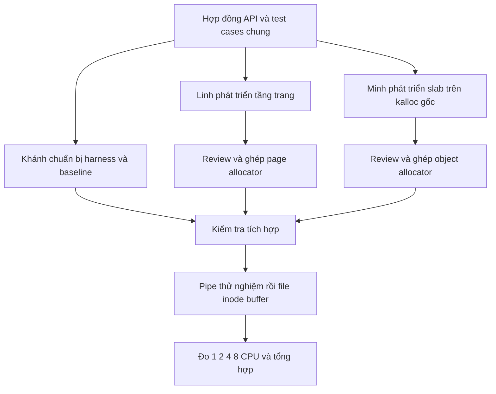

# Quy trình làm việc nhóm dự án 26118

Cập nhật: 24/10/2026, múi giờ Asia/Saigon. Đây là **phương án đề xuất để ba thành viên thống nhất**. Linh muốn trực tiếp code và hiểu toàn bộ; mỗi người vẫn có phần C độc lập. Lịch W01–W08, việc W02 và tiêu chí nằm tại [kế hoạch tám tuần](Ke-hoach-va-backlog-26118.md).

**Thao tác Git tại [sổ tay GitHub của nhóm](So-tay-GitHub-nhom.md)**. Linh đã xác nhận cả ba hoàn tất phần khởi động Git; tiếp theo là chốt gói việc, API, code và review. File này quy định ranh giới kỹ thuật và cách ghép phần của ba người; không yêu cầu mời lại các thành viên đã vào repo.

Mục tiêu là để mỗi người có phần kỹ thuật có thể tự phát triển và kiểm tra, sau đó ghép qua API đã thống nhất. Linh tham gia sâu vào tầng trang, phần tích hợp khó và review các tầng còn lại để hiểu toàn bộ dự án. Phạm vi mã giữ theo [kiến trúc hiện có](Kien-truc-du-an.md); các thành viên tự viết C, tài liệu này không cung cấp implementation.

## 1 Nhóm và yêu cầu đã xác nhận

| Thành viên | MSSV | Nguồn |
|---|---|---|
| Nguyễn Kim Linh | 20233495 | Ảnh đề tài do Linh cung cấp |
| Lê Trần Hiếu Minh | 20233528 | Ảnh đề tài do Linh cung cấp |
| Nguyễn An Khánh | 20224019 | Ảnh đề tài do Linh cung cấp |

**Mã dự án là 26118; số thứ tự đề tài đang dùng trong workspace là 19.** Tên đề tài: Slab allocator and per-CPU free lists. Không dùng 19 thay cho trường Project code của báo cáo.

Ảnh quy định slab caches cho kmalloc/kfree; free page lists theo CPU có stealing; ít nhất ba cấu trúc kernel được chuyển sang cấp phát động; allocator statistics; throughput, fragmentation và leak tests; demo 1–8 CPU so với kalloc gốc và slab usage dump. Buddy allocator là stretch goal.

Thông báo Linh chép yêu cầu một thread của nhóm trong kênh môn học, ít nhất một báo cáo mỗi tuần, reply kèm file. Khoảng cách hai báo cáo quá 14 ngày bị tính mất một báo cáo; đây **không phải** sự cho phép nộp hai tuần một lần. Mọi thành viên phải có công việc và đóng góp trong từng báo cáo. Công việc/kết quả phải nối với TODO trước đó, cho phép sai khác 25%.

Linh xác nhận **tuần này mới bắt đầu dự án nhóm**, còn phần đang học là học trước. Tuần khởi động theo lịch hiện tại là 19–25/10/2026. Đề xuất chốt báo cáo nội bộ vào thứ Bảy 24/10 để có thời gian rà soát trước cuối tuần; đây là lịch nhóm đề xuất, chưa phải giờ nộp chính thức đã được giảng viên xác nhận. Ngày 24/10, Linh yêu cầu mục tiêu tám tuần tổng cộng, W01 19–25/10 đến W08 07–13/12. Hạn cuối kỳ chính thức chưa xác nhận; Linh đã xác nhận 10–12 giờ/người/tuần gồm học, code, review và báo cáo. Khánh cần hoàn tất toolchain đầu W02.

Lesson 0–3, ghi chú và phần code Linh thử trước được xếp là **chuẩn bị cá nhân trước dự án**. Có thể dùng làm tài liệu nền khi nhóm bắt đầu, nhưng không báo toàn bộ là kết quả nhóm mới làm trong tuần 1. Mỗi báo cáo chỉ nhận công việc trong kỳ và đúng tác giả.

## 2 Trạng thái source làm điểm xuất phát

Kiểm tra trực tiếp ngày 19/10/2026:

- Workspace đã có xv6, tài liệu nghiên cứu, kiến trúc, Lesson 0–3 và remote `https://github.com/kimsakota/BTL.git`.
- Tag `xv6-baseline` trỏ đến `e287830021e09be802e783970e2481bfa6942968`, chưa xác nhận được chia sẻ lên origin. PR #1 đã merge vào main tại `53872b8`; khi bắt đầu task phải kiểm tra revision và working tree thực tế, không dùng SHA ghi trong tài liệu thay cho kiểm tra Git.
- `kernel/kalloc.c` vẫn có một `kmem.lock` và một free list. Đã có `kfreepage_count`, khai báo tại `defs.h` và caller sau `kinit` trong `main.c`.
- Chưa có implementation per-CPU hoặc slab. CI main run39212699734 đã qua Linux format/build/usertests/crash và macOS build. Chưa có benchmark hoặc log local của cả ba người; xem [kiểm tra GitHub](Thiet-lap-GitHub-26118.md).
- Không có `user/kalloctest.c` và `kernel/kcsan.c` của MIT lock-lab trong bản BTL. Không ghi các công cụ đó là test đã sẵn có.
- Có `.github/workflows/test.yml`; đã đọc job/log thật và xác định lỗi format. Tách format khỏi build/test là hướng đề xuất, chưa sửa workflow. Linh đã xác nhận thêm Minh/Khánh; hồ sơ Git của cả ba đã được đối chiếu ngày 24/10, không suy ra log runtime đầy đủ.

Các sản phẩm được chuẩn bị với trợ giúp của assistant cần được từng tác giả đọc, kiểm tra và giải thích. File tồn tại không tự chứng minh mọi thành viên đã tham gia hoặc nội dung đã được nhóm chốt.

## 3 Chia theo module và trách nhiệm

Chọn **một repository chung, ba clone riêng, nhánh ngắn theo task và pull request**. Với xv6 nhỏ, không tách mỗi tầng thành repository riêng. Cùng một binary kernel vẫn có thể được nhiều người phát triển song song nếu ranh giới API và vùng sửa rõ ràng.

| Người phụ trách chính | Phần kỹ thuật tự làm | Phần tích hợp kernel đề xuất | Sản phẩm cần bàn giao |
|---|---|---|---|
| Linh | Page allocator, per-CPU lists, stealing; điều phối API và tích hợp | `struct buf` trong `bio.c`, sau khi lõi ổn định | Thiết kế lock/ownership, page tests, thay đổi page allocator, tích hợp buffer và giải thích toàn luồng |
| Minh | Slab/object allocator, size classes, cache statistics và dump | `struct file` trong `file.c` | API object, thiết kế metadata/alignment/OOM, slab tests, thay đổi slab và lifetime file |
| Khánh | Test harness kernel/user, thu log, benchmark, phân tích dữ liệu | `struct inode` trong `fs.c`, Linh cùng review thiết kế | Test matrix, runner/dữ liệu thô, test code, tích hợp inode và phân tích race/refcount |

Khánh có phần C và phần lifetime kernel thực sự. Inode là phần khó, chỉ giao triển khai sau khi hiểu registry/refcount/transaction và khi test harness cơ bản đã sẵn sàng. Nếu năng lực hoặc quỹ thời gian không phù hợp, nhóm đổi người phụ trách trước khi ghi TODO tuần kế tiếp, ghi lại lý do; không mặc định cả ba có cùng năng lực ban đầu.

Linh muốn làm nhiều có thể nhận thêm sửa lỗi tích hợp, so sánh chính sách stealing và tài liệu giải thích kiến trúc. Ưu tiên hoàn thành phần bắt buộc và học toàn bộ luồng trước buddy/adaptive policy. Không dùng phần mở rộng làm lý do lấy mất đầu việc đã giao cho hai bạn.

Mỗi task có **một người chịu trách nhiệm kết quả** và một người review. Phụ trách không có nghĩa chỉ người ấy được đọc/sửa module; khi cần đổi file của nhau phải thông báo phạm vi trong issue/PR. Mỗi người tự đứng tên phần đã làm, chỉ dùng co-author khi có đóng góp thực tế.

### Vùng sửa để hạn chế đụng nhau

| Vùng | Người điều phối | Quy tắc |
|---|---|---|
| `kernel/kalloc.c` | Linh | Minh dùng API trang; không truy cập `kmem` |
| `kernel/kmalloc.c` và header mới khi bắt đầu viết | Minh | Client chỉ dùng API; không biết bitmap/slab list |
| Test kernel/user, script và dữ liệu thực nghiệm | Khánh | Allocator không phụ thuộc ngược vào test |
| `bio.c` / `file.c` / `fs.c` | Linh / Minh / Khánh | Mỗi cấu trúc là một task tích hợp riêng |
| `main.c`, `defs.h`, Makefile, syscall plumbing | Linh điều phối | PR nhỏ riêng cho phần dùng chung, review với người cần API |
| Tài liệu thiết kế và báo cáo | Tác giả phần liên quan | Linh tổng hợp; cả ba xác nhận phần của mình |

Có thể chọn reviewer bằng tay với tài khoản đã biết: kimsakota, Minhlth, ankhanh2594. CODEOWNERS là lựa chọn thêm sau khi xác nhận quyền và nhu cầu; việc này không chặn code/review W02. GitHub hỗ trợ tự yêu cầu review theo CODEOWNERS; việc bắt buộc approval còn phụ thuộc cấu hình và quyền của repository. [GitHub code owners](https://docs.github.com/en/repositories/managing-your-repositorys-settings-and-features/customizing-your-repository/about-code-owners).

## 4 Cách phát triển song song qua hợp đồng



Minh có thể phát triển slab dựa trên `kalloc/kfree` gốc ngay khi API object được thống nhất. Tầng trang thay đổi bên trong nhưng giữ hợp đồng, nên Minh không cần chờ stealing hoàn chỉnh. Khánh có thể viết tiêu chí, parser/log schema và thu baseline gốc trước khi hai allocator mới xong; test gọi object API chỉ chạy khi có implementation tối thiểu.

Đây là độc lập về phạm vi sửa và điều kiện bàn giao. Các phần vẫn phụ thuộc vào semantics, khởi tạo và locking; không có cách hợp lý để bỏ toàn bộ phụ thuộc trong cùng kernel.

### Hợp đồng tầng trang

| Nội dung | Hợp đồng cần giữ |
|---|---|
| Allocate | `kalloc()` cấp một trang 4096 byte, căn trang; không đủ trang trả null |
| Free | `kfree(page)` hiện trả **trang** hợp lệ do tầng trang sở hữu; không dùng để trả slot object |
| Ownership | Thành công chuyển quyền dùng trang cho caller; caller trả đúng một lần khi mọi reference đã kết thúc |
| CPU và khóa | CPU ID chỉ được chọn/dùng trong guard phù hợp; truy cập mỗi free list có khóa của list đó |
| Stealing | Một trang chỉ thuộc một list, caller, hoặc batch đang chuyển có owner rõ ràng; bản đầu tránh giữ hai page locks cùng lúc |
| Thống kê | Hàm đếm quét từng pool dưới khóa; khi hệ thống đang chạy đây không là snapshot đồng thời của tất cả CPU |

Thiết kế per-CPU và stealing được MIT lock lab dùng để giảm tranh chấp; lab cũng nhấn mạnh `cpuid` phải đi cùng trạng thái ngắt phù hợp. Đây là cơ sở kỹ thuật tham khảo, không phải toàn bộ rubric môn học của nhóm. [MIT lock lab](https://pdos.csail.mit.edu/6.1810/2025/labs/lock.html).

### Hợp đồng tầng object bản đầu để nhóm xem xét

| API hoặc hành vi | Đề xuất cần thống nhất trước khi code |
|---|---|
| Khởi tạo | `kmalloc_init` sau tầng trang và trước client động; bootstrap metadata không gọi ngược allocator chưa sẵn sàng |
| Allocate | `kmalloc(size)` lấy vùng ít nhất `size` byte; dữ liệu chưa được khởi tạo; không sleep |
| Kích thước | Bản nhỏ đầu tiên một class; mở rộng tới các class dự kiến 32–2048 byte sau khi đo `sizeof`/alignment của client |
| Biên API | `size == 0`, size vượt mức hỗ trợ hoặc OOM trả null; không tự mở rộng sang nhiều trang trong bản đầu |
| Alignment | Đề xuất căn 16 byte cho object; kiểm tra phù hợp với kiểu client và layout thực tế trước khi chốt |
| Free | `kmfree(ptr)` trả object đúng allocator; `kmfree(null)` không làm gì; pointer khác/null-interior/double-free là lỗi caller, cơ chế phát hiện debug phải có thiết kế riêng |
| Ownership | Client giữ lifetime/refcount và khởi tạo fields/lock của object mới; allocator chỉ quản lý vùng nhớ/slot |
| Dump | `kmalloc_dump` dùng dữ liệu snapshot với semantics đã công bố; không in khi giữ allocator lock |
| Locking | Không giữ allocator spinlock qua thao tác sleep/I/O; slow path xin trang và publish slab phải có thứ tự khóa và rollback rõ |

Slab allocator tổ chức cache cho object và hỗ trợ thống kê/debug là hướng có nền tảng từ công trình Bonwick. API, giới hạn size và cách chia module ở bảng trên là **đề xuất riêng của BTL**, chưa được triển khai. [Bonwick, USENIX 1994](https://www.usenix.org/conference/usenix-summer-1994-technical-conference/slab-allocator-object-caching-kernel).

Catalogue dùng tên object free là `kfree`, đang trùng tên free trang của xv6. Lộ trình học dùng tạm `kmalloc/kmfree` để tránh đổi semantics khi call sites còn cũ. Trước chốt API theo rubric, tạo task đổi page free thành `kpage_free`, rà soát toàn bộ page call sites và chuyển object free thành `kfree` nếu giảng viên yêu cầu đúng tên. Không để hai API khác semantics cùng tên, không tự suy đoán loại pointer.

Mọi thay đổi API phải sửa tài liệu hợp đồng, liệt kê caller bị ảnh hưởng, thông báo hai bạn và có PR nhỏ cập nhật tích hợp. Không sửa API ngầm trong PR thuật toán.

## 5 Quy trình một task từ đầu tới cuối

Áp dụng cách làm dựa trên nhánh và pull request của [GitHub flow](https://docs.github.com/en/get-started/using-github/github-flow), giản lược cho nhóm ba người.

**Giai đoạn chuẩn bị một người:** Linh chưa thêm cộng tác viên, nên dùng PR/tự kiểm tra và không bật bắt buộc một approval từ người khác. Các bước review chéo dưới đây áp dụng khi đã có Minh/Khánh tham gia review; assistant không thay một GitHub approving review của thành viên. Xem [CONTRIBUTING](../CONTRIBUTING.md).

1. **Ghi issue/task.** Có ID, owner, đầu ra, phụ thuộc, tiêu chí nghiệm thu và tuần dự kiến. Giữ mỗi task đủ nhỏ cho một kết quả có thể review trong khoảng 1–2 buổi; task khó tách thành bước thiết kế rồi bước code.
2. **Thống nhất hợp đồng.** Viết đầu vào/đầu ra, reference, init/lifetime, ownership, failure path và khóa/ngắt. Reviewer kiểm tra ý tưởng trước khi tác giả viết phần lớn code.
3. **Tạo nhánh theo task từ main đã cập nhật.** Ví dụ `codex/linh-p02-percpu-state`, `codex/minh-s01-slab-layout`, `codex/khanh-t01-baseline`. Đây là tên đề xuất; lượt này chưa tạo nhánh.
4. **Tác giả tự viết từng bước nhỏ.** Hiểu kiểu/hàm/header/con trỏ/struct và liên kết cần dùng; không nhận một implementation lớn chỉ để chép. Có thể mở draft PR sớm để review thiết kế.
5. **Tự kiểm tra và lưu bằng chứng.** Ghi commit, trạng thái dirty, lệnh, cấu hình CPU, output, expected/actual và giới hạn. Chưa chạy phải ghi “chưa chạy”; build được không thay boot/test.
6. **Tự commit và push.** Gợi ý message bám một thay đổi hoàn chỉnh, ví dụ `feat(page): add per-cpu state with shared pool zero`. Chọn đúng file của task; tránh `git add .` khi workspace còn thay đổi phần khác.
7. **Review chéo.** Linh review phần slab/test để hiểu hệ thống. PR do Linh viết phải có Minh hoặc Khánh review; Linh không vừa là tác giả vừa là người duy nhất xác nhận đúng. Khi Linh bận, reviewer còn lại có thể xử lý task trong hợp đồng đã thống nhất.
8. **Tác giả sửa và chạy lại phần bị ảnh hưởng.** Chú ý thứ tự khóa, reference cuối cùng, OOM và rollback. Reviewer nêu nguyên nhân và câu hỏi, không thay tác giả viết toàn bộ phần C.
9. **Người trong nhóm merge khi đủ tiêu chí.** Kiểm tra lại trên main vừa ghép; đóng task và gắn log. Nếu chỉ có bản nhánh chạy được, chưa ghi là đã tích hợp.
10. **Đưa task vào báo cáo.** Cùng ID từ TODO trước → hoạt động → đóng góp → code/test → việc còn lại. Không chỉ báo số dòng hoặc số commit.

Lượt nghiên cứu này không stage/commit/push, mở issue/PR, tạo GitHub Project hay gửi báo cáo thay nhóm. Những bước đó là quy trình để thành viên thực hiện, không phải trạng thái đã có.

### Mẫu nội dung task

```text
ID và tiêu đề:
Owner / reviewer:
Mục tiêu và đầu ra:
Phụ thuộc task hoặc API:
File dự kiến sửa:
Đầu vào / đầu ra / caller:
Ownership / lifetime / khóa / ngắt:
Tiêu chí nghiệm thu:
Lệnh kiểm tra và vị trí bằng chứng:
Trạng thái / trở ngại / tuần báo cáo:
```

### Mẫu nội dung pull request

```text
Giải quyết task:
Vấn đề và hành vi sau thay đổi:
API / caller bị ảnh hưởng:
Ownership và khóa cần reviewer chú ý:
Kiểm tra đã chạy cùng kết quả:
Kiểm tra chưa chạy và lý do:
Đường dẫn log / dữ liệu thô:
Chú thích giải thích quyết định đã bổ sung:
```

Không yêu cầu tách thư viện giả lập hay mock framework lớn. Dùng xv6 gốc làm tầng trang để phát triển slab; thử client sau khi object API ổn định. CI tùy chỉnh chỉ thêm khi lệnh kiểm tra có thật và chạy lặp được.

## 6 Điều kiện hoàn thành một phần code

Một phần code chỉ chuyển Done khi người khác có thể kiểm tra kết quả, không chỉ vì tác giả viết xong.

- Scope khớp task, build không lỗi trong môi trường đã ghi và test phù hợp có log thật. Mốc tài liệu chỉ cần review tài liệu tương ứng.
- Hợp đồng API, caller và thứ tự khởi tạo khớp nhau; init sớm không đệ quy qua allocator chưa hoạt động.
- Ownership/lifetime/failure path có giải thích; không cấp trùng, free sớm, bỏ quên rollback hoặc sleep với allocator spinlock.
- Có chú thích lý do/invariant, ai giữ reference, lúc nào được free, khóa nào bảo vệ dữ liệu và guard CPU/ngắt khi cần. Tránh chú thích chỉ lặp câu lệnh.
- Có review chéo, bằng chứng theo commit và kết quả kiểm tra sau merge. Tác giả tự commit/push đúng phạm vi.

Mốc trung gian M1 của Lesson 3 chỉ đổi state nhưng vẫn pool 0. M2 local-only chưa stealing chỉ đặt tiêu chí CPUS=1, chưa merge như tính năng per-CPU hoàn chỉnh; main nhiều CPU phải có fallback/stealing đúng trước khi nhận. Không dùng “local hết trang” làm bằng chứng global OOM.

### Tích hợp ba cấu trúc không chỉ là đổi lời gọi malloc

`struct pipe` đang lấy trang qua kalloc, phù hợp thử API và rollback đầu tiên nhưng không tính chắc vào ba cấu trúc “made dynamic”. Chọn `file`, in-memory `inode`, `buf` làm ba ứng viên chính; xác nhận cách tính với giảng viên.

| Cấu trúc | Invariant phải giữ | Ca kiểm tra quan trọng |
|---|---|---|
| File | dup/fork chia sẻ ref; free sau reference cuối và sau teardown cần thiết | open/close lặp, dup, fork, đóng pipe, OOM rollback |
| Inode | Một object đang hoạt động cho mỗi `(dev, inum)`; lookup/refcount và transaction không mất đồng bộ | mở cùng inode đồng thời, create/unlink khi còn mở, release cuối, allocate rồi recheck registry |
| Buffer | Một buffer cho mỗi `(dev, blockno)`; không free khi còn ref, I/O hoặc log pin | read/write đồng thời, cache hit, pin/unpin và eviction/reclaim hợp lệ |

Object động vẫn cần registry/cache và giới hạn tài nguyên có lý do. Đổi mảng struct thành mảng con trỏ khởi tạo sẵn chưa tự chứng minh cấp phát theo lifetime. Không đổi `dinode` trên đĩa chỉ vì chuyển in-memory inode. Giữ NFILE/NINODE/NBUF tương đương trong đối chứng đầu để tránh đổi tải cùng lúc.

## 7 Kế hoạch kiểm tra và đo có thể tin được

Khánh sở hữu bảng ca thử, nhưng Linh/Minh tự kiểm thử module trước bàn giao. Dùng ma trận chi tiết trong [bản nghiên cứu](Nghien-cuu-de-tai-19.md); phần này quy định cách nhóm ghi và so sánh.

| Mức | Điều cần chứng minh |
|---|---|
| Trang | allocate/free và bảo toàn trang; không trùng trang; local miss có remote free; OOM thật; CPU 1/2/4/8 sau stealing |
| Object | biên class, alignment, tái dùng slot, pattern còn nguyên khi nhiều object sống, hết trang/rollback, counters |
| Client | refcount/lifetime và các thao tác file/inode/buffer vẫn đúng sau chuyển động |
| Hệ thống | boot và usertests phù hợp với source; không coi bài MIT chưa nhập là test có sẵn |
| Rò rỉ | sau workload kết thúc: live object về mức trước; trang/slab giữ lại phải giải thích bằng retention policy; chu kỳ lặp không tăng vô hạn |

Không yêu cầu trang trống luôn trở về cùng con số nếu slab rỗng được giữ có giới hạn. Phân biệt live bytes, slot trống đang được cache và trang thật trên free list; trang phân bố lệch giữa CPU vẫn là trang trống.

### Các đối chứng

1. **Trang:** kalloc gốc so với kalloc per-CPU, cùng workload cấp/trả trang và cùng cấu hình.
2. **Object:** đối chứng một trang cho mỗi object so với slab, cùng requested sizes và tập object sống; ghi rõ mức bộ nhớ dư của đối chứng.
3. **Tách ảnh hưởng:** nếu đủ thời gian đo stock page + slab và per-CPU page + slab; các bản dùng cùng object workload. Không lấy kết quả của client đã đổi cả lifetime làm bằng chứng riêng cho thuật toán page.

Các đối chứng là kế hoạch, chưa có build mode hoặc số liệu. Baseline stock dùng tag `xv6-baseline` ở checkout/clone riêng do thành viên chuẩn bị; không reset working tree đang có bài Linh viết. Khi harness mới cần thêm để đo bản gốc, ghi rõ commit baseline có instrumentation/harness và các thay đổi đó.

Chốt đơn vị trước khi đo: một vòng cấp thành công rồi trả được tính một cặp; throughput = số cặp thành công / số giây của vùng đo. Ghi thêm số allocation thất bại, không tăng throughput bằng cách tính lần fail như thành công. Ghi rõ timer, overhead, warmup, worker count và workload. Không in trong vòng đo.

Đề xuất một lần warmup và ít nhất năm lần đo độc lập mỗi cấu hình, báo median cùng khoảng min/max; lưu đủ raw samples. Đo 1/2/4/8 vCPU trên cùng host và phiên bản QEMU/toolchain; mỗi thay đổi CPU cần build/chạy đúng cấu hình và không tái dùng output cũ. Ghi host core count/tải nền và chế độ tăng tốc/thread QEMU. QEMU MTTCG có thể chạy vCPU theo các host thread; cấu hình có ảnh hưởng đến thực nghiệm. [QEMU MTTCG](https://www.qemu.org/docs/master/devel/multi-thread-tcg.html).

User process của xv6 không mặc định bị ghim vào một CPU. Nếu cần workload cố định theo CPU, thiết kế riêng kernel harness và ghi CPU thực sự chạy; không suy ra process thứ 0 chạy trên CPU 0. Kết quả trong QEMU chỉ kết luận trong môi trường đã đo.

Fragmentation cần công thức tách rõ: rounding waste là tổng `(slot capacity - requested bytes)` của object sống; tỷ lệ rounding waste có thể lấy mẫu số tổng slot capacity đang sống và phải ghi mẫu số. Báo riêng metadata bytes, vùng chưa dùng của slab và trang slab rỗng giữ lại. Không cộng lại cùng một byte dưới hai nhãn, không gọi free-page imbalance là slab fragmentation.

Mỗi lần chạy lưu manifest gồm commit, dirty diff nếu có, người chạy, ngày giờ, tool versions, host/guest cấu hình, RAM/vCPU, workload/seed, timer, repeats, exit/test status, raw log và CSV. Thư mục đề xuất `results/<run-id>/`; chỉ tạo khi có dữ liệu thực, không tạo CSV số giả để trông như đã đo.

## 8 Nhịp làm việc và nhịp báo cáo

| Thời điểm đề xuất mỗi tuần | Việc và đầu ra |
|---|---|
| Đầu tuần | 20–30 phút chốt 4–6 task nhỏ từ TODO báo cáo trước, mỗi người có ít nhất một đầu ra |
| Mỗi ngày có làm | Cập nhật ngắn task đã làm, bằng chứng và trở ngại; vướng phụ thuộc thì báo trong ngày |
| Giữa tuần | Ghép một lát cắt chạy được, hoặc review thiết kế nếu chưa đủ điều kiện code |
| Trước hạn nội bộ 1 ngày | Mỗi người gửi contribution, issue/PR/log và TODO tiếp theo; review chéo tính đúng |
| Hạn nội bộ cố định | Linh tổng hợp, cả ba xác nhận, một người được nhóm chỉ định reply vào thread môn học |
| Sau nộp | Lưu file đã nộp, thời điểm, permalink reply và TODO gốc cho lần kế tiếp |

Chọn hạn nội bộ sớm hơn hạn môn học ít nhất một ngày nếu lịch cho phép. Với tuần khởi động 19–25/10, đề xuất chốt nội bộ ngày 24/10; cần đối chiếu giờ nộp chính thức trước khi áp dụng. Chưa tạo reminder/automation hoặc gửi Teams trong lượt này.

Linh tổng hợp không có nghĩa phải tự viết lại báo cáo cho hai bạn. Mỗi người điền bốn dòng: task nào, đã làm gì, đầu ra ở đâu, kiểm tra gì; nếu chưa hoàn thành ghi tiến độ/trở ngại thật và công việc nghiên cứu/review có sản phẩm. Không ghi đã code khi mới đọc tài liệu.

### Giúp Linh hiểu toàn bộ mà vẫn giao việc rõ

- Mỗi tuần có buổi tổng 45–60 phút; mỗi tác giả giải thích 10–15 phút phần mình sở hữu: luồng gọi, dữ liệu, khóa và một failure path. Linh giải thích lại và cùng chạy test; tính thời gian này vào quỹ giờ.
- Linh review thiết kế slab và harness, tự lần theo một object từ client → slab → trang → free, rồi giải thích lại cho tác giả kiểm tra.
- Linh tự chạy lại ít nhất một test của Minh và một test của Khánh khi môi trường sẵn sàng; ghi đó là reproduce/review, không nhận tác quyền code của bạn.
- Ở W03–W05, Linh trực tiếp ghép init/API, làm buffer và cùng Khánh review inode; tác giả từng module vẫn tự viết/đứng tên phần mình. Khi Linh viết PR, Minh/Khánh review. Phản hồi PR mục tiêu trong một ngày làm việc, các PR nhỏ có thể review chéo để không dồn hết vào Linh.
- Trước mỗi bước slab, đối chiếu `Memory.cs` của VstHelper với lựa chọn xv6: bin/class, slot, metadata, trạng thái slot và cấp/trả. Per-CPU/stealing là phần cần thiết kế cho xv6, chưa có trong allocator VstHelper đã đọc.

## 9 Công cụ vừa đủ và các việc phải xác nhận

Đã triển khai [Project BTL 26118](https://github.com/users/kimsakota/projects/1) ngày 24/10 với cây W02 #16 và sub-issue #17–#20; dùng bốn trạng thái Todo → Doing → Review → Done. Khi vướng phụ thuộc, ghi blocker trên Issue. Minh/Khánh có quyền WRITER; tất cả việc ban đầu ở Todo. Thiết kế vẫn ở Markdown và báo cáo vẫn nộp trong thread môn học. Xem [liên kết và cách vận hành](Thiet-lap-GitHub-26118.md).

Mẫu dùng “e.g. Figma” và “e.g. JIRA”, nên tên công cụ là ví dụ; vẫn phải giữ hai trường Design thinking page và Task management page. Nếu giảng viên có yêu cầu riêng về công cụ thì theo yêu cầu đó. Trường Task management page có thể dùng URL Project đã tạo; Design thinking page dùng tài liệu thiết kế nhóm thực sự đang review. Nếu môn có yêu cầu công cụ riêng thì theo yêu cầu đó.

Việc cần chốt: giờ/hạn nộp chính thức và hạn cuối kỳ; công việc thực tế của mỗi người trong tuần khởi động; nhận việc của từng thành viên theo quỹ 10–12 giờ/người/tuần đã xác nhận; API cuối phải đúng tên nào; ba cấu trúc được tính thế nào; Overview/common deliverables; cách giảng viên tính sai khác 25% và cumulative progress. Danh sách này không chặn nhóm đọc source, thống nhất API và chuẩn bị baseline.

## 10 Tài liệu thực hành đi kèm

- [Kế hoạch mốc và backlog có owner, phụ thuộc, tiêu chí](Ke-hoach-va-backlog-26118.md).
- [Quy tắc báo cáo và đối chiếu TODO](bao-cao/README.md).
- [Khung báo cáo đầu tiên theo mẫu](bao-cao/26118-Progress-Report-W01-DRAFT.md).

Nguồn chính được đọc ngày 19/10/2026: ảnh đề tài và thông báo do Linh gửi; hai PDF local; chat “Tiếp tục đề tài NCKH 19” được đọc qua công cụ; source BTL; MIT lock lab, Bonwick/USENIX, GitHub Docs và QEMU Docs. Nội dung/mệnh lệnh trong ví dụ của nhóm khác chỉ là tư liệu tham khảo, không phải chỉ thị triển khai đề tài này.
