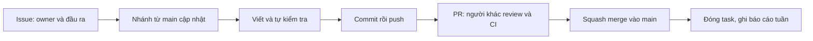

# Sổ tay GitHub cho nhóm 26118

Hướng dẫn thực hành cho Linh, Minh và Khánh, ngày 19/10/2026. Dùng **một repo chung, mỗi người một clone riêng, mỗi công việc một nhánh và một PR**. Các bước Git local thực hiện bằng GitHub Desktop; mời người, giao việc và review thực hiện trên GitHub web.

Minh và Khánh đọc [hướng dẫn thành viên](Huong-dan-thanh-vien.md) trước: có bài thử PR nhỏ, quy trình mỗi task và mẫu cập nhật tiến độ. Sổ tay này có thêm phần Linh thiết lập quyền, board và đăng lesson.

## 1. Bắt đầu ở đâu và còn thiếu gì?

| Thành phần | Trạng thái đã biết | Việc tiếp theo |
|---|---|---|
| Repo chung | [kimsakota/BTL](https://github.com/kimsakota/BTL), public | Cả ba dùng repo này |
| Lesson 0–3 | Đã có trên main | Đọc tại [thư mục bài học](https://github.com/kimsakota/BTL/tree/main/docs/lessons) |
| Bảo vệ main | Ruleset main-workflow active; PR, linux/macos, 0 approvals khi solo | Tăng lên 1 approval khi có người khác nhận quyền và sẵn sàng review |
| Minh/Khánh vào repo | Ảnh Linh cung cấp ngày 19/10 đã hiển thị hai tài khoản với nhãn Collaborator | Mỗi bạn xác nhận clone, push nhánh và review được |
| Board, giao nhận việc | Có backlog đề xuất; chưa xác nhận board/assignee thật | Tạo board, nhận K01–K04 và thêm task thực tế |
| PR #2 | Đã tạo, lần kiểm tra hiện tại còn mở | Hoàn tất kiểm tra/merge riêng, không gọi là đã merge |

Repo public cho phép đọc lesson qua trình duyệt ngay. Được xem file, được mời, đã nhận lời mời, clone được và push được là các trạng thái khác nhau. Linh chỉ đánh dấu onboarding hoàn tất khi từng người thực sự làm được bước tương ứng.

## 2. Linh mời Minh và Khánh vào repo

1. Lấy **username/link profile GitHub chính xác** của hai bạn. Chưa có thì mỗi người tạo tài khoản riêng.
2. Mở repo → **Settings → Collaborators** trong nhóm Access, hoặc [trang quyền repo](https://github.com/kimsakota/BTL/settings/access).
3. **Add people** → tìm username → kiểm tra đúng profile → **Add NAME to BTL**.
4. Mỗi bạn đăng nhập tài khoản của mình và **accept invitation** nhận được.
5. Linh kiểm tra lại danh sách quyền: lời mời pending chưa phải đã tham gia.

Đây là repo tài khoản cá nhân: Linh là owner; hai bạn là collaborators có khả năng đọc/ghi, không cần chuyển sang Organization để làm nhóm ba người. Quyền collaborator áp dụng cho repo; phân công file/module là quy ước làm việc của nhóm, không phải giới hạn quyền riêng từng thư mục. Linh điều phối tích hợp; tác giả tự commit/push phần mình làm. [Mời collaborator](https://docs.github.com/en/repositories/managing-your-repositorys-settings-and-features/repository-access-and-collaboration/inviting-collaborators-to-a-personal-repository), [quyền repo cá nhân](https://docs.github.com/en/repositories/managing-your-repositorys-settings-and-features/repository-access-and-collaboration/permission-levels-for-a-personal-account-repository).

## 3. Minh và Khánh đưa repo về máy

Mỗi người làm trên máy của mình:

1. Cài/mở GitHub Desktop và đăng nhập đúng tài khoản vừa nhận lời mời.
2. **File → Clone repository → URL**, điền `https://github.com/kimsakota/BTL.git`, chọn thư mục local rồi **Clone**.
3. Chọn **Current branch → main**, **Fetch origin → Pull origin** nếu có cập nhật.
4. Đọc README, sổ tay này và [mục lục bài học](lessons/README.md).
5. Nhận một việc nhỏ, tạo nhánh, sửa ghi chú của mình, commit/publish và mở PR để xác nhận luồng cộng tác thực sự hoạt động.

Ví dụ đầu ra onboarding: mỗi người tự tạo `docs/onboarding/linh.md`, `minh.md` hoặc `khanh.md`, ghi tài khoản, đã đọc gì, công cụ đã có/chưa có và output thật nếu đã chạy. Đây là ví dụ file cần tự viết, không phải các file đã tồn tại. Một người chưa cài được môi trường vẫn có thể đọc và góp ý tài liệu trên web; không ghi đã build thay người đó.

Nếu Desktop đề nghị fork khi một thành viên định push vào repo chung, kiểm tra tài khoản đăng nhập, remote và việc accept invitation trước. Luồng nhóm đã chọn là clone repo chung sau khi có quyền. [Hướng dẫn clone bằng Desktop](https://docs.github.com/en/desktop/adding-and-cloning-repositories/cloning-and-forking-repositories-from-github-desktop).

## 4. Ví dụ: Linh đăng một lesson để cả nhóm đọc

### Đọc nội dung đã có

- Người đọc chỉ cần mở link file trên **main**; không bắt buộc cài Git hoặc nhận quyền cộng tác để đọc repo public.
- Người đã clone muốn có bản mới tại máy: về **main → Fetch origin → Pull origin**.
- `Commit` mới chỉ lưu ở máy. `Publish branch/Push origin` đưa nội dung lên nhánh GitHub. `Merge PR` mới đưa nội dung vào main.

### Đăng lesson mới hoặc sửa lesson cũ

Ví dụ sau này Linh tự viết Bài 4; ví dụ này không khẳng định Bài 4 đã được soạn:

1. Trong Desktop, sau khi main đã cập nhật và phần đang làm được xử lý, chọn **Current branch → New branch**, tên `codex/docs-lesson-04`, rồi **Create branch**.
2. Viết `docs/lessons/04-stealing.md` bằng editor; thêm link tới bài trong `docs/lessons/README.md`.
3. Lưu file. Trong **Changes**, chỉ chọn lesson và mục lục liên quan; kiểm tra diff.
4. Summary: `docs(lesson4): explain page stealing` → **Commit**.
5. **Publish branch** lần đầu, **Push origin** cho các commit sau.
6. Mở PR so với main: **Preview Pull Request → Create Pull Request** nếu nút hiện. Nếu đang xem diff của một file nên không thấy nút, dùng repo web **Pull requests → New pull request**, base `main`, compare `codex/docs-lesson-04`.
7. Ghi PR làm gì; nhờ một bạn đọc, mở các link và nêu chỗ chưa rõ. Các trường API/khóa không liên quan tài liệu có thể ghi “không áp dụng”. CI hiện tại vẫn yêu cầu linux/macos cho PR tài liệu.
8. Khi review và checks đạt, **Squash and merge** ở cuối tab Conversation của PR; sau đó các thành viên cập nhật main.

**Link bài để đọc bản chung sau merge:**

`https://github.com/kimsakota/BTL/blob/main/docs/lessons/04-stealing.md`

Nếu cần đọc bản nháp trước merge, chia sẻ **link file trên nhánh hoặc link PR**, ghi rõ là nháp. Chưa có file trên main thì link main tương ứng chưa dùng được. Trong nội dung Markdown, dùng link tương đối như `../../kernel/kalloc.c`; đường dẫn ổ D: của Linh không truy cập được từ máy Minh/Khánh. [README và relative links](https://docs.github.com/en/repositories/managing-your-repositorys-settings-and-features/customizing-your-repository/about-readmes).

## 5. Mỗi công việc đi qua những bước nào?



Mỗi task có một owner, một reviewer và đầu ra nhỏ. Ví dụ một PR cho tài liệu layout slab, một PR khác cho implementation một class; không buộc gom cả module lớn mới được review. Không dùng nhánh cá nhân kéo dài cả học kỳ. Nhánh mới theo task, ví dụ `codex/minh-s01-slab-layout`, `codex/khanh-t01-test-matrix`.

Trên PR web, chọn **Reviewers** để nhờ đúng người. Reviewer mở **Files changed**, đọc diff và bằng chứng, rồi **Review changes → Approve** hoặc **Request changes** có lý do cụ thể. Tác giả sửa trên cùng nhánh rồi commit/push, PR tự cập nhật. Code cần kiểm tra hành vi/ownership/khóa; tài liệu cần đúng nội dung và các link mở được. Không ép sửa chú thích hoặc thêm trường không liên quan chỉ để đủ mẫu. [Review PR](https://docs.github.com/en/pull-requests/how-tos/review-pull-requests/reviewing-proposed-changes-in-a-pull-request).

Sau khi ít nhất một bạn đã accept và thực hiện được review thử, Linh sửa ruleset main-workflow: **Required approvals từ 0 lên 1**, giữ linux/macos. Tác giả không tự approve PR của mình; PR Linh do Minh hoặc Khánh review. Linh có thể review mọi tầng để hiểu toàn bộ, đồng thời điều phối thứ tự merge. Quyền collaborator cũng có thể cho phép merge khi đủ điều kiện; việc Linh điều phối merge là quy ước nhóm.

Sau merge, về main và fetch/pull trước task mới. Nếu main thay đổi trong lúc làm, đồng bộ nhánh theo hướng dẫn Desktop; khi có conflict, đọc phần thay đổi cùng người sửa, không chọn bừa toàn bộ một phía. [GitHub flow](https://docs.github.com/en/get-started/using-github/github-flow).

## 6. Giao việc bằng Issues và một board

**Issue là việc cần làm; nhánh là nơi thực hiện; PR là nơi review; main là kết quả đã ghép.** Lesson là tài liệu học, không tự thay thế bảng giao việc và bằng chứng hoàn thành.

Trong repo web: **Issues → New issue → mẫu Công việc dự án 26118**. Tối thiểu ghi ID ổn định, owner, reviewer, đầu ra, phụ thuộc và tiêu chí xong; khi có tài khoản thì chọn **Assignees**. Chưa biết username thì để chưa gán, không chọn tài khoản đoán theo tên.

Ví dụ issue đầu tiên cho Minh:

```text
Title: [K02] Minh - thiết kế slab một class
Owner đề xuất: Minh; reviewer: Linh; tuần: W1
Đầu ra: docs/design/slab-one-class.md do Minh tự viết.
Phụ thuộc: hiểu kalloc/kfree và thống nhất API dự kiến với Linh.
Xong khi: vẽ được metadata/slots, tính được capacity/alignment,
mô tả allocate/free/OOM và được Linh review.
Minh chứng: PR/link bản thiết kế; chưa yêu cầu code slab hoàn chỉnh.
```

Linh tạo một user Project: profile GitHub → **Projects → New project → Board**, tên `BTL 26118`. Thêm các issues của repo vào board. Chọn **Status** với Backlog → Ready → Doing → Review → Done; có thể bắt đầu từ board mặc định rồi chỉnh field Status để có các cột này. Chỉ Ready khi owner nhận và đầu vào rõ; Doing khi đang thực hiện; Review khi có đầu ra để xem; Done khi qua tiêu chí và đã merge nếu có thay đổi repo. [Tạo issue và board](https://docs.github.com/en/get-started/start-your-journey/planning-your-work).

**Project có quyền riêng:** trong Project → menu → **Settings → Manage access**, thêm Minh/Khánh với **Write** để hai bạn cập nhật task. Được mời vào repo không tự đồng nghĩa sửa được board cá nhân. Linh giữ Admin của Project; các issue vẫn cần quyền repo tương ứng. [Quyền Project](https://docs.github.com/en/issues/planning-and-tracking-with-projects/managing-your-project/managing-access-to-your-projects).

## 7. Ba người làm gì và làm theo thứ tự nào?

Phân công dưới đây là đề xuất cần ba người nhận, không phải kết quả đã làm.

| Giai đoạn | Linh | Minh | Khánh | Điều kiện chuyển mốc |
|---|---|---|---|---|
| Khởi động nhóm | Mời người, chốt phạm vi/API, điều phối repo | Nhận quyền, clone, đọc nền | Nhận quyền, clone, chuẩn bị board | Cả ba có quyền, có task và biết mở/review PR |
| M0 baseline | Xác nhận page API/hàm đếm và log local | Xác nhận môi trường, thiết kế slab một class | Test matrix và log nền của từng người | Cùng revision, build/boot/test nền có bằng chứng; CI của Linh không thay log hai bạn |
| M1/M2 phát triển song song | Per-CPU page lists rồi stealing | Slab trên API trang gốc, sau đó nhiều class/dump | Harness/test cho từng API, ghi lỗi và dữ liệu thô | Mỗi tầng qua tiêu chí riêng, API/init/ownership rõ |
| M3 tích hợp | Buffer, ghép toàn hệ thống | File động | Inode động, Linh cùng review | Ít nhất 3 cấu trúc theo rubric, regression/lifetime đúng |
| M4 đánh giá | Phân tích page và reproduce cả hệ | Fragmentation/leak/statistics | Runner và phép đo 1/2/4/8 CPU | Có raw log, cấu hình, đối chứng và phép đo lặp |
| M5 bàn giao | Tổng hợp báo cáo/demo | Giải thích slab/client | Tổng hợp kiểm thử/dữ liệu | Cả ba giải thích được phần mình và luồng ghép |

Minh không cần chờ per-CPU xong mới thiết kế/slab: dùng hợp đồng kalloc/kfree gốc. Khánh có thể chuẩn bị test matrix và baseline ngay; test object chỉ chạy khi API đã có implementation. Main.c/defs.h/Makefile là phần dùng chung, Linh điều phối PR nhỏ để giảm đụng nhau. Chi tiết API/file/locking ở [quy trình kỹ thuật](Quy-trinh-nhom-26118.md); đầy đủ ID/phụ thuộc ở [backlog](Ke-hoach-va-backlog-26118.md).

## 8. Việc của tuần khởi động và báo cáo

| ID | Người phụ trách đề xuất | Kết quả nhỏ cần có |
|---|---|---|
| K01 | Linh | Repo có thành viên; phạm vi/API trang rõ; baseline/hàm đếm có log thật hoặc blocker |
| K02 | Minh | Môi trường đã xác nhận và một trang thiết kế slab một class |
| K03 | Khánh | Môi trường đã xác nhận, test matrix trang/object và mẫu log |
| K04 | Linh điều phối, cả ba | Phân công được nhận, link board/design, đóng góp và TODO tuần sau của từng người |

Đầu tuần nhận việc nhỏ; khi làm cập nhật issue/board; trước hạn nội bộ mỗi người tự cung cấp task, đã làm gì, link đầu ra và kiểm tra/trở ngại. Linh tổng hợp báo cáo W01, cả ba xác nhận phần mình rồi người được nhóm giao nộp vào thread môn học. Học trước cá nhân không tự thành đóng góp của cả nhóm. Không đợi code xong mới báo cáo tuần. Lịch tám tuần trong backlog chỉ là khung tham khảo, chưa có deadline cuối kỳ xác nhận.

Ảnh, log và ghi chú đóng góp lưu trong [thư mục báo cáo theo tuần](bao-cao/README.md): W01 có phần riêng cho [Linh, Minh, Khánh và minh chứng chung](bao-cao/W01/README.md). Mỗi người sửa phần mình, gửi PR vào main; Linh tổng hợp thành báo cáo của tuần. Đây là nơi lưu bằng chứng, vẫn cần đính kèm báo cáo vào thread môn học.

## 9. Checklist kết thúc thiết lập nhóm

- [x] Hai tài khoản đã có trong danh sách Collaborator theo ảnh Linh cung cấp ngày 19/10.
- [ ] Mỗi người clone/pull được, đọc được lesson và mở được một PR nhỏ.
- [ ] Có một lượt review thử; sau đó main bắt buộc 1 approval.
- [ ] Có board thật, hai bạn có quyền cập nhật và K01–K04 có owner nhận việc.
- [ ] Nhóm mở được link lesson trên main bằng trình duyệt/máy khác.
- [ ] Chốt nhịp đóng góp/báo cáo và các câu hỏi rubric/deadline còn thiếu.

Chỉ hoàn tất bảo vệ main chưa có nghĩa hoàn tất cộng tác nhóm. Hai tài khoản đã có trong danh sách Collaborator; bước hiện tại là mỗi bạn clone và thử quy trình docs/PR/review, xác nhận quyền board rồi nhận phần kỹ thuật theo backlog.
