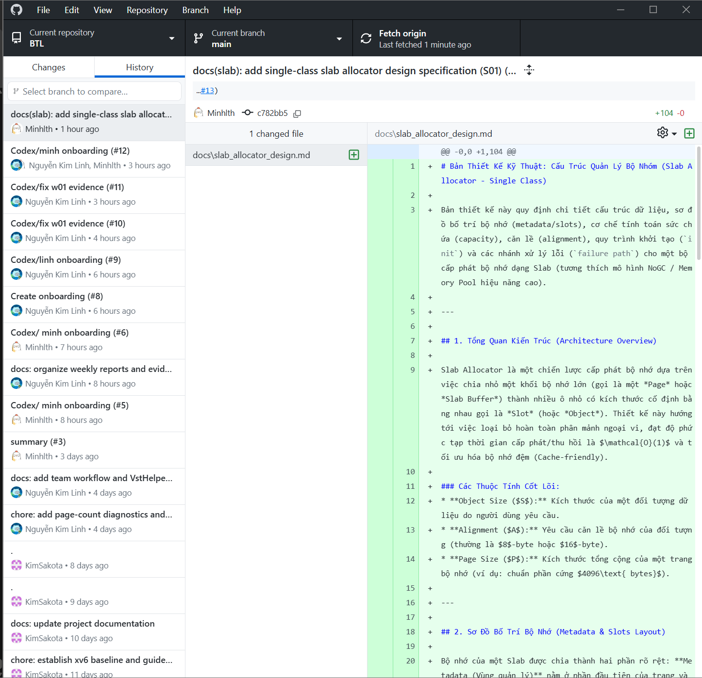
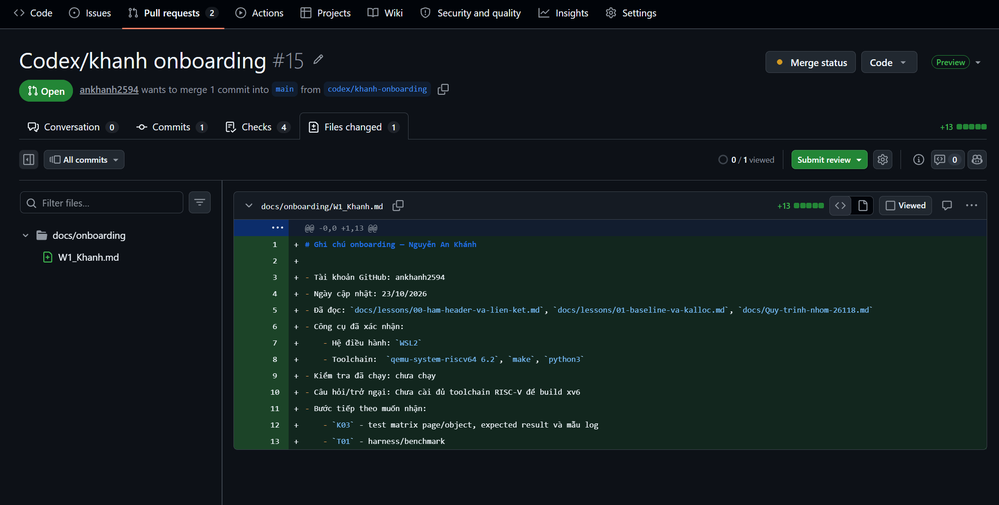

# Nguyễn An Khánh - Đóng góp W01

- MSSV: 20224019.
- Tài khoản GitHub: `ankhanh2594`.
- Ngày cập nhật nội dung: 23/10/2026.
- Khoảng ngày làm việc thực tế: 23/10/2026.
- Trạng thái: hoàn thành các bước onboarding Git (clone, nhánh, commit, PR); PR #15 đang chờ review. Chưa cài đủ môi trường build xv6.

## Việc đã làm và kết quả

Ghi chú onboarding chi tiết: [`docs/onboarding/W1_Khanh.md`](../../../onboarding/W1_Khanh.md).

| Task/hoạt động | Đã làm gì, kết quả cụ thể | Ngày | Link PR/commit/tài liệu |
|---|---|---|---|
| ONB-KHANH | Clone repo `kimsakota/BTL` bằng GitHub Desktop, Fetch nhánh `main`, xem tab History thấy lịch sử commit | 23/10/2026 | Ảnh `2026-10-23-desktop-history.png` |
| ONB-KHANH | Tạo nhánh `codex/khanh-onboarding` từ `main` (trên GitHub web do lúc đó chưa tải xong GitHub Desktop) | 23/10/2026 | Nhánh `codex/khanh-onboarding` |
| ONB-KHANH | Viết ghi chú onboarding `W1_Khanh.md`, commit vào nhánh | 23/10/2026 | [W1_Khanh.md](../../../onboarding/W1_Khanh.md) |
| ONB-KHANH | Mở Pull Request về `main`, chọn reviewer | 23/10/2026 | [PR #15](https://github.com/kimsakota/BTL/pull/15) |
| ONB-KHANH | Điền README W01 và thêm ảnh minh chứng, commit và push bằng GitHub Desktop | 23/10/2026 | [PR #15](https://github.com/kimsakota/BTL/pull/15) |

Tài liệu đã đọc:

- Huong-dan-thanh-vien.md (bản Linh gửi)
- `docs/Quy-trinh-nhom-26118.md`
- `docs/lessons/00-ham-header-va-lien-ket.md`, `docs/lessons/01-baseline-va-kalloc.md`

## Ảnh và log minh chứng

- `2026-10-23-desktop-history.png`: GitHub Desktop hiển thị repo BTL, nhánh `main` và lịch sử commit đã tải về.

  

- `2026-10-23-pr-files-changed.png`: PR #15 do Khánh tạo, tab Files changed thấy tác giả và nội dung `W1_Khanh.md`. Link: [PR #15](https://github.com/kimsakota/BTL/pull/15).

  

Chưa có log build/test vì chưa chạy `make qemu`. Minh chứng chung xem [thư mục chung](../chung/README.md).

## Trở ngại và TODO kỳ sau

- Trở ngại:
  - Mạng yếu nên tải GitHub Desktop mất nhiều thời gian; phần tạo nhánh và ghi chú onboarding phải làm trên GitHub web trước.
  - Chưa cài đủ toolchain RISC-V (`riscv64-linux-gnu-gcc`, `gdb-multiarch`), chưa chạy `make qemu` trên repo BTL.
- Task kỳ sau, đầu ra và mốc dự kiến: đề xuất cài đủ môi trường build xv6 và nhận `K03` (test matrix page/object, expected result, mẫu log); cần Linh xác nhận trước khi cam kết.

[Về mục lục W01](../README.md).