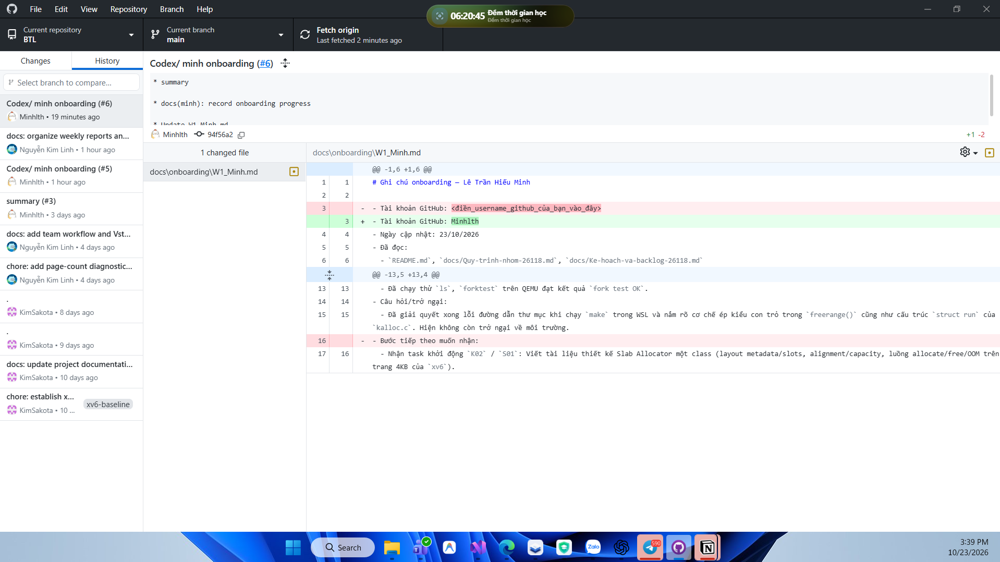
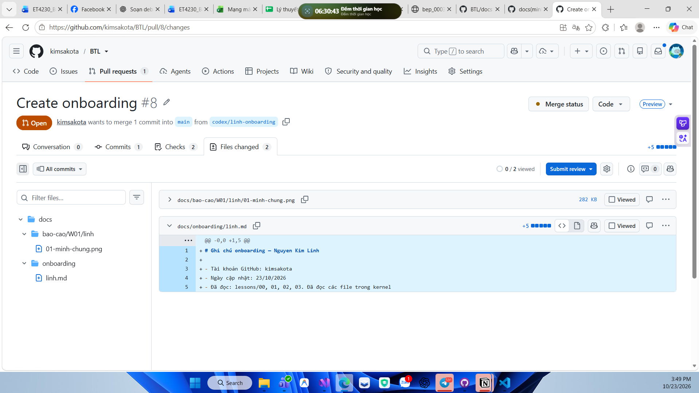

# Nguyễn Kim Linh - Đóng góp W01

- MSSV: 20233495.
- Tài khoản GitHub: [kimsakota](https://github.com/kimsakota).
- Ngày cập nhật: 23/10/2026.
- Kỳ báo cáo: W01, tuần 19–25/10/2026; nội dung dưới đây ghi nhận đến ngày 23/10.

## 1. Công việc đã làm

Trong tuần đầu, tôi tập trung chuẩn bị cấu trúc dự án và thực hành cách làm việc nhóm bằng GitHub:

- Tổ chức repo BTL và thêm Minh, Khánh vào cộng tác.
- Chuẩn bị và đưa lên repo hướng dẫn làm việc, tài liệu học và thư mục báo cáo theo tuần. Cấu trúc W01 có phần riêng cho từng thành viên và phần minh chứng chung; xem [PR #4](https://github.com/kimsakota/BTL/pull/4).
- Sử dụng GitHub Desktop để cập nhật main, xem lịch sử commit và nội dung thay đổi.
- Thực hành tạo nhánh, commit, push và mở PR đóng góp; xem [PR #8](https://github.com/kimsakota/BTL/pull/8).

Phần học trước của tôi được ghi riêng trong [ghi chú onboarding](../../../onboarding/linh.md). Hồ sơ W01 này tập trung vào việc khởi tạo dự án và dùng GitHub.

## 2. Ảnh minh chứng
 
### Ảnh 1 - Cập nhật repo và xem lịch sử

Ảnh chụp ngày 23/10/2026 cho thấy GitHub Desktop đang mở repo BTL, ở main và xem History tại commit `94f56a2`. Tôi đã tải được thay đổi chung và xem diff ghi chú onboarding của Minh. Nội dung test trong diff là ghi chú của Minh; ảnh minh chứng thao tác GitHub của tôi.

### Ảnh 2 - Mở PR đóng góp của Linh

Ảnh chụp ngày 23/10/2026 ghi lại PR #8 từ nhánh `codex/linh-onboarding` vào main. Tại thời điểm chụp, Files changed hiển thị ghi chú onboarding của tôi và ảnh minh chứng thứ nhất. Đây là kết quả thực hành đưa đóng góp lên GitHub để nhóm review.

## 3. Việc tiếp theo

- Hoàn thiện phần đóng góp và minh chứng của cả ba thành viên để tổng hợp báo cáo W01.
- Cùng nhóm xác nhận TODO kỳ sau, người phụ trách và đầu ra cần đạt trước khi ghi vào báo cáo.
- Tiếp tục thực hành review, cập nhật main và đồng bộ nhánh công việc.

[Về mục lục W01](../README.md).
