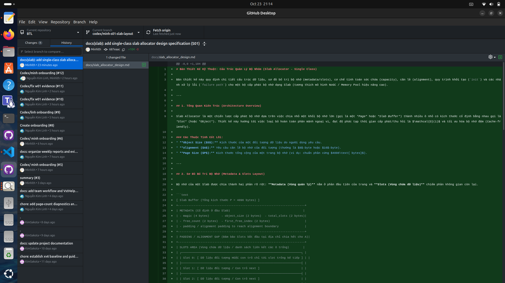
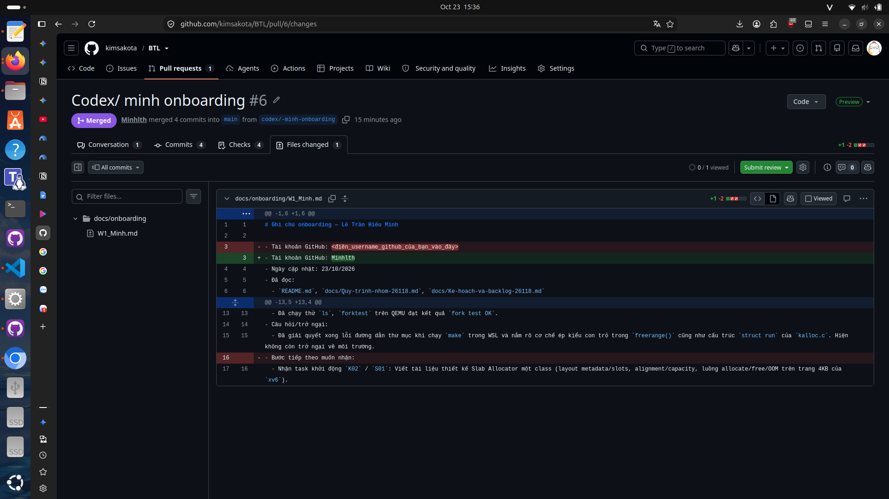

# Báo cáo tiến độ Tuần 01 — Lê Trần Hiếu Minh

- **Người thực hiện / Kỳ báo cáo:** Lê Trần Hiếu Minh (MSSV: 20233528) / W01 (19–25/10/2026)
- **Task ID / Link Issue:** `ONB-MINH`, `K02` / `S01`
- **TODO đã nhận kỳ trước:** Không áp dụng (W01 là tuần khởi động)
- **Trạng thái:** Done

---

## 1. Công việc đã thực hiện trong Tuần 01
1. **Xác nhận quy trình GitHub & Onboarding (`ONB-MINH`):**
   - Đã clone repository `kimsakota/BTL` về máy cá nhân qua GitHub Desktop, tạo nhánh riêng và đóng góp qua Pull Request tại `docs/onboarding/W1_Minh.md`.
2. **Thiết lập & Xác nhận môi trường build/test `xv6-riscv`:**
   - Đã cài đặt WSL2 (Ubuntu Linux), bộ công cụ biên dịch chéo `riscv64-linux-gnu-gcc`, `gdb-multiarch` và trình giả lập `qemu-system-riscv64`.
   - Đã chạy `make clean && make qemu` khởi động thành công nhân `xv6` đa nhân (`CPUS=3`) và chạy kiểm thử `forktest` đạt `fork test OK`.
3. **Đọc hiểu API trang & Thiết kế Slab Allocator một Class (`K02` / `S01`):**
   - Đã đọc hiểu chuỗi bài giảng `Lesson 00` – `Lesson 02` và phân tích API cấp phát trang vật lý trong `kernel/kalloc.c` (`PGSIZE`, `PGROUNDUP`, `PGROUNDDOWN`, `end[]`, `struct run`).
   - Đã biên soạn tài liệu thiết kế kỹ thuật `docs/slab_allocator_design.md`:
     - Đặc tả sơ đồ bố trí bộ nhớ (`struct slab_header` 32 bytes ở đầu trang 4096 bytes + vùng `Slots` dùng con trỏ nhúng `struct slab_slot *next`).
     - Xây dựng công thức căn lề 8-byte (`ALIGN_UP`) và tính sức chứa (`capacity = 4064 / S_aligned`) kèm bảng tính chi tiết.
     - Đặc tả luồng khởi tạo (`init` path) và 5 nhánh xử lý lỗi (`failure` path: sai kích thước, OOM khi `kalloc()` trả về `0`, con trỏ ngoài vùng, lệch biên slot, và `double free`).

---

## 2. Đầu ra & Minh chứng (Deliverables & Evidence)
- **Tài liệu Onboarding:** [`docs/onboarding/W1_Minh.md`](../../../onboarding/W1_Minh.md)
- **Tài liệu Thiết kế Slab 1 Class (`S01`):** [`docs/slab_allocator_design.md`](../../../slab_allocator_design.md)

### Ảnh 1: Minh chứng Clone Repo về máy trên GitHub Desktop (`main` & `History`)

### Ảnh 2: Minh chứng Đóng góp qua Pull Request trên GitHub Web (`Files changed`)

---

## 3. Kiểm tra & Kế hoạch kỳ tới (TODO W02)
- **Kiểm tra thực tế:**
  - Revision cơ sở: `e086c37` (nhánh `main`).
  - Môi trường: WSL2 Ubuntu, `riscv64-linux-gnu-gcc`, `qemu-system-riscv64` (`CPUS=3`).
  - Kết quả: Build sạch `kernel/kernel` và `fs.img`, boot vào shell `$` và chạy `forktest` thành công. Tài liệu `S01` hiện ở bước đặc tả thiết kế, chưa sửa mã nguồn kernel build.
- **Trở ngại / Thay đổi so với TODO:** Không có.
- **TODO kỳ tới (W02):**
  - Tiếp tục `S01` / chuyển sang bước hiện thực hóa cấu trúc dữ liệu và hàm `init`/`alloc`/`free` cho Single-Class Slab Allocator trên nền API trang của `xv6`.