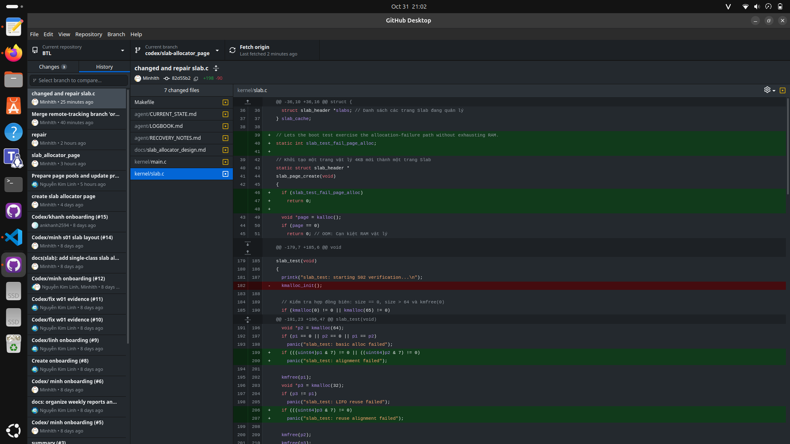
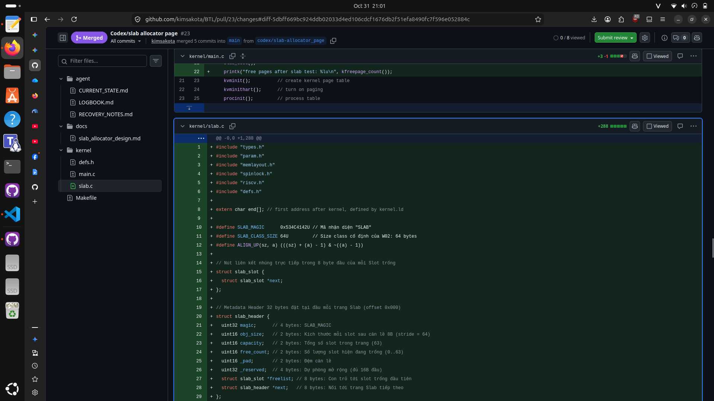

# Báo cáo tiến độ Tuần 02 — Lê Trần Hiếu Minh

- **Người thực hiện / Kỳ báo cáo:** Lê Trần Hiếu Minh (MSSV: 20233528) / W02 (26/10–01/11/2026)
- **Task ID / Link Issue:** `S02` (Liên kết hợp đồng API tại Issue `#18`, Pull Request `#23`)
- **TODO đã nhận kỳ trước (W01):** Tiếp tục `S01` / chuyển sang bước hiện thực hóa cấu trúc dữ liệu và hàm `init`/`alloc`/`free` cho Single-Class Slab Allocator trên nền API trang của `xv6`.
- **Trạng thái:** Done

---

## 1. Công việc đã thực hiện trong Tuần 02

1. **Thống nhất Hợp đồng API (Object Allocator Contract - Issue `#18`) & Đồng bộ Đặc tả `S01`:**
   - Phối hợp với nhóm trưởng (Linh - phụ trách `P02`) và Khánh (phụ trách Test/Harness) để chốt ranh giới API cho lát cắt W02:
     - Giữ nguyên ABI tầng Page của `xv6` (`kinit`, `kalloc`, `kfree`, `kfreepage_count`).
     - Tách biệt tầng Object (`S02`) thông qua bộ 3 hàm: `void kmalloc_init(void)`, `void *kmalloc(uint64 size)`, và `void kmfree(void *ptr)`.
   - Cập nhật tài liệu `docs/slab_allocator_design.md` khớp 100% với mã nguồn thực tế: chuẩn hóa Header cố định $32\text{ bytes}$ (`sizeof(struct slab_header) == 32`), bước nhảy `stride = 64 bytes`, căn lề tối thiểu $8\text{ bytes}$, sức chứa `capacity = 63 slots/page` ($\lfloor (4096 - 32) / 64 \rfloor$), và sử dụng danh sách liên kết con trỏ nhúng `struct slab_slot *freelist`.

2. **Hiện thực hóa Single-Class Slab Allocator trên nền Page gốc (`S02` - `kernel/slab.c`):**
   - Cài đặt đầy đủ các cấu trúc `struct slab_slot`, `struct slab_header` ($32\text{ B}$) và bộ quản lý `slab_cache` bảo vệ bằng `struct spinlock` chuẩn của `xv6`.
   - **`kmalloc_init(void)`:** Khởi tạo khóa `spinlock` và cấu hình thông số cho class cố định $64\text{ B}$ (`capacity = 63`), đảm bảo không tự gọi `kmalloc()` hay cấp phát trang sớm trong pha init.
   - **`kmalloc(uint64 size)`:** Kiểm tra biên kích thước (`size == 0` hoặc `size > 64` trả về `0` ngay, không làm thay đổi trạng thái); cấp phát slot theo cơ chế LIFO $\mathcal{O}(1)$ từ `freelist`; tự động xin trang $4096\text{ B}$ mới qua `kalloc()` khi hết slot trống và xử lý nhánh OOM an toàn (nhả khóa trước khi trả về `0`).
   - **`kmfree(void *ptr)`:** Xử lý `kmfree(0)` là `no-op` theo đúng hợp đồng; định vị trang Slab sở hữu bằng `PGROUNDDOWN((uint64)ptr)`; kiểm tra nghiêm ngặt dải địa chỉ vật lý `[end, PHYSTOP)`, chữ ký `SLAB_MAGIC` (`0x534C4142U`), độ căn lề biên slot (`offset % 64 == 0`), và quét `freelist` kết hợp `free_count` để chặn triệt để lỗi **Double Free** trước khi ghi đè mẫu rác (`memset(ptr, 1, 64)`) và thu hồi slot.

3. **Xây dựng bộ Kiểm thử `slab_test()` & Hoàn thiện CI / Review PR (`PR #23`):**
   - Viết hàm kiểm thử `slab_test()` bao phủ các kịch bản yêu cầu của `S02`:
     - **Boundary & NULL Test:** Kiểm tra `kmalloc(0) == 0`, `kmalloc(65) == 0`, và `kmfree(0)` không gây panic.
     - **LIFO Reuse Test:** Cấp phát, giải phóng và cấp phát lại xác nhận nhận đúng địa chỉ slot vừa trả.
     - **Pattern & Multi-page Test:** Cấp phát lấp đầy toàn bộ $63\text{ slots}$ của trang (và tràn sang trang Slab thứ hai), ghi mẫu byte riêng biệt `(i + 0x20) & 0xFF` cho từng slot để xác minh không ghi đè chéo dữ liệu hoặc làm hỏng Header $32\text{ B}$.
   - Chạy `make fmt` (`clang-format`), giải quyết xung đột (merge conflict) với nhánh `main` và hoàn thiện theo các góp ý review trên PR `#23`.

---

## 2. Đầu ra & Minh chứng (Deliverables & Evidence)

- **Mã nguồn cài đặt Slab (`S02`):** [`kernel/slab.c`](../../../../kernel/slab.c), [`kernel/defs.h`](../../../../kernel/defs.h), [`Makefile`](../../../../Makefile)
- **Tài liệu Thiết kế đã đồng bộ:** [`docs/slab_allocator_design.md`](../../../slab_allocator_design.md)
- **Thảo luận Hợp đồng API & PR:** Issue `#18`, Pull Request `#23` (`codex/slab-allocator_page`)

### Ảnh 1: Minh chứng Chạy kiểm thử `slab_test` và Build trên WSL2 / QEMU

### Ảnh 2: Minh chứng Đóng góp Code & Review Pull Request `#23` trên GitHub Web

---

## 3. Kiểm tra & Kế hoạch kỳ tới (TODO W03)

- **Kiểm tra thực tế:**
  - Revision kiểm tra: Nhánh `codex/slab-allocator_page` (commit `7a06ff5` và các bản cập nhật sau review PR `#23` trên nền `main`).
  - Môi trường: WSL2 (Ubuntu Linux), `riscv64-linux-gnu-gcc`, `qemu-system-riscv64`, `clang-format`.
  - Lệnh & Kết quả:
    - Chạy `make fmt && git diff --exit-code`: Đạt chuẩn định dạng mã nguồn CI.
    - Chạy `make clean && make qemu`: Biên dịch sạch `kernel/kernel` và `fs.img`, xác nhận `kmalloc_init` / `slab_test` vượt qua các bài kiểm tra biên kích thước, `NULL`, alignment, LIFO reuse, pattern $63\text{ slots}$, cấp phát sang trang thứ hai, OOM trả `0` và bắt đúng lỗi `double free` / con trỏ lệch biên.
- **Trở ngại / Thay đổi so với TODO:**
  - Trong quá trình làm việc đã điều chỉnh tên hàm từ `slab_init`/`slab_alloc`/`slab_free` sang `kmalloc_init`/`kmalloc`/`kmfree` và bổ sung quét `freelist` chống `double free` để khớp hoàn toàn với Hợp đồng API chung của nhóm tại Issue `#18`.
- **TODO kỳ tới (W03):**
  - Mở rộng bộ cấp phát Slab từ một class cố định ($64\text{ B}$) sang **nhiều size classes (Multi-class Slab Allocator)** (ví dụ: $16\text{ B}, 32\text{ B}, 64\text{ B}, 128\text{ B}, \dots$).
  - Cài đặt cơ chế hoàn trả lại nguyên trang Slab rỗng về tầng Page (`kfree`) khi toàn bộ các slot trong trang đều đã được thu hồi (`free_count == capacity`) và phối hợp chạy kiểm thử đồng thời đa CPU (multi-CPU stress test).