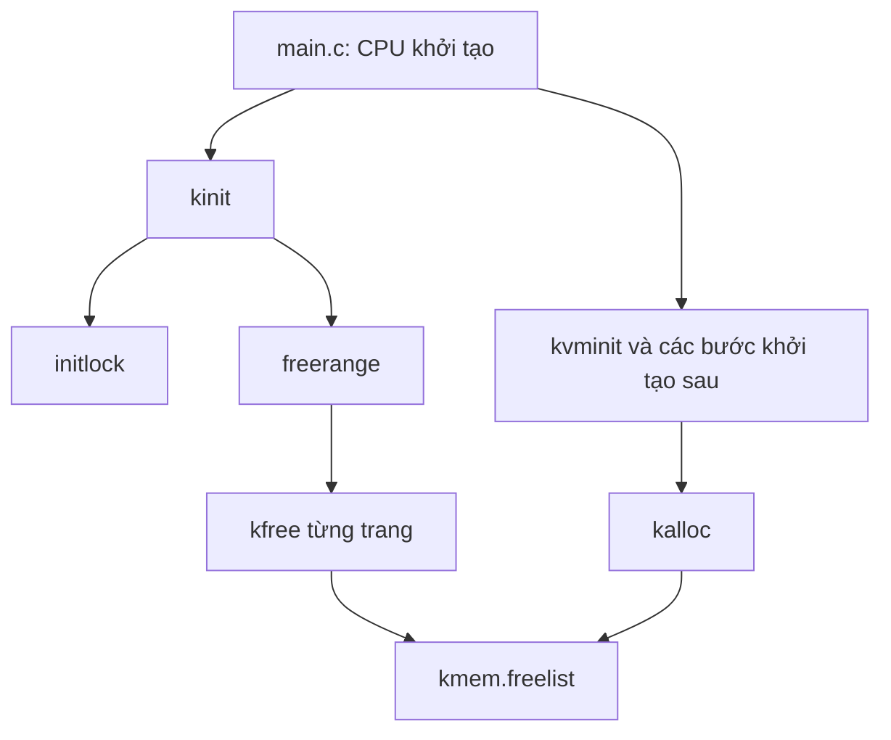

# Bài 1: Bộ nhớ, con trỏ, struct và allocator trang của xv6

Ngày biên soạn và đối chiếu source: 14/10/2026.

Bài này tiếp nối [Bài 0: Hàm, header và liên kết](<D:/2. FullStack/2026.1/Hệ điều hành/BTL/docs/lessons/00-ham-header-va-lien-ket.md>). Bạn đã đọc Bài 0; ở đây chuyển sang cách dữ liệu được biểu diễn và liên kết trong bộ nhớ.

Phương thức học: bạn tự thiết kế, tự viết và tự sửa toàn bộ C của bài tập/đề tài. Tài liệu cung cấp kiến thức, ví dụ nhỏ và các đoạn **mã xv6 đang có để đọc tham chiếu**. Phần bài tập chỉ có yêu cầu và gợi ý; không có implementation hoàn chỉnh để chép.

## 0. Đích đến và cách chia bài

Cuối bài, bạn cần giải thích được:

- Biến, giá trị, địa chỉ và vùng nhớ khác nhau thế nào.
- Cách đọc `uint64`, `char *`, `void *`, `struct run *`.
- `&`, `*`, `.`, `->`, ép kiểu và `sizeof` làm gì.
- Cách một danh sách liên kết biểu diễn các trang trống.
- Vì sao metadata có thể nằm trong chính trang trống.
- Luồng `kinit → freerange → kfree` và thao tác lấy trang của `kalloc`.
- Ai được sử dụng một trang trước và sau khi cấp/phóng thích.
- Cách tự viết một hàm quan sát số trang trống rồi nối khai báo, định nghĩa và lời gọi.

Bài được viết đầy đủ để bạn có tài liệu đọc liên tục. Khi thực hành, vẫn làm từng chặng và kiểm tra trước khi ghép phần tiếp theo.

| Chặng | Đọc | Việc bạn tự làm |
|---|---|---|
| A | Mục 1–3 | Diễn giải địa chỉ, kiểu dữ liệu và dự đoán giá trị qua con trỏ |
| B | Mục 4–7 | Phân biệt cast/sizeof, struct và head/next; vẽ danh sách |
| C | Mục 8–11 | Theo dấu allocator gốc trên giấy, xác định ownership và lỗi |
| D | Mục 12–14 | Thiết lập/chạy baseline nếu chưa có; tự viết hàm đếm từng bước |

Bạn có thể đọc lý thuyết và làm bài trên giấy trước khi có toolchain. Phần kiểm chứng C chạy trong xv6 chỉ hoàn thành khi có build/boot/output thực tế.

## 1. Bộ nhớ: byte, giá trị và địa chỉ

### 1.1. Byte là đơn vị chứa dữ liệu

Trong target xv6 RISC-V đang dùng, một byte có 8 bit. Một vùng 4 byte chứa 32 bit; một trang 4096 byte chứa nhiều kiểu dữ liệu tùy cách sử dụng.

Có thể hình dung một vùng nhớ như nhiều ô byte liên tiếp, mỗi ô có một địa chỉ:

```text
Địa chỉ:  0x1000   0x1001   0x1002   0x1003
Ô byte:   [ ... ]  [ ... ]  [ ... ]  [ ... ]
          <------- một vùng 4 byte ------->
```

Các địa chỉ `0x1000` trong ví dụ này chỉ để minh họa, không phải địa chỉ bạn được tự do dereference trong xv6. Địa chỉ hợp lệ phải thuộc vùng được phép truy cập trong môi trường đang chạy.

### 1.2. Một biến có tên, kiểu và giá trị

Ví dụ nhỏ, dùng trong một khối lệnh:

```c
int so_trang = 3;
```

- `int`: kiểu dữ liệu.
- `so_trang`: tên để chương trình tham chiếu đến đối tượng dữ liệu.
- `3`: giá trị ban đầu.
- Đối tượng dữ liệu có vị trí lưu trữ; ta có thể lấy địa chỉ của biến này bằng `&so_trang`.

Ở mức mô hình C, hãy phân biệt giá trị và địa chỉ. Trình biên dịch có thể tối ưu cách lưu biến; sơ đồ trong bài là mô hình giúp hiểu thao tác, không phải lời cam kết rằng mọi biến đều được đặt ở một ô RAM riêng trong mọi bản build.

Giả sử `so_trang` bắt đầu tại `0x1000`:

```text
Tên biến: so_trang
Kiểu:     int
Địa chỉ:  0x1000
Giá trị:  3
```

Địa chỉ `0x1000` không phải số trang. Nó chỉ vị trí có thể truy cập giá trị `3`.

### 1.3. Hexadecimal và kích thước trang

Tiền tố `0x` biểu diễn số hệ 16:

| Cách viết | Giá trị hệ 10 | Dùng trong bài |
|---|---:|---|
| `0x10` | 16 | Nhận diện hệ 16 |
| `0x1000` | 4096 | Kích thước một trang |
| `0x80000000` | 2147483648 | Đầu RAM theo layout xv6/QEMU này |

Nếu một trang bắt đầu tại địa chỉ A, vùng byte của trang là `[A, A + 4096)`: bao gồm A, không bao gồm A + 4096. Dấu ngoặc vuông/tròn trong cách viết khoảng giúp tránh lỗi tính thừa một byte.

**Tự kiểm tra:** một vùng có 4096 byte thì byte cuối có địa chỉ `A + 4095` hay `A + 4096`? Giải thích bằng một vùng nhỏ 4 byte trước.

## 2. Kiểu dữ liệu và typedef trong xv6

### 2.1. Vì sao phải biết kiểu?

Kiểu cho compiler biết cách diễn giải dữ liệu, kiểm tra phép toán và xác định kích thước/cách căn chỉnh đối tượng.

Trong allocator, ba loại thông tin khác nhau:

| Thông tin | Ví dụ | Kiểu phù hợp về vai trò |
|---|---|---|
| Số lượng | Có bao nhiêu trang trống | Số nguyên |
| Địa chỉ | Trang hoặc node hiện tại ở đâu | Con trỏ |
| Trạng thái kết hợp | Head, khóa và các dữ liệu liên quan | Struct |

Một biến đếm và một biến duyệt danh sách có nhiệm vụ khác nhau, dù trên target này chúng có thể đều chiếm 8 byte.

### 2.2. Đọc types.h

Mở [types.h](<D:/2. FullStack/2026.1/Hệ điều hành/BTL/kernel/types.h>). Các khai báo gốc gồm:

```c
typedef unsigned int uint;
typedef unsigned long uint64;
```

`typedef` đặt tên khác cho một kiểu đã có. Nó không tạo biến, không cấp vùng nhớ, không khởi tạo một giá trị.

Dòng thứ hai đọc là: “Từ đây, tên `uint64` được dùng cho kiểu `unsigned long`.”

`unsigned` biểu diễn số nguyên không âm. Trong bài, số trang trống và số byte là những ví dụ phù hợp với kiểu không âm. Tuy nhiên, kiểu unsigned vẫn có giới hạn; trừ khi giá trị đang bằng 0 có thể gây wraparound, nên không được coi nó là cơ chế tự kiểm tra lỗi.

### 2.3. Kích thước thuộc về target và ABI

Với target RV64 và quy ước LP64 thông thường mà bài này xét:

| Kiểu | Số byte |
|---|---:|
| `char`, `unsigned char` | 1 |
| `short`, `unsigned short` | 2 |
| `int`, `unsigned int`, `uint` | 4 |
| `long`, `unsigned long`, `uint64` của xv6 | 8 |
| Con trỏ dữ liệu, ví dụ `void *` | 8 |

Đây là kích thước theo ABI LP64 của RISC-V, không phải quy tắc “mọi máy 64-bit đều giống nhau”. Khi đổi compiler/target, cần kiểm tra lại. [RISC-V psABI, mục 4.1](https://riscv-non-isa.github.io/riscv-elf-psabi-doc/#_cc_type_sizes_and_alignments).

Đặc biệt, đừng dùng kết quả `sizeof(unsigned long)` từ compiler Windows để suy ra trực tiếp kích thước `uint64` của kernel RISC-V. Máy chạy compiler và máy đích mà compiler tạo code cho có thể khác nhau.

Baseline đặt `-march=rv64gc` và `-std=gnu99` trong [Makefile](<D:/2. FullStack/2026.1/Hệ điều hành/BTL/Makefile:68>). Bài tham chiếu các quy tắc C cơ bản trong dự thảo C11 N1570 để kiểm tra thuật ngữ; việc đó không đổi chế độ ngôn ngữ của dự án. GNU99 là C99 với các mở rộng GNU. [GCC về các chế độ C](https://gcc.gnu.org/onlinedocs/gcc/Standards.html).

**Bài nhỏ:** mở types.h, tự tìm định nghĩa `uint8`, `uint16`, `uint32`. Ghi kiểu gốc của mỗi tên và vì sao tên đó phù hợp với target đang xét.

## 3. Con trỏ, lấy địa chỉ và dereference

### 3.1. Con trỏ chứa gì?

Con trỏ dữ liệu là một giá trị dùng để tham chiếu đến đối tượng hoặc vùng dữ liệu. Trong mô hình địa chỉ của xv6, ta hình dung nó giữ địa chỉ để tìm tới dữ liệu đó.

Ví dụ nhỏ trong cùng một khối lệnh:

```c
int so_trang = 3;
int *p = &so_trang;
```

Đọc dòng thứ hai:

1. `p` là biến.
2. Kiểu của p là `int *`: con trỏ tới int.
3. `&so_trang` lấy địa chỉ của so_trang.
4. Địa chỉ đó được gán vào p.

Giả sử p được lưu tại một vị trí khác:

```text
p, tại 0x2000                so_trang, tại 0x1000
[giá trị: 0x1000] ----------> [giá trị: 3]
```

Bản thân biến con trỏ cũng có địa chỉ. Vì vậy cần phân biệt:

| Biểu thức | Ý nghĩa trong ví dụ |
|---|---|
| `so_trang` | Giá trị 3 |
| `&so_trang` | Địa chỉ của so_trang |
| `p` | Địa chỉ đang được p giữ |
| `&p` | Địa chỉ của chính biến p; có kiểu int ** |
| `*p` | Đối tượng int mà p trỏ tới; khi đọc cho giá trị 3 |

`int **` là con trỏ tới một con trỏ int. Ở bài này chỉ cần nhận diện ý nghĩa `&p`; chưa cần dùng con trỏ hai cấp để thiết kế allocator.

### 3.2. Dấu * có nhiều ngữ cảnh

```c
int *p;
```

Ở **khai báo**, dấu `*` cho biết p là con trỏ.

```c
*p = 7;
```

Ở **biểu thức**, dấu `*` thực hiện dereference: truy cập đối tượng tại nơi p đang trỏ tới. Nếu p vẫn trỏ tới so_trang thì phép gán này thay giá trị so_trang thành 7.

Đây không phải thay địa chỉ trong p. Hãy so sánh:

| Thao tác | Thứ bị thay đổi |
|---|---|
| `p = &bien_khac;` | Giá trị địa chỉ được lưu trong p |
| `*p = 7;` | Đối tượng tại địa chỉ p đang giữ |

Quy tắc lấy địa chỉ và dereference được đối chiếu với N1570 §6.5.3.2. Dereference chỉ hợp lệ khi pointer trỏ tới đối tượng có thể truy cập phù hợp. [Dự thảo C11 N1570](https://www.open-std.org/jtc1/sc22/wg14/www/docs/n1570.pdf).

Viết một pointer declaration chưa đủ để có đối tượng đích. Biến con trỏ cục bộ chưa khởi tạo không có giá trị hợp lệ để đọc/dereference. Trong mã gốc, `struct run *r;` được gán từ head trước khi dùng.

### 3.3. Sao chép con trỏ khác sao chép dữ liệu

Ví dụ độc lập, vẫn trong cùng scope:

```c
int so_trang = 3;
int *p = &so_trang;
int *q = p;
```

Cả p và q đều trỏ tới cùng một đối tượng. Không có int thứ hai được tạo chỉ vì sao chép địa chỉ.

```text
p ----+
      +----> so_trang
q ----+
```

Liên hệ allocator: `r = kmem.freelist;` sao chép địa chỉ node đầu vào biến r. Nó chưa tạo một trang mới và chưa loại node khỏi danh sách.

### 3.4. Null pointer và kiểm tra điều kiện

Trong mã xv6, literal `0` được dùng trong ngữ cảnh con trỏ để biểu diễn con trỏ rỗng. Nó không trỏ tới một đối tượng hợp lệ để dereference.

`if (r)` ở kalloc kiểm tra r khác con trỏ rỗng. `if (r == 0)` kiểm tra r là con trỏ rỗng.

Một pointer khác 0 **chưa đủ** chứng minh vùng đích còn sống, đúng loại, đúng alignment và thuộc quyền sử dụng của bạn. Nó có thể là con trỏ đã free hoặc địa chỉ sai.

**Bài nhỏ A — tự viết:** tạo một biến số nguyên có giá trị ban đầu do bạn chọn; tạo con trỏ tới biến đó; dùng dereference đổi giá trị thành một số khác. Chỉ viết vài câu lệnh trong chat, không thêm chúng vào kernel. Giải thích biến nào chứa số, biến nào chứa địa chỉ, và câu lệnh nào thay đối tượng đích.

## 4. void *, ép kiểu, sizeof và bước con trỏ

### 4.1. Vì sao kalloc trả void *?

Kalloc cấp vùng nhớ một trang, nhưng caller có thể sử dụng trang đó cho nhiều mục đích: page table, stack hoặc buffer. Allocator không cần chọn kiểu nghiệp vụ cho caller.

`void *` là con trỏ tổng quát tới dữ liệu. Nó không mang kích thước vùng cấp phát và không tự ghi nhớ kiểu nội dung của trang.

Để truy cập dữ liệu theo kiểu cụ thể, chương trình dùng con trỏ có kiểu phù hợp. Trong C, chuyển đổi giữa void * và các con trỏ tới đối tượng có thể diễn ra ngầm; không phải lời gọi kalloc nào cũng bắt buộc có cast. Nhưng kiểu hợp lệ không tự chứng minh ownership hoặc đủ kích thước vùng nhớ.

### 4.2. Cast làm gì và không làm gì?

Đọc câu lệnh gốc trong kfree:

```c
r = (struct run *)pa;
```

- pa giữ địa chỉ đầu trang.
- `(struct run *)` yêu cầu dùng địa chỉ đó theo kiểu con trỏ tới struct run.
- r nhận con trỏ đã chuyển kiểu.

Cast trong tình huống này không gọi allocator, không sao chép 4096 byte, không tạo một trang mới. Sau cast, các truy cập `r->next` mới đọc/ghi vùng nhớ theo layout struct run.

Ví dụ khái niệm:

```text
Trước cast: pa giữ địa chỉ đầu trang
Sau cast:   r tham chiếu cùng đầu trang, với kiểu struct run *
RAM mới:    không có
```

Vùng đích phải phù hợp với việc truy cập theo kiểu mới, bao gồm alignment, kích thước và quyền sử dụng. Cast không biến một địa chỉ sai thành hợp lệ.

### 4.3. sizeof đo kiểu/đối tượng, không đo vùng mà pointer sở hữu

Giả sử p có kiểu `int *` và đã trỏ tới một int còn sống:

| Biểu thức | Đo gì? | Kết quả theo target của bài |
|---|---|---:|
| `sizeof(int)` | Kích thước int | 4 |
| `sizeof(p)` | Kích thước biến con trỏ | 8 |
| `sizeof(*p)` | Kích thước kiểu đối tượng được trỏ tới | 4 |

Không suy ra “p trỏ tới trang 4096 byte, nên sizeof(p) bằng 4096”.

Với các kiểu cố định trong bảng, sizeof không thực hiện đọc giá trị tại p. Trường hợp kiểu/mảng có độ dài biến đổi có quy tắc riêng; không dùng VLA trong các bài allocator ban đầu. [N1570, §6.5.3.4](https://www.open-std.org/jtc1/sc22/wg14/www/docs/n1570.pdf).

Kết quả sizeof có kiểu `size_t` trong C. Bài không yêu cầu nhập header libc vào kernel chỉ để dùng tên này; xv6 có bộ kiểu và tiện ích riêng, cần theo source đang dùng.

### 4.4. Cộng con trỏ bước theo kiểu đích

Ví dụ nhỏ có mảng thật:

```c
int gia_tri[3] = {10, 20, 30};
int *p = &gia_tri[0];
```

Với target int dài 4 byte:

- p trỏ phần tử đầu.
- p + 1 trỏ phần tử thứ hai, địa chỉ tăng 4 byte.
- p + 2 trỏ phần tử thứ ba, địa chỉ tăng 8 byte.

Trong khi đó, tăng `char *` thêm 1 là bước một byte. Đây là lý do freerange dùng biến `char *p` để đi từng PGSIZE byte.

Phép cộng con trỏ C có giới hạn theo đối tượng/mảng; con trỏ một vị trí sau cuối mảng có thể dùng làm mốc, nhưng không được dereference. Không học ví dụ p + 1 rồi áp dụng phép toán tùy ý lên mọi số địa chỉ. [N1570, §6.5.6](https://www.open-std.org/jtc1/sc22/wg14/www/docs/n1570.pdf).

Kernel xv6 là mã hệ thống gắn với layout RAM và toolchain cụ thể, có thao tác duyệt vùng RAM theo địa chỉ. Không coi mọi thao tác địa chỉ của nó là mẫu portable C dùng nguyên ở mọi môi trường.

GNU C còn hỗ trợ cộng/trừ void * như một mở rộng, coi bước là một byte. Bài này dùng con trỏ byte có kiểu rõ như char * thay vì dựa vào mở rộng đó. [GCC: Pointer Arithmetic](https://gcc.gnu.org/onlinedocs/gcc/Pointer-Arith.html).

**Tự kiểm tra:** giả sử p trỏ tới một struct run, p + 1 có nghĩa “node kế tiếp trong danh sách” hay “vị trí cách p một sizeof(struct run)”? Phần tiếp theo sẽ giải thích vì sao danh sách cần trường next.

## 5. Struct: gom dữ liệu, layout và hai cách truy cập

### 5.1. Kiểu struct khác biến struct

Ví dụ nhỏ để học cú pháp:

```c
struct thong_ke {
  unsigned int da_cap;
  unsigned int da_tra;
};
```

Đây là định nghĩa một kiểu có hai trường. Chưa có biến thống kê nào được tạo bởi riêng đoạn này.

Ví dụ khai báo một đối tượng thuộc kiểu đó:

```c
struct thong_ke thong_ke_hien_tai = {0, 0};
```

Lúc này có một biến được khởi tạo với hai trường bằng 0.

Giữa các trường và sau trường cuối có thể có padding để đáp ứng alignment. Không tự tính sizeof(struct) bằng cộng kích thước mọi trường trong mọi trường hợp. [N1570, §6.7.2.1](https://www.open-std.org/jtc1/sc22/wg14/www/docs/n1570.pdf).

### 5.2. Dấu chấm cho đối tượng, mũi tên cho con trỏ

Với biến ở trên:

```c
struct thong_ke *p = &thong_ke_hien_tai;
```

| Biểu thức | Ý nghĩa |
|---|---|
| `thong_ke_hien_tai.da_cap` | Truy cập trường qua biến struct |
| `p->da_cap` | Truy cập trường qua con trỏ tới struct |
| `(*p).da_cap` | Cách viết tương đương p->da_cap |

Dấu ngoặc trong `(*p).da_cap` giữ đúng thứ tự: lấy đối tượng mà p trỏ tới, sau đó chọn trường da_cap.

Đối chiếu xv6:

- `kmem.freelist`: kmem là biến struct.
- `r->next`: r là con trỏ tới struct run.
- `&kmem.lock`: lấy địa chỉ của trường khóa trong biến kmem.

### 5.3. Đọc struct run tự tham chiếu

Mã gốc tại [kalloc.c, dòng 17](<D:/2. FullStack/2026.1/Hệ điều hành/BTL/kernel/kalloc.c:17>):

```c
struct run {
  struct run *next;
};
```

Đọc từ trong ra ngoài: next là một trường có kiểu con trỏ tới struct run.

Một node giữ **địa chỉ của node khác**, không chứa toàn bộ node khác bên trong nó. Kích thước con trỏ đã xác định theo ABI, nên struct có thể chứa con trỏ tới chính loại struct của nó.

Nếu cố đặt một struct run hoàn chỉnh làm trường bên trong chính struct run, sẽ cần đối tượng chứa bản sao của nó lặp vô hạn; kiểu như vậy không có kích thước hữu hạn để định nghĩa.

Với layout một trường pointer trên target của bài, struct run chiếm 8 byte. Điều này không có nghĩa trang được cấp cũng chỉ 8 byte: node quản lý và đơn vị cấp phát là hai khái niệm khác nhau.

### 5.4. Struct không có tên kiểu riêng của kmem

Mã ở [kalloc.c, dòng 21](<D:/2. FullStack/2026.1/Hệ điều hành/BTL/kernel/kalloc.c:21>) có dạng:

```c
struct {
  struct spinlock lock;
  struct run *freelist;
} kmem;
```

Đoạn này vừa mô tả một kiểu struct không đặt tag riêng, vừa định nghĩa biến kmem.

- lock là **đối tượng khóa nằm trong kmem**, không phải pointer tới khóa.
- freelist là pointer tới node đầu.
- Khóa và dữ liệu được đặt cạnh nhau để thể hiện quan hệ bảo vệ.

Kmem ở phạm vi file, có thời gian lưu trữ suốt hoạt động kernel. Nó không phải biến cục bộ bị hủy khi kinit kết thúc. Đối tượng global chưa có initializer tường minh được zero-initialize trong mô hình C; trường con trỏ freelist ban đầu là con trỏ rỗng.

Trong source này kmem chưa được đánh dấu static. Đừng đồng nhất “đặt trong .c” với “được compiler bảo đảm private”: static ở phạm vi file mới là một cơ chế giới hạn liên kết về file đó. Bài không yêu cầu đổi khai báo gốc.

**Bài nhỏ B — tự viết:** định nghĩa một struct đơn giản có một trường số lượng và một trường kích thước; tự chọn tên. Tạo một biến của kiểu đó và một con trỏ tới nó. Tự viết một truy cập bằng dấu chấm và một truy cập bằng mũi tên. Đây là luyện cú pháp trong chat, chưa phải thiết kế metadata slab.

## 6. Danh sách liên kết: head, node và next

### 6.1. Ba vai trò

Trong free list trang của xv6:

| Thành phần | Vai trò |
|---|---|
| kmem.freelist | Head: con trỏ tới trang trống đầu tiên |
| struct run ở đầu mỗi trang | Node quản lý trang đó |
| node.next | Con trỏ tới node của trang trống tiếp theo |
| Con trỏ rỗng ở next cuối | Dấu kết thúc danh sách |

Ví dụ có ba trang trống:

```text
kmem.freelist
      |
      v
  [A: next=B] ---> [B: next=C] ---> [C: next=0]
```

A, B, C là nhãn minh họa cho các địa chỉ trang. Head là một biến riêng giữ địa chỉ A, không phải một trang phụ ở trước A.

### 6.2. Node kế tiếp không nhất thiết nằm sát nhau

Các trang trong danh sách có thể có địa chỉ không liên tiếp:

```text
Head -> trang ở 0x80009000
        next -> trang ở 0x80023000
                next -> trang ở 0x80011000
                        next -> 0
```

Địa chỉ trên chỉ minh họa thứ tự, không phải log runtime. Chúng đều căn theo 4096 byte, nhưng thứ tự trong list không cần tăng dần.

Vì vậy:

- `r->next`: theo liên kết được lưu trong node.
- `r + 1`: phép tính vị trí theo sizeof(struct run), không phải theo liên kết.
- `r = r->next`: đổi node mà biến duyệt tham chiếu.
- `r->next = ...`: sửa liên kết trong dữ liệu của node.

Hai câu cuối có tác động khác nhau. Hàm quan sát danh sách chỉ nên thay biến duyệt cục bộ; không sửa liên kết.

### 6.3. Sao chép head vào biến duyệt

Giả sử r được gán từ head:

```text
Head ----+
         +----> A -> B -> C -> 0
r -------+
```

Nếu thay r để nó tham chiếu B, head vẫn giữ A. Đây là cơ sở để duyệt mà không lấy trang ra khỏi danh sách.

Nếu thay chính head sang B, thì danh sách mà allocator nhìn thấy đã đổi: A không còn ở phần có thể đi tới từ head.

### 6.4. Điều kiện danh sách đúng

Trong trạng thái ổn định, sau khi một thao tác hoàn tất:

1. Mỗi node biểu diễn một trang hợp lệ, căn theo PGSIZE.
2. Một trang trống xuất hiện đúng một lần trong danh sách.
3. Danh sách không có vòng.
4. Head và các next cho phép đi tới mọi trang trống của allocator.
5. Trang đã giao cho caller không còn nằm trong danh sách trống.

Những điều kiện cần giữ luôn đúng như vậy gọi là **invariant**. Khi làm per-CPU lists, invariant sẽ mở rộng thành nhiều danh sách nhưng quyền sở hữu trang vẫn phải rõ.

**Bài nhỏ C — vẽ:** bắt đầu head → A → B → C → 0. Vẽ hai trường hợp: chỉ chuyển biến duyệt từ A sang B; và chuyển head từ A sang B. Chỉ rõ trường hợp nào làm mất A khỏi danh sách allocator.

## 7. Metadata nằm trong chính trang trống

### 7.1. Một trang vừa là tài nguyên vừa chứa node lúc đang trống

Metadata là dữ liệu dùng để quản lý dữ liệu khác. Ở đây, next là metadata giúp tìm trang trống tiếp theo.

Một trang trống không có caller đang sở hữu dữ liệu cần giữ. Allocator tận dụng phần đầu trang đó để đặt struct run:

```text
Một trang trống: 4096 byte
+--------------------+---------------------------------------+
| next: 8 byte       | phần còn lại của trang                |
+--------------------+---------------------------------------+
^
Địa chỉ của trang cũng là nơi allocator xem như struct run
```

Node không được malloc riêng. Không cần một mảng 32768 node chỉ để liệt kê trang trống.

Thiết kế free list đi qua các trang và việc đặt node trong trang được mô tả trong sách xv6. [MIT xv6 book, mục 3.4–3.5](https://mit-pdos.github.io/xv6-riscv-book/mem.html#code-physical-memory-allocator).

### 7.2. Khi được cấp, caller có thể dùng cả trang

Sau khi A đã bị lấy khỏi list, allocator không còn cần next của A. Caller có thể dùng cả 4096 byte, bao gồm phần từng chứa next.

Điều này chỉ đúng vì A đã chuyển khỏi danh sách trước khi nội dung quản lý bị ghi đè. Nếu A vẫn có trong list mà caller ghi vào đầu trang, allocator có thể đọc next bị hỏng.

Khi caller trả A bằng page free, quyền dùng trang được trả cho allocator; allocator ghi lại metadata cần thiết.

| Trạng thái | Ai sử dụng nội dung trang? | Trường next ở đầu trang có ý nghĩa gì? |
|---|---|---|
| Trống, trong free list | Allocator | Liên kết sang trang trống khác |
| Đang trong thao tác lấy/trả, được đồng bộ | Thao tác allocator đang quản lý | Chỉ đọc/ghi theo đúng thứ tự thao tác |
| Đã cấp cho caller | Caller theo lifetime của nó | Không còn là liên kết free list mà caller phải giữ |
| Đã trả về danh sách | Allocator | Liên kết được thiết lập lại |

### 7.3. Đặt nền cho slab

Allocator trang gốc dùng 4096 byte làm đơn vị. Slab sau này sẽ chia một hoặc nhiều trang thành các slot để cấp object nhỏ.

Ở bài này, chỉ phân biệt:

- **Trang:** đơn vị tài nguyên do tầng trang cấp/trả.
- **Object/slot:** đơn vị nhỏ hơn mà tầng slab sẽ quản lý.
- **Metadata:** dữ liệu theo dõi tài nguyên, không phải một allocation bổ sung tự xuất hiện do cast.

Cấp một slot rồi gọi page kfree vào địa chỉ giữa trang là sai API. Thuật toán slab và layout metadata của nó sẽ được thiết kế ở các bài sau.

## 8. Bản đồ source, vùng RAM và thứ tự khởi tạo

### 8.1. File nào cung cấp phần nào?

| File trong BTL | Phần cần đọc | Trách nhiệm/phụ thuộc |
|---|---|---|
| [types.h](<D:/2. FullStack/2026.1/Hệ điều hành/BTL/kernel/types.h>) | Các typedef | Tên kiểu được dùng trong kernel |
| [riscv.h](<D:/2. FullStack/2026.1/Hệ điều hành/BTL/kernel/riscv.h:389>) | PGSIZE, PGROUNDUP, PGROUNDDOWN | Kích thước và căn chỉnh trang |
| [memlayout.h](<D:/2. FullStack/2026.1/Hệ điều hành/BTL/kernel/memlayout.h:43>) | KERNBASE, PHYSTOP | Giới hạn RAM theo cấu hình xv6 này |
| [kernel.ld](<D:/2. FullStack/2026.1/Hệ điều hành/BTL/kernel/kernel.ld:44>) | Symbol end | Linker xác định cuối image kernel |
| [kalloc.c](<D:/2. FullStack/2026.1/Hệ điều hành/BTL/kernel/kalloc.c>) | run, kmem và bốn hàm allocator | Sở hữu free list và thực hiện cấp/trả trang |
| [spinlock.h](<D:/2. FullStack/2026.1/Hệ điều hành/BTL/kernel/spinlock.h>) | Kiểu struct spinlock | Cấu trúc khóa được nhúng trong kmem |
| [spinlock.c](<D:/2. FullStack/2026.1/Hệ điều hành/BTL/kernel/spinlock.c>) | initlock, acquire, release | Khởi tạo và thực hiện đồng bộ |
| [defs.h](<D:/2. FullStack/2026.1/Hệ điều hành/BTL/kernel/defs.h:59>) | Nhóm khai báo kalloc.c | Công bố các hàm cho file khác gọi |
| [main.c](<D:/2. FullStack/2026.1/Hệ điều hành/BTL/kernel/main.c:19>) | kinit trước kvminit | Khởi tạo allocator trước các phần cần lấy trang |
| [vm.c](<D:/2. FullStack/2026.1/Hệ điều hành/BTL/kernel/vm.c:228>) | Một lời gọi kalloc trong uvmalloc | Ví dụ caller nhận trang và xử lý kết quả |
| [Makefile](<D:/2. FullStack/2026.1/Hệ điều hành/BTL/Makefile:10>) | kalloc.o trong OBJS | Link phần thực hiện vào kernel |
| [printk.c](<D:/2. FullStack/2026.1/Hệ điều hành/BTL/kernel/printk.c:64>) | Định dạng số khi quan sát | Tiện ích in của kernel, không phải printf libc |

Các số dòng đã đối chiếu ngày 14/10/2026. Khi bạn thêm code, dòng có thể dịch chuyển; hãy tìm theo tên hàm/symbol.

### 8.2. Vì sao kalloc.c include các header?

Đầu file gốc include types.h, param.h, memlayout.h, spinlock.h, riscv.h và defs.h. Khi đọc, nối từng reference với nguồn:

- uint64 → typedef ở types.h.
- PHYSTOP → macro ở memlayout.h.
- struct spinlock → định nghĩa ở spinlock.h.
- PGSIZE và PGROUNDUP → macro ở riscv.h.
- initlock, acquire, release, memset, panic → khai báo ở defs.h; định nghĩa ở các module tương ứng.

Không bắt buộc mọi header của file gốc đều được sử dụng trực tiếp trong một đoạn bạn đang đọc. Bài không yêu cầu dọn include. Bạn đang học cách tìm nguồn một tên trước khi thay đổi code.

Định nghĩa đầy đủ của struct spinlock cần có vì kmem chứa một đối tượng khóa thật. Nếu chỉ có forward declaration `struct spinlock;`, compiler chưa biết kích thước để bố trí trường lock. Ngược lại, một trường là pointer tới struct có thể được khai báo khi struct đích chưa có định nghĩa đầy đủ.

### 8.3. Vùng cấp phát bắt đầu sau image kernel

Các giá trị trong baseline:

```c
#define PGSIZE 4096
#define KERNBASE 0x80000000L
#define PHYSTOP (KERNBASE + 128 * 1024 * 1024)
```

PGSIZE nằm ở riscv.h; hai macro địa chỉ nằm ở memlayout.h. Đoạn trên gom lại để so sánh, không phải yêu cầu tạo thêm file chứa ba dòng.

```text
KERNBASE                                           PHYSTOP
0x80000000                                         0x88000000
| image kernel | ... end ... | trang có thể cấp ... |
                         ^
                         bắt đầu sau khi làm tròn lên ranh giới trang
```

128 MiB / 4096 = 32768 trang trong toàn vùng RAM cấu hình. Đây không phải số trang trống ban đầu, vì image kernel đã sử dụng một phần. Các bước khởi tạo sau đó còn xin thêm trang.

Trong kalloc.c:

```c
extern char end[];
```

Ở đây end là symbol do linker script cung cấp; allocator không định nghĩa một mảng buffer mới tên end. Mở kernel.ld và tìm `PROVIDE(end = .)`: dấu chấm trong linker script là vị trí hiện tại khi bố trí các section, khác dấu chấm truy cập trường struct trong C.

Địa chỉ end biểu diễn điểm ngay sau phần image kernel đã được bố trí, gồm code và dữ liệu/BSS. Tăng code hoặc global data có thể làm end thay đổi.

### 8.4. Địa chỉ vật lý và con trỏ kernel

Allocator quản lý trang RAM vật lý. Sau khi kernel bật paging, CPU truy cập qua địa chỉ ảo; vùng RAM này có direct mapping, cho kernel sử dụng giá trị địa chỉ tương ứng để truy cập trang. Trước khi bật paging, boot dùng địa chỉ trực tiếp. [Sách xv6, mục 3.2–3.3](https://mit-pdos.github.io/xv6-riscv-book/mem.html#kernel-address-space).

Bài này chưa yêu cầu hiểu toàn bộ page table. Chỉ ghi nhớ: con trỏ kernel dùng được không đồng nghĩa chương trình user được dereference địa chỉ đó. Tầng allocator không tự cấp quyền truy cập user bằng việc trả pointer.

### 8.5. Theo reference từ main đến allocator



Mũi tên thể hiện lời gọi hoặc phần dữ liệu được dùng, không phải include. Thứ tự kinit trước các phần cần kalloc là yêu cầu vận hành: muốn lấy trang phải có pool trang đã sẵn sàng.

**Tự kiểm tra:** types.h công bố tên kiểu, defs.h công bố hàm, còn kernel.ld cung cấp end. Vì sao không thể quy tất cả các reference này thành “hàm nằm trong header”?

## 9. Đọc kinit và freerange: xây pool trang trống

### 9.1. Hợp đồng từng hàm

| Hàm | Đầu vào | Kết quả/trạng thái |
|---|---|---|
| kinit | Không nhận tham số | Khởi tạo khóa và đưa các trang khả dụng vào free list |
| freerange | Địa chỉ đầu và cuối phạm vi | Gọi page free để đưa từng trang trọn vẹn vào pool |

Mở [kinit](<D:/2. FullStack/2026.1/Hệ điều hành/BTL/kernel/kalloc.c:27>). Hai công việc trong mã gốc:

```c
initlock(&kmem.lock, "kmem");
freerange(end, (void *)PHYSTOP);
```

- `&kmem.lock`: truyền địa chỉ đối tượng khóa để hàm initlock sửa chính đối tượng đó.
- `"kmem"`: chuỗi tên phục vụ nhận diện/debug khóa.
- end: địa chỉ sau image kernel.
- PHYSTOP: macro số địa chỉ, được chuyển thành void * ở lời gọi này theo mô hình target của kernel.

Nếu truyền một bản sao đối tượng cần sửa, thay đổi trên bản sao không cập nhật đối tượng gốc. Việc truyền pointer là một cách hàm C thao tác dữ liệu ở nơi caller cung cấp. Tham số C vẫn được truyền theo giá trị: giá trị được sao chép ở đây là địa chỉ.

### 9.2. Vì sao phải làm tròn lên?

Mở [freerange](<D:/2. FullStack/2026.1/Hệ điều hành/BTL/kernel/kalloc.c:34>), nhận diện:

```c
p = (char *)PGROUNDUP((uint64)pa_start);
```

Địa chỉ end có thể ở giữa một trang. Nếu đưa cả trang đó vào danh sách trống, client có thể ghi đè phần image kernel còn nằm trong cùng trang.

Ví dụ địa chỉ minh họa:

```text
pa_start = 0x80012345
đầu trang chứa pa_start = 0x80012000
đầu trang hoàn toàn tiếp theo = 0x80013000
```

Freerange chọn 0x80013000, bỏ qua phần chưa trọn một trang sau end.

Đọc macro PGROUNDUP ở riscv.h. Có thể hiểu ý nghĩa trước khi tính từng bit:

- PGSIZE - 1 bằng 4095.
- Cộng 4095 trước khi xóa 12 bit thấp cho kết quả làm tròn lên.
- Nếu địa chỉ đã căn theo 4096, kết quả vẫn giữ nguyên.
- PGROUNDDOWN chỉ xóa 12 bit thấp, làm tròn xuống.

Macro được định nghĩa trong source và có giả định số trang là lũy thừa của 2. Phân tích overflow sẽ cần khi thiết kế các phép tính size tổng quát; không sao chép một công thức rounding rồi bỏ kiểm tra miền giá trị.

### 9.3. Đọc vòng lặp mà không nhầm đơn vị

Vòng lặp gốc:

```c
for (; p + PGSIZE <= (char *)pa_end; p += PGSIZE)
  kfree(p);
```

| Phần | Cách đọc |
|---|---|
| Phần đầu trước dấu ; để trống | p đã được khởi tạo ở dòng trước |
| p + PGSIZE <= pa_end | Chỉ đưa vào pool trang có toàn bộ 4096 byte trong phạm vi |
| p += PGSIZE | Vì p là char *, bước tăng là 4096 byte |
| kfree(p) | Trả nguyên trang bắt đầu tại p vào free list |

pa_end là mốc ngoài cuối vùng, không phải địa chỉ byte cuối để dereference.

Freerange là ngoại lệ được ghi trong source: các trang khi khởi tạo chưa được kalloc cấp trước đó. Kfree được dùng để xây danh sách ban đầu.

### 9.4. Thứ tự list sau khởi tạo

Giả sử freerange lần lượt đi qua A, B, C theo địa chỉ tăng dần, và kfree thêm vào đầu:

```text
Ban đầu: head -> 0
Thêm A:  head -> A -> 0
Thêm B:  head -> B -> A -> 0
Thêm C:  head -> C -> B -> A -> 0
```

Do đó thứ tự free list ngược thứ tự duyệt địa chỉ lúc khởi tạo.

**Bài nhỏ D — trên giấy:** dùng kích thước trang giả lập là 16 byte, vùng bắt đầu tại 20 và kết thúc tại 70. Tự tính đầu trang hợp lệ đầu tiên, liệt kê các trang trọn vẹn và vẽ head cuối. Đây là mô hình số nhỏ, không thay PGSIZE của xv6.

## 10. Đọc kfree và kalloc: trả trang và lấy trang

### 10.1. Hợp đồng và lifetime

| Hàm | Đầu vào | Kết quả | Tác động |
|---|---|---|---|
| kfree | Con trỏ tới đầu một trang hợp lệ mà caller được quyền trả | Không trả giá trị | Trang trở thành tài nguyên trống |
| kalloc | Không nhận tham số | Con trỏ tới trang, hoặc con trỏ rỗng khi hết trang | Một trang bị lấy khỏi pool nếu thành công |

Tên kfree ở bài này là page free gốc của xv6. Nó không nhận “mọi pointer” để tự đoán kích thước, và chưa phải object free của đề tài slab.

### 10.2. Kiểm tra đầu vào của kfree

Đọc điều kiện tại [kalloc.c, dòng 51](<D:/2. FullStack/2026.1/Hệ điều hành/BTL/kernel/kalloc.c:51>):

```c
if (((uint64)pa % PGSIZE) != 0 || (char *)pa < end || (uint64)pa >= PHYSTOP)
  panic("kfree");
```

Các thành phần:

- `%`: lấy phần dư.
- Chuyển pointer sang uint64 để kiểm tra căn chỉnh địa chỉ theo quy ước target.
- `||`: chỉ cần một điều kiện sai về pointer là đi vào panic.
- `(char *)pa < end`: loại địa chỉ trước cuối image kernel.
- `pa >= PHYSTOP`: loại địa chỉ ở/vượt mốc ngoài cuối vùng RAM.

Đầu trang hợp lệ phải chia hết cho PGSIZE. Một pointer vào giữa trang không phải đầu trang để trả cho tầng này.

Các kiểm tra trên **không phát hiện đầy đủ double free hoặc ownership sai**. Hai lần free cùng một địa chỉ trang hợp lệ vẫn có thể vượt qua cả ba kiểm tra.

### 10.3. Ghi byte debug rồi tạo metadata

Mã gốc gọi:

```c
memset(pa, 1, PGSIZE);
```

Memset ghi byte 0x01 lặp lại trên 4096 byte. Nó không đặt toàn bộ trang thành số nguyên 1 và không trả RAM cho hệ điều hành host.

Việc ghi mẫu giúp một số lỗi dùng lại dữ liệu sau free dễ lộ hơn, nhưng không là cơ chế bảo đảm phát hiện mọi lỗi.

Sau đó cast pa thành struct run * và ghi next. Như vậy phần đầu trang không còn toàn byte 0x01 sau khi node được nối vào list.

### 10.4. Push: thêm trang vào đầu

Đoạn thao tác list gốc:

```c
acquire(&kmem.lock);
r->next = kmem.freelist;
kmem.freelist = r;
release(&kmem.lock);
```

Giả sử r trỏ A, head ban đầu trỏ B:

| Bước | Giá trị/thao tác |
|---|---|
| Giữ khóa | Có quyền thực hiện phần thay đổi cấu trúc dùng chung |
| Gán A.next từ head | A.next giữ địa chỉ B |
| Gán head từ r | Head giữ địa chỉ A |
| Thả khóa | Kết thúc vùng thay đổi list được bảo vệ |

```text
Trước: head -> B -> C -> 0
Sau:   head -> A -> B -> C -> 0
```

Thứ tự hai phép gán có ý nghĩa. Nếu đổi head sang A trước rồi gán A.next từ head, có thể tạo A.next trỏ A. Bài tập sẽ yêu cầu bạn tự phân tích hậu quả.

### 10.5. Pop: lấy trang đầu

Đoạn thao tác gốc trong [kalloc](<D:/2. FullStack/2026.1/Hệ điều hành/BTL/kernel/kalloc.c:69>):

```c
acquire(&kmem.lock);
r = kmem.freelist;
if (r)
  kmem.freelist = r->next;
release(&kmem.lock);
```

Trình tự:

1. Giữ khóa trước khi đọc head dùng để cấp trang.
2. Sao chép địa chỉ head vào r.
3. Nếu r không rỗng, chuyển head sang node kế tiếp.
4. Thả khóa.

```text
Trước: head -> A -> B -> C -> 0
Sau:   head -> B -> C -> 0
       r trỏ A, không còn thuộc danh sách trống
```

Khi list rỗng, r bằng 0. Điều kiện if ngăn việc đọc r->next qua con trỏ rỗng.

Sau vùng giữ khóa, kalloc ghi byte 0x05 vào trang nếu có trang, rồi trả pointer. Việc ghi này làm mất next cũ của A; nó an toàn về mặt list vì A đã được loại khỏi list trước đó.

Kalloc không bảo đảm zero-initialize. Caller cần dữ liệu sạch phải tự khởi tạo theo yêu cầu.

### 10.6. Đọc một caller mà không học toàn bộ vm.c

Mở [uvmalloc, vm.c dòng 228](<D:/2. FullStack/2026.1/Hệ điều hành/BTL/kernel/vm.c:228>):

```c
mem = kalloc();
```

mem ở hàm đó có kiểu char *. Từ lời gọi này:

- kalloc thực hiện việc lấy một trang.
- mem nhận pointer trả về, không nhận một bản sao nội dung trang.
- Caller kiểm tra mem == 0.
- Nếu lấy được trang, caller dùng memset(mem, 0, PGSIZE) để zero.
- Nếu bước thiết lập mapping sau đó lỗi, caller trả trang bằng kfree.

Tự mở source để theo đúng thứ tự. Không cần đọc toàn bộ mappages trong bài này; mục tiêu là thấy cấp phát, kiểm tra thất bại, khởi tạo và rollback là các việc khác nhau.

### 10.7. Allocation khác initialization

| Công việc | Câu hỏi được giải quyết |
|---|---|
| Cấp phát | Vùng nhớ nào được giao cho tôi? |
| Khởi tạo | Trong vùng đó cần chứa dữ liệu/trạng thái ban đầu nào? |
| Giải phóng | Khi nào tôi trả quyền sử dụng vùng đó? |

Mẫu byte debug 0x05 không phải giá trị khởi tạo đúng cho mọi object. Khi viết slab, cũng phải xác định rõ API cấp bộ nhớ thô hay API kèm khởi tạo.

**Bài nhỏ E — theo dấu:** từ head → A → B → C → 0, thực hiện trên giấy: lấy một trang; lấy thêm một trang; trả trang đầu đã lấy; lấy tiếp một trang. Ghi head và các trang còn do caller sở hữu sau mỗi thao tác. Không chạy thử bằng cách sửa hàm gốc.

## 11. Ownership, lỗi lifetime và vai trò khóa

### 11.1. Ownership là quyền sử dụng/quản lý

Ownership trong bài là một quy tắc thiết kế: tại một thời điểm ổn định, ai được dùng nội dung trang, ai được trả nó, ai chịu trách nhiệm bảo đảm lifetime.

```text
Trống trong list --kalloc thành công--> Caller sở hữu trang
Caller sở hữu    --kfree đúng lúc-----> Trang trở lại list
```

Pointer vẫn có thể giữ cùng giá trị địa chỉ sau khi free. Nhưng caller đã mất quyền dùng trang. Không được suy ra “pointer vẫn khác 0 nên còn dùng được”.

Các cấu trúc chia sẻ có thể cần refcount/lifetime phức tạp hơn; chúng sẽ được học khi tích hợp file, inode và buffer.

### 11.2. Ba lỗi cần nhận diện

| Lỗi | Tình huống | Hậu quả có thể xảy ra |
|---|---|---|
| Memory leak | Trang không còn cần dùng nhưng không được trả; mất đường tham chiếu quản lý | Pool bị giảm dần |
| Use-after-free | Caller tiếp tục đọc/ghi trang sau khi trả | Ghi hỏng next hoặc dữ liệu của chủ mới |
| Double free | Trả cùng trang hai lần khi chưa được cấp lại hợp lệ | Node lặp/vòng; có thể cấp trùng hoặc treo khi duyệt |

Đặt một biến pointer thành 0 chỉ đổi biến đó, không tự gọi kfree và không sửa các pointer khác cùng trỏ tới trang. Caller cần quản lý cả quyền sử dụng lẫn các reference còn tồn tại.

Với chuỗi nhiều bước, phải xác định rollback: cấp thành công nhưng bước sau thất bại thì phần nào cần được trả. Đoạn uvmalloc là một ví dụ source để đọc.

### 11.3. Vì sao đọc/ghi list cần khóa?

Ví dụ suy luận khi bỏ khóa:

| Thời điểm | CPU 0 | CPU 1 |
|---|---|---|
| 1 | Đọc head là A | |
| 2 | | Đọc head cũng là A |
| 3 | Chuyển head sang B | |
| 4 | | Chuyển head sang B |
| 5 | Trả A cho caller 0 | Trả A cho caller 1 |

Cả hai caller nghĩ mình sở hữu A. Mỗi phép gán pointer có vẻ đơn giản, nhưng toàn bộ thao tác lấy head và cập nhật list cần một vùng đồng bộ.

Spinlock bảo vệ critical section, tức đoạn code truy cập trạng thái dùng chung cần thực hiện theo quy tắc loại trừ. Nó không tự bảo vệ dữ liệu nếu có caller truy cập list mà không theo cùng cơ chế khóa.

### 11.4. Khóa không sửa lỗi ownership

Trong kfree, memset trang diễn ra trước khi giữ kmem.lock. Đây là thiết kế dựa trên việc caller có quyền trả trang và không còn bên nào đang dùng trang đó trái lifetime.

Trong kalloc, mẫu debug được ghi sau khi thả khóa, khi trang đã thuộc thao tác cấp phát và không còn nằm trong pool.

Không suy ra rằng mọi dòng trong hàm phải giữ khóa, cũng không suy ra rằng “có lock nên free cùng trang nhiều lần vẫn an toàn”.

### 11.5. Ngắt và CPU: chỉ đọc đúng cơ chế hiện có

Ở [spinlock.c](<D:/2. FullStack/2026.1/Hệ điều hành/BTL/kernel/spinlock.c:22>), acquire gọi push_off trước khi lấy khóa, dùng atomic exchange để lấy khóa; release thả khóa rồi gọi pop_off.

push_off/pop_off theo dõi mức lồng và trạng thái ngắt ban đầu. Thả khóa không đồng nghĩa luôn bật ngắt. Bài 2 sẽ giải thích race, memory ordering, CPU ID và lý do phải giữ đúng trạng thái này.

Trong bài 1, dùng cơ chế xv6 đã có. Không thay khóa bằng một biến int/volatile tự tạo.

### 11.6. Quan sát cũng cần đồng bộ

Một hàm đếm không sửa list vẫn phải đọc head và next trong trạng thái nhất quán. CPU khác có thể lấy trang rồi ghi đè next bằng dữ liệu caller/mẫu debug trong lúc hàm đang đi theo nó.

Do đó, với baseline list chung, phần duyệt phải giữ khóa phù hợp xuyên suốt. Sau khi lấy được số đếm, thả khóa rồi mới in.

Hàm đếm cho một snapshot tại lúc quan sát, không cam kết số trang giữ nguyên sau khi trả kết quả.

**Tự kiểm tra:** vì sao chỉ giữ khóa lúc lấy head rồi thả khóa trước khi duyệt next vẫn không bảo vệ được việc đếm?

## 12. Môi trường, build và baseline trước implementation

### 12.1. Phân biệt nơi chạy lệnh và nơi chạy chương trình

```text
Windows/PowerShell
  editor và lệnh quản lý WSL
          |
          v
Ubuntu trong WSL
  Make + compiler cross RISC-V + QEMU
          |
          v
Máy RISC-V do QEMU cung cấp
  xv6 kernel + chương trình user của xv6
```

Compiler chạy trong Ubuntu nhưng tạo code cho RISC-V. Đây là cross-compilation. Công cụ mkfs tạo ảnh filesystem lại chạy trên host Linux, nên được build cho host.

Kernel là môi trường freestanding: không mặc định có runtime/libc của chương trình desktop. Kernel dùng tiện ích của xv6; không thêm stdio.h hoặc malloc/free của libc để triển khai allocator. Makefile có -ffreestanding và -nostdlib. [GCC về freestanding](https://gcc.gnu.org/onlinedocs/gcc/Standards.html).

### 12.2. Trạng thái được kiểm chứng

- Source nền đã được nhập vào BTL; nguồn và commit ghi tại [Nguồn xv6](<D:/2. FullStack/2026.1/Hệ điều hành/BTL/docs/Nguon-xv6.md>) và [metadata](<D:/2. FullStack/2026.1/Hệ điều hành/BTL/docs/xv6-baseline.json>).
- Diff source ngày 14/10/2026 có chú thích/khoảng trắng ở defs.h và kalloc.c; chưa đổi logic allocator.
- Kiểm tra môi trường gần nhất ngày 13/10/2026 chưa có distro WSL. Chưa kiểm tra lại cài đặt trong lượt soạn bài này.
- Chưa có bằng chứng build/boot/usertests thành công tại BTL và chưa có hàm đếm mới.

Các lệnh và output dưới đây là hướng dẫn/kết quả mong đợi, không phải log đã chạy.

### 12.3. Thiết lập nếu máy chưa sẵn sàng

Trong PowerShell Administrator, khi WSL/distro chưa có, tự thực hiện:

```powershell
wsl --list --verbose
wsl --install -d Ubuntu-24.04
```

Nếu đã có distro phù hợp thì dùng distro đó; không cần cài lại chỉ để khớp tên trong ví dụ. Khởi động lại nếu trình cài yêu cầu, mở Ubuntu và tạo tài khoản Linux. Sau đó kiểm tra distro dùng WSL 2. [Microsoft: cài WSL](https://learn.microsoft.com/en-us/windows/wsl/install).

Trong **terminal Ubuntu**, tự cài các công cụ cần cho bản xv6 này:

```bash
sudo apt-get update
sudo apt-get install git build-essential gdb-multiarch qemu-system-misc gcc-riscv64-linux-gnu binutils-riscv64-linux-gnu bc perl
```

Kiểm tra:

```bash
make --version
riscv64-linux-gnu-gcc --version
qemu-system-riscv64 --version
```

Makefile baseline yêu cầu QEMU tối thiểu 7.2; bc hỗ trợ kiểm tra phiên bản, Perl tạo syscall stubs. Tên toolprefix thực tế do Makefile xác định theo compiler được cài. [MIT: bộ công cụ xv6](https://pdos.csail.mit.edu/6.1810/2025/tools.html).

### 12.4. Build/boot trước khi thêm hàm

Trong Ubuntu:

```bash
cd '/mnt/d/2. FullStack/2026.1/Hệ điều hành/BTL'
make kernel/kernel fs.img
make qemu CPUS=1
```

Dùng CPUS=1 trước để giảm số yếu tố khi học. Makefile mặc định hiện dùng 3 CPU nếu không truyền CPUS.

Output boot mong đợi có thông báo kernel và shell, ví dụ:

```text
xv6 kernel is booting
...
init: starting sh
$
```

Tại shell **xv6**, không phải Ubuntu, chạy:

```text
usertests -q
```

Trong bản source này, -q chạy nhóm quick tests. Khi không lỗi, chương trình in ALL TESTS PASSED. Lần chạy -q thành công không có nghĩa đã chạy nhóm slow tests hoặc đã chứng minh đúng trên nhiều CPU.

Thoát QEMU: Ctrl+A, thả phím, rồi nhấn X.

### 12.5. Khi gặp lỗi, xác định đúng tầng

| Biểu hiện | Việc cần kiểm tra trước |
|---|---|
| apt-get không được nhận diện | Có đang gõ trong Ubuntu hay PowerShell? |
| Không tìm thấy riscv64 compiler | Cài toolchain và kết quả chọn TOOLPREFIX |
| QEMU không có/quá cũ | Cài đặt và phiên bản QEMU |
| Compiler báo unknown type name | Header/typedef và thứ tự khai báo |
| Linker báo undefined reference | Có định nghĩa hàm và object tương ứng trong bước link chưa? |
| Kernel panic | Thông báo panic, thao tác trước đó và diff source |
| Boot treo sau thay đổi | Giữ log và diff; xác định bước khởi tạo đang dừng |

Gửi lệnh đã chạy, loại terminal và lỗi đầu tiên/phần cuối output. Không sửa thuật toán allocator để che một lỗi setup hoặc chỉ sửa số đếm cho giống ví dụ.

## 13. Bài tập tự viết: đếm trang trống từng bước

Đây là bước thực hành sau khi đã hiểu nền C và baseline build/boot/quick tests được. Bạn có thể chuẩn bị hợp đồng/khai báo trên giấy trước. Chỉ ghép vào runtime khi phần tương ứng đã được kiểm tra.

### 13.1. Hợp đồng cần tự diễn giải

Hàm dự kiến cho bài học tên kfreepage_count:

| Thuộc tính | Yêu cầu |
|---|---|
| Trách nhiệm | Đếm số node/trang trống của allocator gốc |
| Tham số | Không có |
| Kiểu kết quả | uint64 của xv6 |
| Danh sách rỗng | Trả số 0 |
| Dữ liệu được dùng | kmem.freelist và trường next |
| Thay đổi được phép | Biến duyệt và biến đếm cục bộ |
| Thay đổi không được phép | Head, next, nội dung/ownership của trang |
| Đồng bộ | Bảo vệ phần đọc/duyệt bằng kmem.lock |
| Đầu ra phụ | Không in khi đang giữ allocator lock |

Tên này là hàm quan sát của bài học, không thay API kalloc/kfree và không phải slab allocator đã hoàn thành.

### 13.2. Reference và vị trí nối

```text
main.c: gọi hàm để lấy số đếm và in sau khi hàm trả về
       |
       | compiler thấy prototype qua defs.h
       v
kalloc.c: định nghĩa hàm, đọc kmem mà file này quản lý
       |
       | kalloc.o đã nằm trong OBJS
       v
Makefile/linker: giải quyết lời gọi vào binary kernel
```

Không include kalloc.c từ main.c. Không tạo một bản kmem thứ hai trong main.c. Không tạo module đếm riêng chỉ để phải công bố dữ liệu nội bộ của allocator.

Defs.h dùng các tên kiểu theo quy ước include của xv6. Khi viết prototype chứa uint64, file include nó phải có khai báo kiểu đó trước. Main.c hiện đã include types.h; tự mở đầu file để đối chiếu.

### 13.3. Chặng 1 — tự viết khai báo, chưa viết thân

Bạn làm:

1. Viết một dòng khai báo hàm đúng hợp đồng trên.
2. Giải thích từng thành phần: kiểu kết quả, tên, tham số và dấu kết thúc.
3. Xác định vị trí khai báo trong nhóm hàm allocator của defs.h.

Gửi dòng dự kiến để kiểm tra trước khi thêm vào source. Một prototype chưa có định nghĩa vẫn có thể tồn tại khi chưa có lời gọi cần link; nếu đã thêm lời gọi nhưng thiếu định nghĩa, linker sẽ không giải quyết được reference.

### 13.4. Chặng 2 — chọn biến và lập bảng theo dấu

Bạn tự chọn:

- Một biến giữ node đang xét.
- Một biến giữ số trang đã đếm.

Giải thích vì sao chúng có kiểu khác nhau. Lập bảng với danh sách A → B → C → 0:

| Thời điểm | Biến duyệt tham chiếu gì? | Số đếm là bao nhiêu? | Head có đổi không? |
|---|---|---|---|
| Trước duyệt | Bạn điền | Bạn điền | Bạn điền |
| Sau xem A | Bạn điền | Bạn điền | Bạn điền |
| Sau xem B | Bạn điền | Bạn điền | Bạn điền |
| Sau xem C | Bạn điền | Bạn điền | Bạn điền |

Chưa cần viết vòng lặp hoàn chỉnh để điền bảng. Nếu còn nhầm địa chỉ với số đếm, quay lại mục 3 và 6.

### 13.5. Chặng 3 — tự viết điều kiện dừng và một bước tiến

Yêu cầu:

- Không dereference khi biến duyệt là con trỏ rỗng.
- Mỗi lượt quan sát đúng một node.
- Tiến tới node theo liên kết, không theo phép cộng địa chỉ.
- Không làm mất head hoặc ghi vào next.

Đầu tiên chỉ viết ý tưởng/đoạn bước tiến nhỏ. Giải thích nó khác thao tác pop trong kalloc như thế nào. Sau khi được kiểm tra, bạn tự ghép phần duyệt.

Gợi ý tăng dần nếu cần: node kế tiếp được biểu diễn bởi trường nào? Một phép gán đang sửa biến local hay dữ liệu trong node?

### 13.6. Chặng 4 — tự đặt khóa và hoàn thiện kết quả

Bạn cần xác định:

1. Khi nào bắt đầu truy cập head dùng chung?
2. Bao lâu các node đọc được cần giữ lifetime ổn định?
3. Điểm thả khóa trên đường list rỗng và đường có node?
4. Đường trả kết quả có để sót khóa đang giữ không?

Chỉ bảo vệ lúc lấy head không đủ. Khóa phải bao trùm phần duyệt phù hợp; mọi đường kết thúc phải thả đúng khóa đã giữ.

Hàm dự kiến có độ phức tạp O(n) vì đọc từng node. N là số trang trống. Chỉ dùng ở điểm quan sát của bài học, không gọi/in trên mỗi allocation. Khi cần thống kê hiệu năng, thiết kế counter sẽ được xem xét riêng.

### 13.7. Chặng 5 — ghép định nghĩa, khai báo và caller

Sau khi từng phần đã được kiểm tra, bạn tự:

- Đặt định nghĩa trong kalloc.c.
- Đặt khai báo tương thích trong defs.h.
- Chọn một điểm gọi trong main.c sau kinit và trước các bước khởi tạo tiêu thụ thêm trang, nếu muốn quan sát pool ngay sau kinit.
- Lấy kết quả và in sau khi hàm đếm đã thả allocator lock.

Bản source này dùng printk trong kernel. Tự đọc printk.c để chọn định dạng tương thích với kiểu trả về; không giả định mọi format của printf libc đều được hỗ trợ. Trong mã hiện tại, nhánh %lu nhận uint64; đối chiếu lại khi source thay đổi.

Từng file có trách nhiệm riêng: main điều phối/in, kalloc sở hữu dữ liệu và đếm, defs công bố cách gọi, Makefile giữ object tham gia link.

### 13.8. Kiểm chứng runtime và đọc diff

Sau khi bạn tự viết/tích hợp, thực hiện trong Ubuntu:

```bash
make kernel/kernel fs.img
make qemu CPUS=1
```

Ở shell xv6 chạy lại usertests -q. Sau khi thoát QEMU, kiểm tra:

```bash
git diff -- kernel/kalloc.c kernel/defs.h kernel/main.c
git diff --check
```

Diff kỳ vọng gồm phần bạn tự thêm cho bài đếm, cùng chú thích học nếu có. Giữ nguyên thuật toán cấp/trả trang. Kiểm tra diff là để hiểu thay đổi, không tự xóa ghi chú hay code khác của người dùng.

Có thể kiểm tra số trang **ngay sau kinit, trước các allocation khác** bằng quan hệ:

```text
số trang = (PHYSTOP - PGROUNDUP(địa chỉ end)) / PGSIZE
```

Đây là công thức theo layout/phạm vi baseline, không phải số cứng để gán vào hàm đếm. Nếu thêm code làm end dịch qua ranh giới trang, số ban đầu có thể thay đổi. Nếu đếm muộn hơn trong boot, pool đã bị tiêu thụ bởi các bước khác.

Một số đếm đúng lúc boot và quick tests pass là bằng chứng cho phạm vi đó; chưa chứng minh correctness của slab/per-CPU lists trên nhiều CPU.

## 14. Tự kiểm tra, tiêu chí hoàn thành và phần tiếp theo

### 14.1. Câu hỏi theo từng nhóm

| Nhóm | Câu hỏi cần tự trả lời |
|---|---|
| Biến/địa chỉ | p, &p và *p khác nhau thế nào? |
| Kiểu | Vì sao uint64 trong xv6 không được suy từ unsigned long của mọi hệ điều hành? |
| Cast | Câu r = (struct run *)pa có cấp thêm RAM không? |
| Size | sizeof(pointer), sizeof(node) và PGSIZE có cùng ý nghĩa không? |
| Struct | Khi nào dùng dấu chấm, khi nào dùng mũi tên? |
| List | Vì sao r + 1 không tương đương r->next? |
| Metadata | Khi nào caller được ghi đè phần đầu từng chứa next? |
| Push/pop | Nếu đổi thứ tự hai phép gán trong kfree, có thể hỏng list ra sao? |
| Ownership | Pointer còn giữ địa chỉ sau free có giữ quyền dùng trang không? |
| Đồng bộ | Vì sao hàm chỉ đếm vẫn cần khóa? |
| Khởi tạo | Vì sao phải kinit trước kvminit? |
| Reference | Hàm mới được khai báo, định nghĩa, gọi và link ở những nơi nào? |

Không cần trả lời tất cả trong một lượt. Chọn nhóm tương ứng với chặng đang học để kiểm tra hiểu trước khi viết tiếp.

### 14.2. Hai mức hoàn thành riêng

**Đọc/hiểu lý thuyết:**

- Giải thích được kiểu, pointer, cast, struct, head/next bằng lời của bạn.
- Vẽ đúng chuỗi cấp/trả trang và ownership.
- Phân biệt đoạn code xv6 gốc với phần hàm mới cần tự viết.
- Chỉ ra reference cần thiết khi đi từ một tên hàm/kiểu đến nguồn.

**Thực hành đã kiểm chứng:**

- Baseline build, boot và quick tests có output thực tế.
- Bạn tự viết hàm đếm và các điểm tích hợp.
- Diff được đọc và các phần thêm đã được giải thích.
- Bản có hàm đếm build/boot/quick tests thành công.
- Số trang được giải thích theo thời điểm đo và layout, không sửa bằng số cứng.

Đọc xong tài liệu không tự trở thành “đã chạy test” hoặc “đã hoàn thành allocator”.

### 14.3. Bước học sau

Bài 2 sẽ tập trung vào race condition, critical section, spinlock, trạng thái ngắt và CPU ID. Sau khi hiểu những cơ chế đó mới triển khai free list theo CPU và stealing.

Trong Bài 1, giữ allocator gốc để hiểu rõ điểm xuất phát. Slab và per-CPU lists còn là phần bạn sẽ thiết kế/viết trong các bài tiếp theo.

## 15. Nguồn nghiên cứu và cách dùng tài liệu

Phần giải thích, sơ đồ số nhỏ và bài tập là tài liệu được soạn cho dự án. Các đoạn code ghi là “mã gốc” được đối chiếu với source BTL. Nguồn web hỗ trợ kiểm tra quy tắc ngôn ngữ/ABI và hướng dẫn môi trường; source local xác định hành vi của phiên bản đang học.

| Nguồn chính | Dùng để đối chiếu |
|---|---|
| [Source và phiên bản xv6 của BTL](<D:/2. FullStack/2026.1/Hệ điều hành/BTL/docs/Nguon-xv6.md>) | Baseline, layout, API và nơi nhập mã |
| [MIT xv6 book, chương 3](https://mit-pdos.github.io/xv6-riscv-book/mem.html) | Direct mapping, page allocator và free list |
| [WG14 N1570, dự thảo C11](https://www.open-std.org/jtc1/sc22/wg14/www/docs/n1570.pdf) | §6.3.2.3 con trỏ; §6.5.3.2 &/*; §6.5.3.4 sizeof; §6.5.6 phép cộng con trỏ; §6.7.2.1 struct |
| [RISC-V psABI, mục 4.1](https://riscv-non-isa.github.io/riscv-elf-psabi-doc/#_cc_type_sizes_and_alignments) | Kích thước/căn chỉnh kiểu theo LP64 |
| [GCC: Standards](https://gcc.gnu.org/onlinedocs/gcc/Standards.html) | GNU99, hosted và freestanding |
| [GCC: Pointer Arithmetic](https://gcc.gnu.org/onlinedocs/gcc/Pointer-Arith.html) | Mở rộng phép toán trên void * |
| [MIT: Tools](https://pdos.csail.mit.edu/6.1810/2025/tools.html) | Toolchain và QEMU cho xv6 |
| [Microsoft: Install WSL](https://learn.microsoft.com/en-us/windows/wsl/install) | Thiết lập môi trường Linux trên Windows |

Sách xv6 và nhánh upstream có thể có thay đổi về tên hàm/số dòng. Khi có khác biệt, đọc source BTL trước và ghi rõ điều gì là mô tả chung, điều gì đúng với bản đang dùng.

**Bắt đầu thực hành:** làm Bài nhỏ A ở mục 3.4 và gửi các câu lệnh cùng phần giải thích. Nếu đã tự làm phần này, chọn chặng tiếp theo tương ứng; không cần lặp lại Lesson 0.
