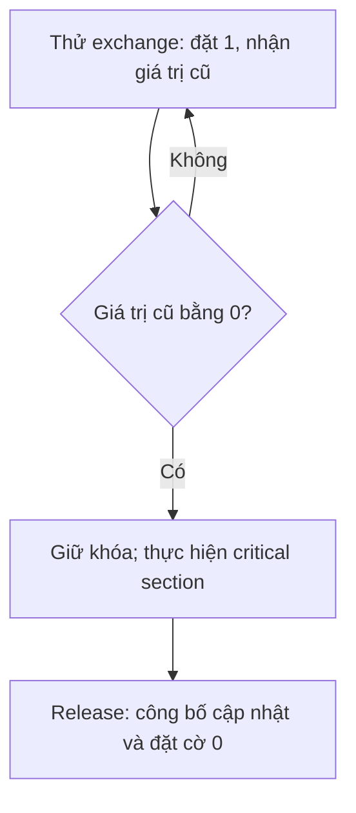
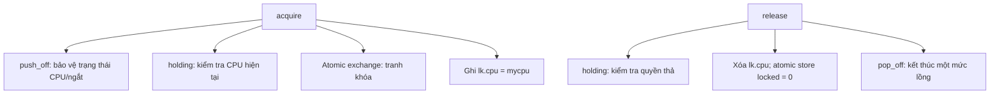
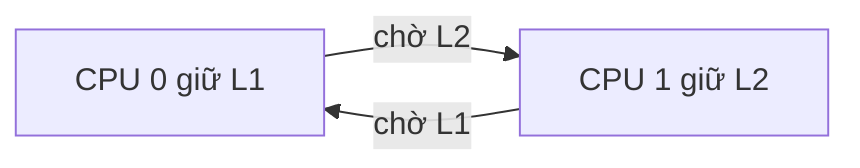

# Bài 2: Race condition, spinlock, CPU ID và trạng thái ngắt trong xv6

Ngày biên soạn và đối chiếu source: 15/10/2026.

Bài này tiếp nối [Bài 1: Bộ nhớ, con trỏ, struct và allocator trang](<01-baseline-va-kalloc.md>). Bài 1 giải thích một trang được lấy/trả ra sao; Bài 2 giải thích cách giữ những thao tác đó đúng khi có nhiều CPU hoặc một đoạn code bị ngắt giữa chừng.

Bạn tự thiết kế, tự viết và tự sửa toàn bộ C của bài tập/đề tài. Tài liệu có đoạn **mã đang có trong xv6 để đọc tham chiếu**, bảng mô phỏng và yêu cầu tự viết. Không có implementation đầy đủ của per-CPU allocator hoặc stealing để chép.

## 0. Mục tiêu, phạm vi và cách học

Cuối bài, bạn cần giải thích được:

- CPU/hart khác tiến trình, và concurrent khác parallel.
- Vì sao một phép cập nhật list gồm nhiều bước có thể bị xen kẽ.
- Shared data, invariant, critical section và mutual exclusion liên quan thế nào.
- Spinlock dùng atomic exchange để quyết định ai giữ khóa.
- Acquire/release memory ordering giúp công bố dữ liệu đúng thứ tự ra sao.
- Tắt ngắt ở CPU hiện tại khác giữ khóa dùng chung.
- push_off/pop_off giữ mức lồng và trạng thái ngắt ban đầu như thế nào.
- Vì sao phải ổn định CPU trước khi lấy cpuid để chọn dữ liệu theo CPU.
- Vì sao per-CPU lists vẫn cần đồng bộ và quy tắc chuyển ownership.

| Chặng | Đọc | Sản phẩm tự làm |
|---|---|---|
| A | Mục 1–3 | Phân biệt CPU/tiến trình; vẽ một race và vùng cần giữ khóa |
| B | Mục 4–6 | Theo dấu acquire/release; giải thích atomic và memory ordering |
| C | Mục 7–9 | Điền bảng noff/intena; tìm lỗi chọn CPU quá sớm |
| D | Mục 10–12 | Vẽ deadlock, đề xuất phạm vi khóa và ownership cho bài tiếp theo |
| E | Mục 13–14 | Tự viết bài quan sát nhỏ nếu môi trường sẵn sàng; tự kiểm tra hiểu |

Đọc hết bài để có bản đồ kiến thức. Khi viết C, vẫn làm từng bước và kiểm tra trước khi ghép. Các bảng diễn tiến là ví dụ suy luận, chưa phải log test đã chạy.

Bài này nghiên cứu và giải thích cơ chế xv6 hiện có. Thiết kế per-CPU ở mục 11 chỉ là hướng cho Lesson 3, chưa là chức năng đã triển khai.

## 1. CPU, hart, tiến trình và sự xen kẽ

### 1.1. CPU/hart là nơi thực thi

Trong bài này, CPU là đơn vị thực thi được xv6 nhận diện. RISC-V dùng từ **hart** cho một hardware thread. Với máy RISC-V mô phỏng đang xét, ta dùng nhãn CPU 0, CPU 1 để nói về các hart xv6 quản lý.

Mỗi hart có trạng thái thanh ghi riêng và có thể thực thi luồng lệnh riêng. Nhiều hart truy cập cùng RAM, nên việc “mỗi CPU có thanh ghi riêng” không làm dữ liệu kernel trong RAM tự tách thành nhiều bản sao.

```text
CPU 0: thanh ghi riêng ----+
                          +---- RAM dùng chung: kmem, free list...
CPU 1: thanh ghi riêng ----+
```

### 1.2. Tiến trình không phải CPU

Một tiến trình có trạng thái thực thi và tài nguyên riêng. Scheduler quyết định tiến trình nào chạy trên CPU nào.

Ví dụ:

```text
Thời điểm A: tiến trình P chạy trên CPU 0
Thời điểm B: P nhường CPU và chưa chạy
Thời điểm C: P được chạy lại trên CPU 1
```

P vẫn là tiến trình đó, nhưng CPU hiện tại đã đổi. Vì vậy PID, con trỏ struct proc và CPU ID không có cùng ý nghĩa.

| Thông tin | Đại diện cho gì? |
|---|---|
| PID | Danh tính tiến trình |
| struct proc * | Đối tượng quản lý tiến trình |
| CPU ID/hartid | CPU đang thực thi tại thời điểm lấy ID |
| struct cpu * | Dữ liệu trạng thái của một CPU cụ thể |

### 1.3. Concurrent và parallel

- **Concurrency:** nhiều hoạt động có thể xen kẽ nhau trong một khoảng thời gian.
- **Parallelism:** nhiều hoạt động thực sự thực thi đồng thời trên các CPU khác nhau.

Một CPU vẫn có concurrency: tiến trình đang chạy có thể bị timer interrupt, scheduler chuyển sang hoạt động khác; interrupt handler cũng là một đường thực thi có thể chạm dữ liệu kernel.

Nhiều CPU bổ sung khả năng các đoạn code truy cập RAM dùng chung song song. [MIT xv6 book, phần mở đầu chương Locking](https://mit-pdos.github.io/xv6-riscv-book/lock.html).

### 1.4. Vì sao allocator chịu ảnh hưởng?

Các đường kernel khác nhau đều có thể gọi kalloc/kfree:

- Tạo hoặc thay đổi bộ nhớ của tiến trình.
- Cấp page table.
- Quản lý kernel stack.
- Dùng/trả các buffer lấy từ tầng trang.

Không thể suy ra allocator chỉ được CPU 0 gọi vì CPU 0 thực hiện kinit. Khởi tạo pool và sử dụng pool là hai giai đoạn khác nhau.

**Tự kiểm tra:** một chương trình chạy với CPUS=1 có đủ để chứng minh allocator đúng khi CPUS=4 không? Dựa vào loại xen kẽ nào có thể xuất hiện.

## 2. Race condition: kết quả sai vì các bước bị xen kẽ

### 2.1. Một dòng C không nhất thiết là một thao tác không thể chia

Ví dụ khái niệm:

```c
so_lan = so_lan + 1;
```

Có thể tách ý nghĩa thành:

1. Đọc số hiện tại.
2. Tính số mới.
3. Ghi số mới.

Hai CPU cùng làm có thể cùng đọc giá trị cũ. Không được dùng ví dụ này để tự xây một shared counter không đồng bộ.

| Bước | CPU 0 | CPU 1 | Giá trị dùng chung |
|---|---|---|---:|
| 0 | | | 5 |
| 1 | Đọc 5 | | 5 |
| 2 | | Đọc 5 | 5 |
| 3 | Tính 6 | | 5 |
| 4 | | Tính 6 | 5 |
| 5 | Ghi 6 | | 6 |
| 6 | | Ghi 6 | 6 |

Hai lần tăng nhưng chỉ giữ được một lần: **lost update**.

Bảng là mô hình phân tích lỗi, không phải cam kết máy sẽ thực hiện đúng từng bước theo thứ tự đó. Trình biên dịch và phần cứng có thể tạo diễn tiến khác.

### 2.2. Race khi hai CPU cùng lấy trang

Bỏ qua khóa để suy luận, head ban đầu trỏ A:

```text
head -> A -> B -> C -> 0
```

| Bước | CPU 0 | CPU 1 | Head |
|---|---|---|---|
| 1 | Lưu địa chỉ A vào biến local r0 | | A |
| 2 | | Lưu địa chỉ A vào r1 | A |
| 3 | Chuyển head sang B | | B |
| 4 | | Chuyển head sang B | B |
| 5 | Giao A cho caller 0 | Giao A cho caller 1 | B |

Vấn đề không nằm ở phép sao chép pointer riêng lẻ. **Hai thao tác cấp phát đã cùng nhận ownership của A**.

### 2.3. Race khi hai CPU cùng trả hai trang khác nhau

Head ban đầu là C; CPU 0 trả A, CPU 1 trả B:

| Bước | CPU 0 | CPU 1 |
|---|---|---|
| 1 | A.next = C | |
| 2 | | B.next = C |
| 3 | head = A | |
| 4 | | head = B |

Kết quả nhìn từ head:

```text
head -> B -> C -> 0

A -> C -> 0, nhưng không còn đường từ head tới A
```

A có liên kết, nhưng allocator không tìm tới A được nữa. Pool mất một trang có thể sử dụng.

### 2.4. Race condition và data race

Race condition là khái niệm rộng: kết quả đúng/sai phụ thuộc một thứ tự xen kẽ chưa được kiểm soát.

Trong mô hình C, data race có các truy cập xung đột giữa thread: ít nhất một truy cập ghi, ít nhất một truy cập không atomic, và không có quan hệ đồng bộ happens-before cần thiết. Chương trình có data race gây undefined behavior. [WG14 N1570, §5.1.2.4](https://www.open-std.org/jtc1/sc22/wg14/www/docs/n1570.pdf).

Dự án vẫn dùng GNU99 như Makefile hiện tại. N1570 được dùng để đối chiếu thuật ngữ mô hình bộ nhớ; các thao tác thực tế của bài nằm trong builtin GNU và cơ chế xv6, không yêu cầu đổi chế độ C của dự án.

“Undefined behavior” không có nghĩa chỉ đôi lúc đếm sai một đơn vị. Không được dự đoán chính xác mọi hậu quả của một chương trình C có data race từ một bảng mô phỏng đơn giản.

Một chương trình dùng atomic cho từng lần đọc/ghi vẫn có thể sai logic nếu thao tác nhiều bước không được đồng bộ như một đơn vị. Ví dụ kiểm tra cờ đang 0, rồi đặt 1 bằng hai thao tác riêng, chưa đủ để chọn duy nhất một người giữ khóa.

### 2.5. Dấu hiệu khó tái hiện

Race có thể xuất hiện khi timing thay đổi. Chạy một lần không lỗi chưa chứng minh đúng. Thêm printk có thể làm các CPU bị chậm/đổi thứ tự, nên lỗi biến mất chỉ vì chèn log cũng chưa chứng minh đã sửa.

**Bài nhỏ A — tự vẽ:** dùng ví dụ hai CPU trả A/B, tự chọn một diễn tiến khác trong đó không mất trang. So sánh với diễn tiến lỗi và chỉ ra khoảng cần được bảo vệ chung.

## 3. Dữ liệu dùng chung, invariant và critical section

### 3.1. Xác định thứ cần bảo vệ trước khi chọn khóa

Trong allocator gốc:

| Thành phần | Vai trò | Vì sao cần xét đồng bộ? |
|---|---|---|
| kmem.freelist | Head của pool | Nhiều CPU cùng đọc/đổi head |
| next của các trang đang trong list | Liên kết | Caller có thể lấy trang và ghi đè nội dung |
| Biến r cục bộ | Pointer riêng của lời gọi | Bản thân biến local không chia sẻ; dữ liệu nó trỏ tới có thể chia sẻ |
| Nội dung trang đã cấp riêng | Dữ liệu caller | Lifetime/ownership quyết định khi nào được dùng |

Local pointer không làm vùng đích trở thành private. Đặt r trong stack vẫn có thể dẫn tới việc dereference một node mà CPU khác vừa lấy khỏi list.

### 3.2. Invariant nhắc lại từ Lesson 1

Ở trạng thái ổn định:

- Mỗi trang trống thuộc list đúng một lần.
- List không có vòng và các liên kết trỏ tới trang hợp lệ.
- Trang đã cấp cho caller không còn là trang trống.
- Mọi bên thay/quan sát cấu trúc chung tuân thủ cùng quy tắc đồng bộ.

Trong một thao tác, dữ liệu có thể đang ở bước trung gian. Bên khác không được dựa vào trạng thái nửa cập nhật đó để thực hiện thao tác của mình.

### 3.3. Critical section là vùng thao tác cần đi cùng nhau

Với pop của kalloc, critical section gồm ít nhất:

```text
Đọc head
Kiểm tra có node
Đọc next cần dùng
Cập nhật head nếu có trang
```

Với push của kfree:

```text
Gắn next của trang trả vào head hiện tại
Đặt head thành trang trả
```

Nếu khóa từng phép gán rồi thả giữa chúng, thao tác tổng thể vẫn có thể bị xen kẽ sai.

### 3.4. Mutual exclusion không có nghĩa “dừng cả hệ thống”

Mutual exclusion: tại một thời điểm, chỉ một CPU giữ **cùng một khóa**.

CPU giữ kmem.lock không ngăn CPU khác chạy code không liên quan, dùng một khóa khác, hoặc đọc dữ liệu mà nó không có quyền truy cập theo quy tắc của allocator. Lock có hiệu lực vì mọi đường truy cập tài nguyên được bảo vệ đều tuân thủ nó.

Một CPU trực tiếp sửa freelist mà bỏ qua acquire vẫn có thể phá list. Spinlock không đặt một hàng rào phần cứng làm RAM trở thành vùng không thể truy cập.

### 3.5. Phạm vi khóa phải vừa đủ

Trong kalloc, trang bị tách khỏi list trong vùng giữ khóa, rồi được ghi mẫu debug ngoài vùng đó.

Trong kfree, caller đã có quyền trả trang; ghi mẫu debug và chuẩn bị pointer xảy ra trước khi nối vào list dưới khóa.

Điểm mấu chốt là **khi nào trang chuyển giữa trạng thái dùng chung và ownership riêng**, không phải cố giữ khóa quanh mọi dòng.

Hàm đếm chỉ đọc nhưng cần bảo vệ thời gian duyệt vì các node có thể bị lấy khỏi list. Lock của snapshot bảo vệ cấu trúc tại lúc quan sát, không giữ nguyên số trang sau khi hàm trả về.

**Bài nhỏ B — tự đánh dấu:** mở kalloc.c, ghi lại dòng bắt đầu/kết thúc critical section của kalloc và kfree. Giải thích một thao tác ở ngoài khóa tại mỗi hàm vì sao được đặt ở đó.

## 4. Spinlock và atomic exchange

### 4.1. Đọc struct spinlock

Mở [spinlock.h](<../../kernel/spinlock.h>):

```c
struct spinlock {
  uint locked;
  char *name;
  struct cpu *cpu;
};
```

| Trường | Ý nghĩa trong source |
|---|---|
| locked | Cờ khóa: 0 chưa giữ, 1 đã giữ |
| name | Tên phục vụ nhận diện/debug |
| cpu | Pointer tới struct cpu của CPU giữ khóa, phục vụ kiểm tra/debug |

cpu là pointer, không phải số CPU ID. Gán `lk->cpu = 0` là đặt pointer rỗng, không có nghĩa CPU 0 đang giữ khóa. Pointer tới CPU 0 sẽ là địa chỉ phần tử cpus[0].

Trường cpu không thay thế locked và thao tác atomic để quyết định người thắng.

### 4.2. Initlock chỉ khởi tạo đối tượng khóa

Mở [initlock](<../../kernel/spinlock.c#L12>). Source gán tên, đặt locked = 0 và cpu = 0.

Initlock không giữ khóa. Nó cần được gọi trước khi đối tượng khóa được các CPU dùng. Không khởi tạo lại một khóa đang có người giữ/chờ; làm vậy phá trạng thái quản lý.

Kinit gọi initlock(&kmem.lock, "kmem") trước khi xây list. Các tên hàm init/acquire/release có trách nhiệm khác nhau.

### 4.3. Spin nghĩa là chờ bằng vòng lặp

Source acquire có đoạn:

```c
while (__atomic_exchange_n(&lk->locked, 1, __ATOMIC_ACQUIRE) != 0)
  ;
```

Dấu ; ở dòng dưới là thân rỗng của while. CPU tiếp tục thử lấy khóa, không tự sleep để nhường CPU như một sleep lock.

| Giá trị cũ mà exchange trả về | Đã ghi gì vào locked? | Cách xử lý |
|---:|---:|---|
| 0 | 1 | Lấy khóa thành công, thoát vòng |
| 1 | 1 | Khóa đã có người giữ, tiếp tục thử |

Đọc “giá trị cũ” là điều quan trọng. Khi thắng, CPU đã đặt cờ thành 1, dù kết quả trả về từ exchange là 0.

### 4.4. Atomic exchange gộp đọc và ghi

Với lời gọi trên, ba đối số mang ý nghĩa:

1. Địa chỉ của cờ khóa.
2. Giá trị mới muốn đặt: 1.
3. Memory order: acquire.

Builtin thực hiện atomic exchange và trả giá trị trước đó. [GCC: __atomic builtins](https://gcc.gnu.org/onlinedocs/gcc/_005f_005fatomic-Builtins.html).

Nếu hai CPU tranh cùng cờ đang 0, một exchange đi trước đổi cờ thành 1 và nhận 0; exchange tiếp theo nhận 1. Không có khoảng trống giữa “thấy 0” và “chiếm khóa” để cả hai cùng thắng.



Sơ đồ mô tả vòng thử, không cam kết người chờ lâu nhất sẽ được lấy khóa tiếp theo. Spinlock baseline không cung cấp một hàng đợi FIFO trong source này.

### 4.5. Atomic của cờ không làm mọi thao tác list tự atomic

Next, head và ownership vẫn cần được cập nhật trong vùng giữ khóa. Chỉ thay head thành “pointer atomic” không tự bảo đảm thao tác pop nhiều bước an toàn về lifetime.

Bài này dùng spinlock xv6 có sẵn. Không cần tự viết khóa mới, lock-free stack hoặc ABA handling trước khi hiểu thiết kế hiện tại.

**Tự kiểm tra:** vì sao đoạn “đọc locked, thấy 0, rồi gán locked = 1” khác atomic exchange, kể cả khi từng lần đọc/ghi không bị xé nhỏ?

## 5. Theo dấu acquire, release và holding trong source

### 5.1. Bản đồ lời gọi



Đây là các công việc của hàm; thứ tự được diễn giải dưới đây. Mục 7–9 sẽ mở phần CPU/ngắt.

### 5.2. Acquire làm bốn việc theo thứ tự

Mở [acquire, dòng 22](<../../kernel/spinlock.c#L22>):

1. Gọi push_off trước khi chạm trạng thái CPU/ownership.
2. Nếu holding(lk) đúng thì panic: CPU này đang giữ chính khóa đó.
3. Dùng vòng atomic exchange chờ đến khi chiếm được cờ.
4. Ghi lk->cpu bằng pointer tới CPU hiện tại.

Chờ khóa cũng nằm trong vùng ngắt tắt. Nếu gọi push_off sau khi đã tranh khóa thì có thể tạo khoảng nguy hiểm trước khi ngăn interrupt handler cùng CPU đi vào đường dùng khóa đó.

### 5.3. Holding kiểm tra CPU, không nhận PID

Mở [holding](<../../kernel/spinlock.c#L81>):

```c
r = (lk->locked && lk->cpu == mycpu());
```

- && yêu cầu cả hai điều kiện đúng.
- Khóa đang được giữ.
- CPU giữ được ghi nhận chính là CPU hiện tại.

Điều kiện gọi holding là ngắt đã tắt, vì nó dùng mycpu. Source acquire/release gọi nó trong vùng đã được bảo vệ.

Holding phục vụ kiểm tra/debug; không dùng nó như phép “kiểm tra rồi tranh khóa” để thay acquire. CPU khác có thể thay trạng thái ngay sau một phép kiểm tra không sở hữu khóa.

### 5.4. Khóa này không reentrant

Reentrant lock cho phép một người giữ lấy lại chính khóa đó theo cơ chế đếm mức lồng. Spinlock xv6 này không cung cấp cơ chế đó: acquire kiểm tra holding và panic khi lấy lại cùng khóa.

Cần phân biệt:

- **Lồng push_off:** được hỗ trợ bằng noff.
- **Lấy hai khóa khác nhau:** có thể xảy ra, cần thứ tự khóa đúng.
- **Lấy lại cùng spinlock:** source này từ chối.

### 5.5. Release phải thả khóa đúng quyền

Mở [release, dòng 46](<../../kernel/spinlock.c#L46>):

1. Kiểm tra holding(lk); sai thì panic.
2. Đặt lk->cpu thành pointer rỗng.
3. Atomic store đặt locked thành 0 với release ordering.
4. Gọi pop_off.

Đoạn store gốc:

```c
__atomic_store_n(&lk->locked, 0, __ATOMIC_RELEASE);
```

Không tự thay thành phép gán thông thường chỉ vì “cả hai đều ghi số 0”. Source cần cả cách cập nhật cờ và thứ tự quan sát dữ liệu giữa các CPU.

### 5.6. Hai quy tắc khác nhau

| Quy tắc | Tránh lỗi gì? |
|---|---|
| Acquire/release cùng khóa bảo vệ list | CPU khác quan sát/sửa list xen kẽ sai |
| Push_off/pop_off trên CPU hiện tại | Ngắt cùng CPU và việc dùng trạng thái CPU không ổn định |

Release không phải intr_on vô điều kiện. Nó hoàn tất một mức lồng và chỉ khôi phục ngắt khi điều kiện của pop_off cho phép.

**Bài nhỏ C — tự theo dấu:** khởi đầu locked = 0. CPU 0 acquire thành công, CPU 1 thử lấy, CPU 0 release, CPU 1 thử lại. Ghi giá trị cũ của từng exchange, cờ sau thao tác và CPU nào được vào critical section.

## 6. Memory ordering và vì sao volatile không thay khóa

### 6.1. Đúng người giữ khóa vẫn cần đúng thứ tự dữ liệu

Hình dung CPU 0 nối một node mới:

```text
Chuẩn bị node.next
Công bố head trỏ node
Thả khóa
```

CPU 1 lấy cùng khóa sau đó cần quan sát node và next đã được chuẩn bị. Nếu việc công bố/thả khóa có thể vượt trước các ghi dữ liệu cần thiết, CPU 1 có thể thấy trạng thái chưa hoàn chỉnh.

Ở đây “công bố” nghĩa là làm reference tới đối tượng trở thành phần của trạng thái dùng chung, không phải in lên màn hình.

### 6.2. Acquire/release thiết lập quan hệ quan sát

- Release ordering ràng buộc các truy cập cần công bố trước thao tác thả khóa.
- Acquire ordering ở lần lấy khóa thành công ràng buộc các truy cập sau khi đã có khóa.
- Khi lần acquire phù hợp quan sát trạng thái được release trước đó công bố, các cập nhật được nối theo quan hệ đồng bộ.

Đây là điều cần hiểu về __ATOMIC_ACQUIRE/__ATOMIC_RELEASE trong builtin của source. Không có nghĩa CPU xóa mọi cache hoặc đồng bộ mọi biến không liên quan trong chương trình. [GCC: các memory order](https://gcc.gnu.org/onlinedocs/gcc/_005f_005fatomic-Builtins.html).

```text
CPU 0                              CPU 1
Giữ khóa
Ghi node.next
Ghi head
Release cùng khóa  ------------->  Acquire cùng khóa thành công
                                   Đọc head và node.next theo giao thức
```

Bạn chưa cần tự đặt fence hoặc đọc toàn bộ mô hình bộ nhớ RISC-V để sử dụng spinlock xv6 đúng cách. Cần biết vì sao không tùy tiện thay builtin/cờ ordering.

### 6.3. Volatile có nhiệm vụ khác

Volatile ràng buộc một số cách compiler thực hiện truy cập vào đối tượng volatile. Nó không cung cấp mutual exclusion và không thay memory barrier cho dữ liệu thông thường. [GCC: Volatiles](https://gcc.gnu.org/onlinedocs/gcc/Volatiles.html).

Hai CPU vẫn có thể cùng đọc giá trị cũ của một volatile counter rồi ghi đè kết quả của nhau. Đánh dấu head volatile cũng không biến thao tác pop thành một giao dịch an toàn.

### 6.4. Một ví dụ thật từ main.c

Mở [main.c](<../../kernel/main.c#L7>): source có biến started được đánh dấu volatile, nhưng CPU khởi tạo công bố bằng atomic store release và CPU khác chờ bằng atomic load acquire.

Điều giúp đồng bộ bước khởi tạo là giao thức atomic/order thực sự trong code. Không được bỏ hai thao tác atomic vì thấy biến đã có chữ volatile.

**Tự kiểm tra:** mutual exclusion giải quyết “ai đang thao tác”; memory ordering giải quyết “các thao tác được quan sát ra sao”. Hãy tự diễn giải mỗi vai trò bằng ví dụ head/next.

## 7. Ngắt: tắt ở đâu, bảo vệ khỏi điều gì?

### 7.1. Timer interrupt có thể đổi đường thực thi

Interrupt là sự kiện khiến CPU chuyển tới đường xử lý phù hợp. Timer interrupt giúp hệ điều hành có cơ hội điều phối tiến trình.

Trong [kerneltrap](<../../kernel/trap.c#L137>), khi xác định timer interrupt và đang có tiến trình, source có đường gọi yield. Xem đoạn này để nối interrupt với scheduler; chưa cần học toàn bộ trap assembly.

Ví dụ:

```text
Tiến trình P đang chạy trong kernel trên CPU 0
Timer interrupt
Kernel xử lý rồi có thể yield
Scheduler chạy hoạt động khác
P được chạy lại, có thể ở CPU khác
```

### 7.2. Tắt ngắt không làm CPU khác ngừng chạy

Intr_off thay trạng thái nhận ngắt supervisor trên hart hiện tại. CPU 1 vẫn có thể chạy và sửa RAM dùng chung khi CPU 0 tắt ngắt.

| Cơ chế | Phạm vi tác động chính trong bài |
|---|---|
| Tắt ngắt CPU hiện tại | Ngăn đường ngắt tương ứng xen vào CPU đó |
| Giữ spinlock | Loại trừ các CPU khác cũng tranh cùng khóa |
| Cả hai trong acquire | Bảo vệ phối hợp dữ liệu chung và ngữ cảnh CPU |

Tắt ngắt không ngăn mọi exception, không làm đoạn C tự atomic trên nhiều CPU, và không cho phép bạn chủ động sleep/yield trong đoạn allocator cần giữ CPU ổn định.

### 7.3. Vì sao cùng một CPU cũng có nguy cơ?

Mô hình lỗi giả sử đang giữ khóa L nhưng vẫn cho đường interrupt dùng cùng L:

```text
Code thường giữ L
    -> bị ngắt
        -> handler muốn lấy L
            -> code bị ngắt chưa được chạy tiếp để thả L
```

Nếu handler chờ khóa, đường thả khóa không tiến triển. Với cơ chế holding của xv6, việc lấy lại khóa cùng CPU còn có thể bị phát hiện và panic trước vòng chờ.

Ví dụ là cách hiểu lý do tắt ngắt, không khẳng định interrupt handler hiện tại của BTL luôn gọi allocator. Quan hệ “hai đường cùng dùng một lock” mới tạo yêu cầu đó.

### 7.4. Đọc sstatus và SSTATUS_SIE

Mở [riscv.h, dòng 47](<../../kernel/riscv.h#L47>):

```c
#define SSTATUS_SIE (1L << 1)
```

- sstatus là thanh ghi trạng thái supervisor.
- SIE là bit bật ngắt supervisor trong ngữ cảnh đang xét.
- 1L << 1 tạo mask có bit số 1 bật, giá trị 2.

Intr_get đọc sstatus rồi kiểm tra bit SIE, trả 0 hoặc 1. Intr_off xóa bit đó; intr_on đặt bit đó. Đây là wrapper trong source, không phải một biến global điều khiển đồng thời mọi CPU. [RISC-V ISA: supervisor status](https://github.com/riscv/riscv-isa-manual/blob/main/src/priv/supervisor.adoc).

### 7.5. Rc_sstatus đọc trạng thái cũ và xóa bit

Bản BTL có wrapper [rc_sstatus](<../../kernel/riscv.h#L77>) dùng lệnh CSRRC.

Với rc_sstatus(SSTATUS_SIE), ý nghĩa cần dùng là:

1. Lấy giá trị sstatus trước thao tác.
2. Xóa bit SIE của hart hiện tại.
3. Trả trạng thái cũ để caller biết trước đó ngắt có bật không.

CSRRC là thao tác đọc rồi xóa các bit CSR theo mask; nó không tranh một lock trong RAM với CPU khác. [RISC-V ISA: Zicsr](https://github.com/riscv/riscv-isa-manual/blob/main/src/unpriv/zicsr.adoc).

Một số bản xv6/tài liệu cũ viết push_off bằng intr_get rồi intr_off. Bài này theo wrapper đọc/xóa thực tế đang có trong BTL, không chép nguyên phiên bản khác.

**Tự kiểm tra:** sau khi rc_sstatus trả flags, flags chứa trạng thái trước hay sau khi SIE bị xóa? Vì sao biết trạng thái trước lại cần cho việc khôi phục?


## 8. Push_off/pop_off: mức lồng và khôi phục đúng trạng thái

### 8.1. Hai trường trong struct cpu

Mở [proc.h, dòng 22](<../../kernel/proc.h#L22>):

| Trường | Vai trò trong đoạn allocator ngắn của bài |
|---|---|
| proc | Pointer tới tiến trình đang chạy trên CPU, có thể rỗng |
| context | Context để trở về scheduler của CPU |
| noff | Số mức push_off chưa được pop_off tương ứng |
| intena | Trạng thái ngắt được lưu khi đi vào mức ngoài cùng |

Noff là **độ sâu bảo vệ ngắt**, không phải luôn bằng số khóa đang giữ. Bạn có thể gọi push_off để bảo vệ CPU ID mà không lấy spinlock nào.

Trạng thái noff/intena được lưu theo struct cpu. Ở các đường scheduler/context switch, source có xử lý riêng để giữ trạng thái của kernel thread; bài allocator này không chủ động chuyển context trong vùng được bảo vệ.

### 8.2. Đọc từng phần push_off

Mở [push_off, dòng 93](<../../kernel/spinlock.c#L93>). Các dòng gốc:

```c
uint64 flags = rc_sstatus(SSTATUS_SIE);
int old = !!(flags & SSTATUS_SIE);
```

Dòng đầu vừa tắt ngắt vừa nhận flags cũ. Dòng thứ hai chuyển bit được mask thành số 0 hoặc 1:

- flags & mask khác 0 nếu SIE trước đó bật.
- Một dấu ! đổi thành giá trị phủ định logic.
- Hai dấu !! chuẩn hóa lại thành 0/1 đúng ý nghĩa ban đầu.

Nếu bit mask có giá trị 2, old cần là 1 để biểu diễn “đã bật”, không cần giữ nguyên số 2.

Phần gốc tiếp theo:

```c
if (mycpu()->noff == 0)
  mycpu()->intena = old;
mycpu()->noff += 1;
```

Chỉ khi bước vào **mức ngoài cùng**, source mới lưu trạng thái ngắt ban đầu. Các lần lồng tiếp theo không được ghi đè thông tin đó bằng trạng thái “đã tắt” mà lần push trước tạo ra.

Mycpu chỉ được dùng sau khi SIE đã tắt. Đây là thứ tự có ý nghĩa, không phải các dòng có thể đổi chỗ tùy ý.

### 8.3. Một guard chưa phải một khóa

```text
push_off
    vùng cần CPU/ngắt ổn định
pop_off
```

“Guard” ở đây chỉ là cách gọi đoạn bảo vệ có mở/đóng tương ứng. Nó không tạo ra class hoặc thư viện bổ sung.

Chỉ dùng cặp này chưa bảo vệ được free list khỏi CPU khác. Nếu đoạn còn chạm dữ liệu chung, vẫn cần khóa phù hợp.

### 8.4. Đọc pop_off theo thứ tự kiểm tra

Mở [pop_off, dòng 106](<../../kernel/spinlock.c#L106>):

1. Lấy struct cpu hiện tại; ngắt phải đang tắt.
2. Nếu intr_get cho thấy ngắt bật, panic.
3. Nếu noff nhỏ hơn 1, panic vì không có mức hợp lệ để đóng.
4. Giảm noff một mức.
5. Nếu đã về mức 0 và intena cho biết ngắt ban đầu bật, gọi intr_on.

Các dòng cuối gốc:

```c
c->noff -= 1;
if (c->noff == 0 && c->intena)
  intr_on();
```

Bỏ bớt pop làm vùng bảo vệ không kết thúc đúng. Pop thừa hoặc tự bật ngắt giữa vùng được bảo vệ cũng làm sai hợp đồng và có thể bị panic.

### 8.5. Tình huống 1: ngắt ban đầu bật, có hai mức lồng

Giả sử không có context switch/chuyển CPU chủ động trong chuỗi:

| Bước | Ngắt hiện tại | noff | intena được lưu |
|---|---:|---:|---|
| Ban đầu | 1 | 0 | Chưa dùng ở chuỗi này |
| push_off lần 1 | 0 | 1 | 1 |
| push_off lần 2 | 0 | 2 | 1 |
| pop_off lần 1 | 0 | 1 | 1 |
| pop_off lần 2 | 1 | 0 | 1 |

Lần push thứ hai thấy ngắt đang tắt, nhưng không đổi intena thành 0. Nếu đổi, lần pop ngoài cùng sẽ quên rằng ban đầu cần khôi phục trạng thái bật.

### 8.6. Tình huống 2: ngắt ban đầu đã tắt

| Bước | Ngắt hiện tại | noff | intena được lưu |
|---|---:|---:|---|
| Ban đầu | 0 | 0 | Chưa dùng ở chuỗi này |
| push_off lần 1 | 0 | 1 | 0 |
| push_off lần 2 | 0 | 2 | 0 |
| pop_off lần 1 | 0 | 1 | 0 |
| pop_off lần 2 | 0 | 0 | 0 |

Kết thúc chuỗi vẫn tắt. Đây là lý do không thay pop_off bằng intr_on: caller có thể đã tắt ngắt trước khi gọi bạn.

### 8.7. Tình huống 3: acquire lồng bên trong guard ngoài

Acquire tự gọi push_off. Release tự gọi pop_off. Nếu bạn đã có một mức bên ngoài:

| Bước | Ngắt nếu ban đầu bật | noff |
|---|---:|---:|
| Ban đầu | 1 | 0 |
| Mở guard ngoài bằng push_off | 0 | 1 |
| Acquire một spinlock | 0 | 2 |
| Release spinlock đó | 0 | 1 |
| Đóng guard ngoài bằng pop_off | 1 | 0 |

Thả khóa bên trong chưa kết thúc việc bảo vệ CPU của guard ngoài.

Tương tự, giữ hai khóa **khác nhau** có thể tạo hai mức noff. Điều này không làm việc giữ nhiều khóa tự an toàn về deadlock; cần thêm quy tắc thứ tự ở mục 10.

### 8.8. Ba cặp khác nhau

| Cặp | Nhiệm vụ |
|---|---|
| intr_off/intr_on | Thay bit ngắt trực tiếp, không tự lưu mức lồng/noff |
| push_off/pop_off | Bảo vệ ngắt có mức lồng và lưu trạng thái ban đầu |
| acquire/release | Đồng bộ spinlock, đồng thời gọi push_off/pop_off |

Mỗi acquire đã có một push. Bạn không tự thêm pop chỉ vì thấy ngắt đang tắt; phải đóng đúng mức mà code của mình đã mở.

**Bài nhỏ D — tự điền:** ban đầu ngắt bật, noff = 0. Chuỗi là push_off ngoài → acquire L1 → acquire L2 → release L2 → release L1 → pop_off ngoài. L1 và L2 là hai khóa khác nhau, giả sử lấy được đúng thứ tự. Ghi noff, intena và trạng thái ngắt sau mỗi bước. Làm lại với ngắt ban đầu tắt.

## 9. CPU ID, mycpu và khoảng bảo vệ trước khi chọn pool

### 9.1. Cpu ID được lấy từ đâu?

Mở [start.c, dòng 48](<../../kernel/start.c#L48>): boot đọc hartid và ghi vào thanh ghi tp của hart.

Trong kernel, [r_tp ở riscv.h](<../../kernel/riscv.h#L341>) đọc tp. [Cpuid ở proc.c](<../../kernel/proc.c#L65>) lấy giá trị đó làm ID.

```text
Boot của hart
  -> đặt tp
  -> kernel đọc r_tp
  -> cpuid
  -> chọn phần tử cpus[id]
```

Tp của kernel được xv6 quản lý khi đi qua user/kernel; không được tự dùng tp làm biến tạm cho bài tập. Chưa cần viết assembly để đọc CPU ID: source đã cung cấp wrapper.

### 9.2. Mycpu chọn phần tử theo ID hiện tại

Đoạn gốc ở [proc.c, dòng 74](<../../kernel/proc.c#L74>):

```c
int id = cpuid();
struct cpu *c = &cpus[id];
return c;
```

Cpus là mảng struct cpu được định nghĩa trong proc.c, công bố extern trong proc.h. Mycpu trả địa chỉ phần tử của CPU đang chạy.

Điều kiện dùng cpuid/mycpu trong source: ngắt đã tắt, để giá trị “CPU hiện tại” không bị lỗi thời do timer khiến tiến trình chuyển CPU. [MIT xv6 book, mục 8.5](https://mit-pdos.github.io/xv6-riscv-book/sched.html#code-mycpu-and-myproc).

### 9.3. Một ID đã lưu không tự cập nhật

Mô hình lỗi:

| Bước | Diễn tiến |
|---|---|
| 1 | P chạy trên CPU 0, lưu id = 0 khi ngắt còn bật |
| 2 | Timer interrupt, P yield |
| 3 | P được chạy tiếp trên CPU 1 |
| 4 | Biến id vẫn giữ số 0 |
| 5 | Code dùng id như thể nó vẫn chỉ CPU hiện tại |

Con số vẫn là một CPU ID tồn tại, nhưng không còn là CPU hiện tại.

Nếu dùng ID đó để chọn một pool dùng chung có khóa đúng, chưa đủ để kết luận ngay rằng cấp trùng trang đã xảy ra. Tuy nhiên, code đã vi phạm điều kiện gọi cpuid và giả định “đang thao tác local CPU”; các trạng thái theo CPU có thể bị dùng sai.

### 9.4. Acquire không bảo vệ được phần xảy ra trước lời gọi

Ví dụ **thiết kế giả định chưa có trong source**, dùng pool như một mảng theo CPU:

```c
int id = cpuid();
acquire(&pool[id].lock);
```

Hai dòng này không tự chứng minh CPU ID ổn định. Acquire chỉ tắt ngắt khi đã vào hàm, trong khi cpuid và phép chọn đối số đã xảy ra trước đó.

Tương tự, cpuid nằm trong biểu thức đối số của acquire vẫn được tính trước phần thân acquire. Không thể dựa vào push_off của acquire để bảo vệ “ngược về trước”.

Không thêm đoạn giả định này vào kernel; pool chưa được tạo ở Lesson 2.

### 9.5. Trình tự thiết kế cần đạt

Khi thật sự cần ID của CPU hiện tại để chọn local pool:

1. Đi vào khoảng bảo vệ CPU/ngắt trước.
2. Lấy ID bên trong khoảng đó.
3. Chọn cấu trúc local tương ứng.
4. Lấy/thả khóa bảo vệ cấu trúc nếu thao tác dữ liệu dùng chung.
5. Hoàn tất mọi việc còn dựa trên “CPU hiện tại”.
6. Đóng khoảng bảo vệ ngoài đúng cặp.

Ở bước lấy khóa, acquire có thể tạo thêm một mức noff. Bảng mục 8.7 giải thích vì sao release không bật ngắt quá sớm.

Nếu ngắt đã tắt sẵn, một số đường boot/trap có thể gọi cpuid không kèm push ngay trước đó. Phải đọc điều kiện entry của đường đó; không lấy ví dụ boot làm bằng chứng rằng cpuid gọi ở mọi nơi đều an toàn.

### 9.6. Đọc myproc để thấy một mẫu lấy snapshot

Mở [myproc](<../../kernel/proc.c#L83>). Source:

- Mở guard.
- Lấy mycpu.
- Lấy c->proc vào biến local.
- Đóng guard.
- Trả pointer tiến trình.

Pointer tiến trình đại diện cho P đang chạy, nên việc P sau đó chuyển CPU không làm nó trở thành pointer của CPU mới. Nhưng pointer từ mycpu được hiểu là dữ liệu của một CPU cụ thể; không giữ nó ngoài guard rồi tiếp tục giả định đó luôn là CPU hiện tại.

Bạn vẫn phải tôn trọng lifetime của đối tượng khi dùng các pointer. Migration và lifetime là hai vấn đề riêng.

### 9.7. Snapshot sau guard phải được gọi đúng ý nghĩa

Nếu ghi lại id/noff vào các biến số trong guard rồi in sau khi đóng guard, các số đó là **snapshot lúc ghi nhận**. Lúc in, tiến trình có thể đã chuyển CPU.

Không gọi một ID snapshot là “CPU đang chạy tại thời điểm in” khi chưa lấy/bảo vệ lại thông tin đó. Đặt nhãn log theo thời điểm quan sát.

**Bài nhỏ E — tự phân tích:** sửa thứ tự thiết kế của ví dụ chọn pool ở mục 9.4 bằng danh sách bước hoặc pseudocode của bạn. Chỉ rõ guard ngoài bảo vệ điều gì, khóa pool bảo vệ điều gì. Chưa viết per-CPU kalloc/kfree.

## 10. Deadlock, thứ tự khóa và giới hạn của spinlock

### 10.1. Deadlock khác chờ khóa bình thường

Chờ khóa bình thường: CPU giữ khóa vẫn có thể tiến triển và thả nó.

Deadlock: một vòng phụ thuộc khiến các bên đều chờ việc mà một bên đang chờ khác phải làm.

Với hai khóa L1/L2:

| CPU 0 | CPU 1 |
|---|---|
| Giữ L1 | Giữ L2 |
| Chờ L2 | Chờ L1 |



Không CPU nào đến được bước thả khóa đang giữ. Tắt ngắt không phá vòng chờ giữa hai CPU.

### 10.2. Một thứ tự khóa thống nhất

Nếu thiết kế bắt buộc giữ đồng thời nhiều khóa, mọi đường liên quan phải theo thứ tự thống nhất, chẳng hạn L1 trước L2. Không chỉ một hàm theo thứ tự trong khi helper/caller lại lấy ngược.

Một thứ tự toàn cục chỉ xử lý lớp lỗi vòng thứ tự khóa tương ứng; không bảo đảm mọi vấn đề lifetime, self-deadlock hoặc chờ tài nguyên khác tự biến mất.

Trong source xv6 có chú thích wait_lock phải được acquire trước p->lock ở proc.c. Đọc để thấy lock order là một phần hợp đồng của hệ thống, không nhất thiết là cơ chế compiler tự kiểm tra.

### 10.3. Hướng stealing một khóa mỗi lần sẽ được học sau

Trong thiết kế đơn giản cho bài stealing, có thể tránh giữ khóa local và donor cùng lúc: tách trang khỏi donor dưới khóa donor, rồi quản lý trang đã tách theo ownership riêng trước khi giao/gắn ở nơi mới.

Đây mới là hướng thiết kế, chưa phải thuật toán đã viết. Cần nêu rõ trạng thái **đang chuyển** để trang không mất khỏi hệ thống dù nó tạm thời không nằm trong free list nào.

Lesson 4 sẽ cụ thể hóa cách chuyển trang, OOM và tránh giữ hai khóa. Bài này chỉ đặt câu hỏi ownership và thứ tự cần giải quyết.

### 10.4. Không sleep/yield trong critical section allocator

Khi giữ spinlock allocator, không thêm sleep, yield hoặc chờ I/O để “giảm bận” hay “đợi có trang”. Những thao tác đó có thể nhường CPU trong khi người khác vẫn cần khóa bạn giữ.

Scheduler của xv6 có giao thức riêng quanh p->lock và context switch. Không lấy ngoại lệ/giao thức đó áp dụng tùy ý cho kmem.lock.

### 10.5. Spinlock và sleep lock khác nhau

| Đặc điểm | Spinlock allocator | Sleep lock cho thao tác dài |
|---|---|---|
| Khi không lấy được | Thử/chờ bằng vòng spin | Có cơ chế ngủ/chờ được đánh thức |
| Trạng thái ngắt | Acquire tạo mức ngắt tắt | Có giao thức khác, không giữ ngắt tắt suốt thời gian sở hữu như spinlock |
| Phù hợp | Đoạn ngắn bảo vệ trạng thái chung | Một số thao tác dài có thể chờ |
| Trong interrupt handler | Cần đúng quy tắc và đoạn ngắn | Không dùng đường ngủ tùy ý |
| Có thể thay cho nhau bằng đổi tên hàm? | Không | Không |

Source BTL có [sleeplock.c](<../../kernel/sleeplock.c>), dùng sleep_prepare rồi sleep theo API hiện tại. Không chép mẫu sleep(chan, lock) từ bản xv6 khác vào bài này.

### 10.6. Log có thể làm thay đổi vấn đề đang đo

Printk dùng khóa riêng và I/O console. Gọi nó trong mỗi vòng chờ/cấp phát:

- Làm đổi timing.
- Tăng thời gian ở trong đường đồng bộ.
- Có thể tạo phụ thuộc khóa bổ sung.
- Làm kết quả benchmark chịu ảnh hưởng của console.

Với số liệu đơn giản, ghi nhận dưới cơ chế bảo vệ phù hợp, rồi thả khóa và in snapshot. Không khẳng định mọi printk trong mọi vùng giữ khóa đều deadlock; cần xét cụ thể thứ tự và đường gọi.

**Bài nhỏ F — tự vẽ:** vẽ hai CPU lấy L1/L2 theo thứ tự ngược và chỉ ra vòng chờ. Sau đó nêu hai hướng tránh vòng này: thứ tự thống nhất, hoặc thiết kế không giữ đồng thời hai khóa. Ghi điều kiện ownership cần giữ với hướng thứ hai.

## 11. Liên hệ đề tài: tại sao cần per-CPU free lists?

### 11.1. Điểm nghẽn của baseline

Hiện BTL có một free list và một kmem.lock. Dù CPU 0 và CPU 1 muốn lấy hai trang khác nhau, cả hai vẫn tranh cùng điểm vào danh sách.

```text
CPU 0 ----+
CPU 1 ----+----> kmem.lock ----> free list chung
CPU 2 ----+
CPU 3 ----+
```

Khóa giúp đúng, nhưng thao tác được serialize qua cùng critical section. Contention là mức tranh chấp khi nhiều bên muốn tài nguyên/khóa cùng lúc. Chờ khóa có thể giảm lợi ích của nhiều CPU.

Đây là lý do nghiên cứu thay thiết kế, không phải lý do xóa khóa khỏi baseline.

### 11.2. Hướng per-CPU

Thiết kế cho bài sau:

```text
CPU 0 -> pool 0: lock 0 + list 0
CPU 1 -> pool 1: lock 1 + list 1
CPU 2 -> pool 2: lock 2 + list 2
```

Local path có thể tránh tranh một khóa chung khi các CPU dùng pool khác nhau. Đây là kỳ vọng thiết kế; lợi ích thực tế cần đo trên workload và số CPU cụ thể.

Không tự kết luận nhanh hơn N lần, và không bảo đảm bộ nhớ được phân phối đều chỉ vì đã tách mảng.

### 11.3. Per-CPU vẫn có truy cập remote

Khi pool local rỗng, CPU đó có thể cần lấy trang từ pool khác. Vì có stealing, pool của CPU 1 không nhất thiết chỉ do CPU 1 truy cập.

Một pool “theo CPU” không đồng nghĩa tài nguyên cứng thuộc độc quyền vĩnh viễn của CPU đó. Guard ổn định CPU hiện tại và khóa bảo vệ pool là hai tầng yêu cầu khác nhau.

Trang có thể được cấp trên CPU 0 rồi được trả bởi hoạt động chạy trên CPU 1. API page allocator baseline không cung cấp ràng buộc “phải free trên CPU đã cấp”. Chính sách pool nhận trang cần được thiết kế rõ.

### 11.4. Invariant mở rộng

Khi triển khai, cần phân biệt ít nhất:

1. Trang trống ở đúng một pool.
2. Trang do caller sở hữu.
3. Trang đã tách khỏi pool và được một thao tác chuyển quản lý riêng.
4. Trang chưa thuộc vùng cấp phát hoặc đã dành cho hệ thống.

Một trang không được ở đồng thời hai pool; trang đã cấp không được xuất hiện như trang trống; trạng thái chuyển cần có một chủ quản lý rõ ràng.

NCPU = 8 trong [param.h](<../../kernel/param.h#L2>) là giới hạn bố trí state; CPUS khi chạy QEMU chọn số CPU thực tế. Chúng không đồng nghĩa “mọi phần tử của mảng luôn có một CPU đang chạy”.

### 11.5. Nguồn lab dùng để tham khảo yêu cầu

MIT lock lab hướng dẫn giảm tranh chấp allocator bằng free list theo CPU, có locking và stealing; lab cũng yêu cầu dùng cpuid trong vùng ngắt tắt. [MIT lock lab](https://pdos.csail.mit.edu/6.1810/2025/labs/lock.html).

Bản BTL hiện không có user/kalloctest.c hoặc kernel/kcsan.c sau kiểm tra file ngày 15/10/2026. Không coi lệnh test của lab là test có sẵn trong mọi checkout xv6. Bộ test của đề tài sẽ được thiết kế/nhập có kiểm tra ở bài thích hợp.

## 12. Bản đồ reference và cách đọc source theo thứ tự

### 12.1. Thứ tự đọc tập trung

| Thứ tự | File/vị trí | Điều cần tìm |
|---|---|---|
| 1 | [kalloc.c](<../../kernel/kalloc.c#L59>) | Critical section và dữ liệu được bảo vệ |
| 2 | [spinlock.h](<../../kernel/spinlock.h>) | locked/name/cpu |
| 3 | [spinlock.c: initlock](<../../kernel/spinlock.c#L12>) | Khởi tạo khóa |
| 4 | [spinlock.c: acquire](<../../kernel/spinlock.c#L22>) | push, kiểm tra holding, atomic exchange, CPU chủ |
| 5 | [spinlock.c: release/holding](<../../kernel/spinlock.c#L46>) | Quyền thả khóa, store release, pop |
| 6 | [proc.h: struct cpu](<../../kernel/proc.h#L22>) | noff và intena |
| 7 | [spinlock.c: push/pop](<../../kernel/spinlock.c#L93>) | Bảo vệ có lồng và trạng thái ngắt ban đầu |
| 8 | [riscv.h: rc_sstatus](<../../kernel/riscv.h#L77>) | Đọc/xóa SIE |
| 9 | [riscv.h: intr_get/r_tp](<../../kernel/riscv.h#L324>) | Đọc bit ngắt và ID từ tp |
| 10 | [proc.c: cpuid/mycpu/myproc](<../../kernel/proc.c#L65>) | CPU hiện tại khác pointer tiến trình |
| 11 | [trap.c: kerneltrap](<../../kernel/trap.c#L137>) | Timer dẫn tới yield |
| 12 | [proc.c: scheduler/sched](<../../kernel/proc.c#L429>) | Context switch có giao thức riêng |

Dòng có thể thay đổi khi bạn thêm chú thích/code. Tìm theo tên hàm nếu số dòng dịch chuyển.

### 12.2. Phân biệt khai báo, định nghĩa và phần inline

- Spinlock.h/proc.h: công bố layout và các kiểu dữ liệu cần dùng.
- Defs.h: công bố prototype của acquire/release/push_off/pop_off/cpuid/mycpu.
- Spinlock.c/proc.c: chứa các định nghĩa hàm tương ứng.
- Riscv.h: có các wrapper static inline với định nghĩa trong header.
- Makefile: đã link spinlock.o, proc.o và kalloc.o vào kernel.

Vì vậy “header chỉ chứa khai báo, tuyệt đối không có thân hàm” là một khái quát quá mạnh. Các wrapper static inline gắn với phần cứng là một mẫu đang có thực tế trong xv6.

Static inline trong header không phải include một file .c để ghép module. Bạn chưa cần tự viết wrapper assembly hoặc thay cách link của kernel.

### 12.3. Bảng trách nhiệm cần tự lập trước khi sửa

| Đối tượng/thông tin | Chủ quản lý | Quy tắc truy cập cần nêu |
|---|---|---|
| Free list chung | Module kalloc | Khóa kmem cho cấu trúc list |
| Cờ spinlock | Cơ chế spinlock | Dùng các thao tác acquire/release hiện có |
| noff/intena | Trạng thái CPU/ngữ cảnh xv6 | Push/pop và giao thức scheduler, không gán tùy ý |
| CPU ID để chọn local data | Ngữ cảnh thực thi hiện tại | Lấy/dùng trong vùng ổn định CPU |
| Trang đã tách/giao | Caller hoặc thao tác allocator đang sở hữu | Lifetime rõ, không xuất hiện như trang trống nữa |
| Số liệu in sau guard | Biến snapshot | Nhãn thể hiện thời điểm ghi nhận |

Một thay đổi đúng không chỉ “biên dịch được”. Nó cần bảo toàn hợp đồng truy cập, ownership và trạng thái khi trả về.

## 13. Thực hành: tự viết bài quan sát trạng thái ngắt

### 13.1. Phạm vi của bài C nhỏ

Các bài A–F phía trên làm bằng bảng/sơ đồ hoặc đoạn thiết kế. Nếu muốn tiếp tục viết C và môi trường baseline đã sẵn sàng, tự viết một helper quan sát ngắn:

| Thuộc tính | Yêu cầu |
|---|---|
| Trách nhiệm | Ghi nhận trạng thái ngắt trước/trong/sau một guard push_off/pop_off |
| Tham số | Không cần tham số trong bản đầu |
| Kiểu kết quả | Bạn có thể chọn void nếu helper tự in các snapshot sau khi đóng guard |
| Dữ liệu lấy trong guard | CPU ID, một giá trị noff chụp lại nếu muốn, trạng thái ngắt trong guard |
| Dữ liệu lấy trước/sau | Intr_get để so sánh trạng thái ngắt |
| Thay đổi hợp lệ | Mở/đóng đúng một guard và dùng các biến cục bộ |
| Không sửa | noff/intena trực tiếp, spinlock.c, scheduler, thuật toán allocator |
| Chỗ in | Sau khi đóng guard của helper, theo điều kiện caller |

Tên/helper này là bài quan sát, chưa phải API allocator chính thức. Không cần tạo một thư viện hoặc một manager mới cho nó.

Nếu caller vốn đã ở vùng ngắt tắt/đang có noff khác 0, helper chỉ khôi phục đúng trạng thái caller. “Đóng guard của helper” không có nghĩa chắc chắn không còn guard nào hoặc ngắt chắc chắn bật.

### 13.2. Bước 1 — thiết kế trước khi gõ

Bạn tự chọn tên hàm và mô tả đầu vào/đầu ra. Liệt kê các snapshot cần giữ và kiểu của mỗi biến.

Đặc biệt, thông tin noff/CPU phải được lấy khi điều kiện dùng mycpu/cpuid đúng. Không đọc mycpu trước guard chỉ để biết “noff ban đầu”.

Gửi hợp đồng và khai báo dự kiến để kiểm tra; chưa viết cả hàm và caller cùng lượt.

### 13.3. Bước 2 — viết phần quan sát bằng biến local

Yêu cầu từng phần:

1. Ghi trạng thái ngắt entry.
2. Mở guard của helper.
3. Lấy CPU ID và trạng thái ngắt bên trong guard; nếu lấy noff thì chụp giá trị số tại đây.
4. Đóng guard đúng cặp.
5. Ghi trạng thái ngắt sau guard.

Bạn tự viết các câu lệnh, rồi giải thích ở mỗi dòng biến nào giữ một snapshot và dòng nào thực sự đổi trạng thái CPU.

Không bật ngắt bằng intr_on để tạo “case ngắt bật” ở một điểm boot/trap không cho phép. Hai case bật/tắt đều có thể học bằng bảng; runtime cần chọn ngữ cảnh gọi hợp lệ.

### 13.4. Bước 3 — in sau quan sát và nối reference

Sau khi phần quan sát được kiểm tra, tự thiết kế output ghi:

- Trạng thái entry.
- Trạng thái bên trong.
- Trạng thái sau guard.
- CPU ID là snapshot lấy trong guard.
- Nếu có noff, ghi rõ đó là snapshot ở một mốc nhất định.

Không gọi mycpu mới ngoài guard chỉ để format log, không lặp cpuid với ngắt bật. Không giữ một struct cpu * rồi coi nó luôn là “CPU hiện tại” sau khi guard đã đóng.

Main.c có thể gọi helper tại một điểm khởi tạo phù hợp, sau printkinit. Bạn tự chọn nơi định nghĩa, prototype và caller; với bài nhỏ có thể dùng module hiện có như main.c, tránh tạo thêm file chỉ cho vài câu lệnh. Nếu helper chỉ được gọi nội bộ một file, cân nhắc static và không công bố API không cần thiết.

Các đường boot ban đầu thường đã tắt ngắt. Quan sát entry = 0 ở điểm đó không có nghĩa helper lỗi.

### 13.5. Tiêu chí kiểm tra bài quan sát

- Chỉ số trạng thái ghi trong guard cho biết ngắt đang tắt.
- Trạng thái sau guard khớp entry khi helper không có thay đổi/ngữ cảnh khác chen vào làm thay trạng thái theo hợp đồng.
- Nếu quan sát noff, giải thích được nó tăng đúng một mức so với mức caller, thay vì luôn kỳ vọng bằng 1.
- Không còn một guard do helper mở mà chưa đóng.
- Không có đường return sớm bỏ qua pop_off.
- CPU ID trong output được gọi đúng là snapshot.
- Không coi một dòng log đúng là benchmark hay chứng minh per-CPU allocator đã đúng.

### 13.6. Xử lý return sớm

Nếu thiết kế helper hoặc hàm allocator có nhiều nhánh, tự vẽ đường đi và đánh dấu tài nguyên đang giữ:

| Điểm | Guard của hàm đang mở? | Khóa đang giữ? | Trước return cần làm gì? |
|---|---|---|---|
| Trước khi mở | Bạn điền | Bạn điền | Bạn điền |
| Sau mở guard | Bạn điền | Bạn điền | Bạn điền |
| Sau lấy khóa | Bạn điền | Bạn điền | Bạn điền |
| Sau thả khóa | Bạn điền | Bạn điền | Bạn điền |

Không sao chép một câu return rồi thêm pop_off tùy chỗ; hãy xác định quyền sở hữu guard/lock của chính hàm ở nhánh đó.

### 13.7. Kiểm chứng khi toolchain đã hoạt động

Dùng lại hướng dẫn môi trường trong Lesson 1 nếu chưa sẵn sàng. Bài này không tự cài phần mềm hoặc chạy kernel trong lượt soạn tài liệu.

Sau khi bạn tự viết code được kiểm tra, tại root BTL trong Ubuntu:

```bash
make kernel/kernel fs.img
make qemu CPUS=1
```

Tại shell xv6, chạy usertests -q. Khi baseline/bài nhỏ ổn, có thể quan sát boot và quick tests với CPUS=2 hoặc 4 bằng cách đổi tham số QEMU trong lệnh Make; mỗi lần chỉ ghi thành công theo output thực tế.

Thoát QEMU bằng Ctrl+A rồi X. Xem diff sau khi tự code:

```bash
git diff -- kernel/main.c kernel/defs.h kernel/kalloc.c
git diff --check
```

Nếu helper đặt ở file khác, thêm chính file đó vào danh sách diff. Giữ lại các ghi chú/code người dùng đã có để đối chiếu; không reset/xóa thay đổi chỉ để tạo một diff đẹp.

Không cố tạo deadlock thật hoặc bỏ khóa allocator trong kernel để “thấy lỗi” trong bài này. Các diễn tiến lỗi đã được học bằng mô hình trên giấy; bài runtime chỉ quan sát trạng thái hợp lệ.

### 13.8. Gợi ý chú thích và nhắc commit khi chốt phần code

Với helper quan sát, các ý cần được bạn tự chú thích khi phù hợp:

- Vùng bảo vệ bắt đầu trước khi lấy CPU ID hoặc mycpu.
- Snapshot CPU/noff được lấy trong guard và được in theo thời điểm đã ghi nhận.
- Cặp push_off/pop_off của helper phải giữ nguyên trạng thái ngắt của caller, kể cả khi entry đã tắt.
- Chỗ in nằm sau khi đóng guard của helper; không đọc lại CPU hiện tại ngoài guard để thay snapshot.

Gợi ý tập trung vào lý do và hợp đồng, tránh chỉ diễn lại “gọi push_off” hoặc “gọi pop_off”. Người dùng tự viết chú thích trong source.

**Mốc gợi ý:** khi helper và điểm gọi đã được bạn tích hợp, giải thích và kiểm tra, gợi ý message là `feat(kernel): add interrupt-state observation helper`. Nếu phần vừa làm chỉ là ghi chú hoặc một phần nhỏ khác, message cần phản ánh đúng diff đó.

**Nhắc bạn:** đọc diff, ghi kết quả kiểm tra thật, tự stage đúng file/hunk của mốc, commit local rồi push lên GitHub. Dùng [quy trình chốt phần code](<../Lo-trinh-hoc.md>) và đúng các file bạn đã chọn đặt helper/caller. Các bài A–F chỉ làm trên giấy chưa tạo thay đổi source thì chưa có mốc commit code.

## 14. Câu hỏi, tiêu chí hoàn thành và Lesson 3

### 14.1. Bảng tự kiểm tra

| Nhóm | Câu hỏi |
|---|---|
| CPU/tiến trình | Vì sao PID không dùng thay cpuid để chọn pool local? |
| Race | Hai CPU free hai trang khác nhau vẫn có thể mất trang ra sao? |
| Critical section | Vì sao khóa riêng từng phép gán chưa đủ? |
| Atomic | Exchange trả giá trị cũ bằng 0 thì locked mới có giá trị gì? |
| Owner | lk->cpu = 0 khác CPU ID 0 như thế nào? |
| Ordering | Giữ khóa và công bố dữ liệu theo đúng thứ tự giải quyết hai việc gì? |
| Volatile | Volatile head có làm pop nhiều bước trở nên an toàn không? |
| Ngắt | CPU 0 tắt ngắt có ngăn CPU 1 sửa free list không? |
| Nested guard | Noff luôn bằng số khóa đang giữ hay không? |
| Khôi phục | Vì sao release cuối vẫn có thể để ngắt tắt? |
| ID | Vì sao acquire không bảo vệ cpuid đã chạy trước lời gọi? |
| Deadlock | Giữ L1 chờ L2 và giữ L2 chờ L1 hỏng ở đâu? |
| Per-CPU | Khi có stealing, vì sao một pool vẫn cần khóa? |
| Snapshot | CPU ID in sau guard đại diện thời điểm nào? |

### 14.2. Kết quả lý thuyết và runtime được ghi riêng

**Lý thuyết:** bạn giải thích được bảng race, code acquire/release, mức noff/intena và trình tự ổn định CPU ID bằng lời của mình.

**Thực hành trên giấy:** có bảng A–F hoặc phân tích tương ứng; chỉ ra được invariant và ownership.

**Thực hành C nếu đã làm:** helper do bạn viết, diff được giải thích, build/boot/test có output thật.

Không tự đánh dấu ba mức đều hoàn thành chỉ vì tài liệu Lesson 2 đã được tạo.

### 14.3. Trạng thái dự án lúc soạn bài

Kiểm tra source ngày 15/10/2026: allocator vẫn là một list/lock chung. Thay đổi chưa commit được thấy trong kalloc.c và proc.h là chú thích; không có per-CPU lists/slab hoặc helper quan sát mới.

Lượt soạn bài chỉ sửa tài liệu/bộ nhớ. Chưa kiểm tra lại cài đặt môi trường và chưa build/boot/test; kết quả kiểm tra WSL gần nhất trong bộ nhớ là 13/10/2026.

### 14.4. Tiếp tục Lesson 3

Bài tiếp theo sẽ hướng dẫn **thiết kế và tự viết free list riêng theo CPU**:

- Chọn dữ liệu mỗi pool cần sở hữu.
- Khởi tạo khóa/list theo cấu hình.
- Chọn CPU local trong vùng bảo vệ đúng.
- Giữ API lấy/trả trang với ownership rõ.
- Xác định tình huống local hết trang trước khi học stealing đầy đủ.

Những câu hỏi này cần Lesson 1 về list và Lesson 2 về đồng bộ. Bạn tự viết code từng phần; assistant kiểm tra/gợi ý. Tiếp tục [Lesson 3: Thiết kế và tự viết free list theo CPU](<03-per-cpu-free-lists.md>), đã soạn ngày 17/10/2026, gồm hai mốc thực hành và phần chú thích/commit.

## 15. Nguồn nghiên cứu và phạm vi kiểm chứng

| Nguồn | Dùng để đối chiếu |
|---|---|
| [Source xv6 của BTL](<../Nguon-xv6.md>) | Phiên bản nền và quy tắc bám source |
| [MIT xv6 book: Locking](https://mit-pdos.github.io/xv6-riscv-book/lock.html) | Concurrency, invariant, locking và deadlock |
| [MIT xv6 book: Scheduling](https://mit-pdos.github.io/xv6-riscv-book/sched.html) | CPU/tiến trình, cpuid/mycpu và migration |
| [MIT lock lab](https://pdos.csail.mit.edu/6.1810/2025/labs/lock.html) | Mục tiêu per-CPU page lists, stealing và điều kiện dùng cpuid |
| [GCC: __atomic builtins](https://gcc.gnu.org/onlinedocs/gcc/_005f_005fatomic-Builtins.html) | Exchange/store và acquire/release ordering |
| [GCC: Volatiles](https://gcc.gnu.org/onlinedocs/gcc/Volatiles.html) | Giới hạn của volatile |
| [WG14 N1570](https://www.open-std.org/jtc1/sc22/wg14/www/docs/n1570.pdf) | §5.1.2.4, data race và mô hình thực thi C |
| [RISC-V supervisor ISA](https://github.com/riscv/riscv-isa-manual/blob/main/src/priv/supervisor.adoc) | Sstatus/SIE |
| [RISC-V Zicsr ISA](https://github.com/riscv/riscv-isa-manual/blob/main/src/unpriv/zicsr.adoc) | CSRRC đọc/xóa bit CSR |

Các ví dụ race, bảng trạng thái và bài tập là nội dung soạn cho dự án. Đoạn trích ghi là source gốc đã được đối chiếu file local. Sách/lab có thể khác phiên bản/API; khi có khác biệt, source BTL xác định hành vi cần học.

**Bắt đầu bài:** đọc chặng A, rồi làm Bài nhỏ A ở mục 2.5. Nếu đã hiểu phần race, có thể tiếp tục chặng B/C; không cần lặp lại Lesson 1 chỉ để được đọc bài mới.
