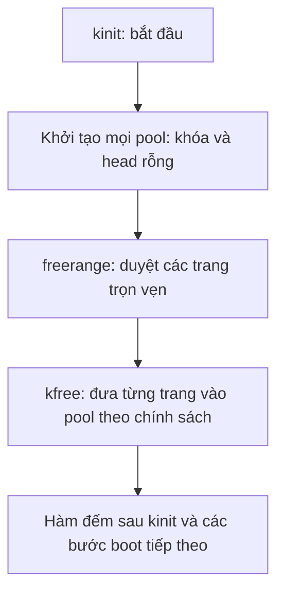

# Bài 3: Thiết kế và tự viết free list theo CPU trong xv6

Ngày biên soạn và đối chiếu source: 17/10/2026.

Bài này tiếp nối [Lesson 2: Race condition, spinlock, CPU ID và trạng thái ngắt](<02-race-spinlock-va-cpu.md>). Bây giờ bạn dùng kiến thức con trỏ/list và đồng bộ để thay cấu trúc quản lý trang.

Bạn tự thiết kế và tự viết toàn bộ C. Tài liệu giải thích mô hình, reference, yêu cầu từng bước và cách kiểm tra; không chứa bản kalloc/kfree per-CPU hoàn chỉnh để chép. Các đoạn C nhỏ là ví dụ cú pháp hoặc mã tham chiếu hiện có.

## 0. Mục tiêu và hai mốc thực hành

Sau bài này, bạn cần làm được:

- Thiết kế một pool gồm khóa và head của danh sách trang trống.
- Biểu diễn nhiều pool bằng mảng có kích thước NCPU.
- Khởi tạo mọi pool trước khi đưa trang vào hệ thống.
- Giữ CPU ID ổn định trước khi chọn pool local.
- Tự cập nhật page free và page allocation với khóa/guard đúng cặp.
- Cập nhật hàm đếm đang có mà không quên các pool khác.
- Phân biệt local-empty với thiếu bộ nhớ toàn hệ thống.
- Tự viết chú thích và chốt các phần code bằng commit/push.

### 0.1. Phạm vi được chia rõ

| Mốc | Hành vi | Phạm vi kiểm chứng của bài |
|---|---|---|
| M1: đổi cách biểu diễn | Có mảng pool nhưng cấp/trả vẫn dùng pool 0; pool khác rỗng | Giữ mô hình một pool chung trước khi đổi chính sách |
| M2: chọn pool local | Cấp/trả dùng CPU hiện tại; chưa có remote fallback/stealing | Bản trung gian để luyện, kiểm chứng với CPUS=1 |
| Lesson 4 | Local rỗng thì tìm/lấy trang từ pool khác | Hoàn thiện đường cấp trang trên nhiều CPU |

M1 không giảm tranh chấp: mọi CPU vẫn dùng cùng pool 0. Nó giúp tách thay đổi cấu trúc dữ liệu khỏi thay đổi chính sách.

**M2 chưa phải allocator nhiều CPU hoàn chỉnh.** Nếu trang ban đầu tập trung ở pool 0, CPU khác có thể thấy pool local rỗng dù hệ thống còn nhiều trang. Không dùng kết quả CPUS=1 để kết luận per-CPU allocator đã dùng hết RAM hoặc chạy đúng trên nhiều CPU.

Bạn có thể đọc toàn bài trước. Khi code, làm từng phần nhỏ; chỉ chốt một mốc code sau khi các phần liên quan đã được ghép nhất quán và kiểm tra phù hợp.

### 0.2. Các chặng đọc

| Chặng | Mục | Sản phẩm tự làm |
|---|---|---|
| A | 1–4 | Đọc source hiện tại, học mảng struct, vẽ ownership |
| B | 5–6 | Thiết kế khởi tạo và vùng ổn định CPU/ngắt |
| C | 7–9 | Thiết kế free, allocate và đếm trên nhiều pool |
| D | 10–11 | Lập bản đồ sửa reference, tự code theo M1/M2 và chốt commit |
| E | 12–14 | Kiểm chứng, tìm lỗi, tự đánh giá và chuẩn bị stealing |

## 1. Điểm xuất phát thực tế của BTL

### 1.1. Source đã có thêm phần bạn tự viết

Kiểm tra ngày 17/10/2026 cho thấy:

| Thành phần | Hiện có |
|---|---|
| [kalloc.c](<../../kernel/kalloc.c>) | Một biến kmem với một lock và một freelist |
| [kfreepage_count](<../../kernel/kalloc.c#L86>) | Hàm đếm dùng biến duyệt local, giữ kmem.lock suốt vòng duyệt |
| [defs.h](<../../kernel/defs.h#L63>) | Đã có khai báo hàm đếm |
| [main.c](<../../kernel/main.c#L20>) | Đã gọi/in số trang ngay sau kinit, trước kvminit |
| Thuật toán cấp/trả trang | Vẫn dùng free list chung gốc |
| Slab/per-CPU lists | Chưa có implementation trong source được kiểm tra |

Đây là xác nhận **đã có code**, chưa phải xác nhận code đã build/boot/test thành công. Lượt soạn bài này không chạy kernel hoặc kiểm tra lại cài đặt toolchain.

Bộ nhớ trước đó ghi chưa có hàm đếm; source mới nhất đã khác, nên Lesson 3 dùng source hiện tại làm điểm xuất phát.

### 1.2. Các API page giữ nguyên

Trong bài này giữ tên, tham số và kiểu kết quả của:

- Kinit: khởi tạo allocator.
- Kalloc: lấy một trang, trả pointer hoặc con trỏ rỗng khi không cấp được.
- Kfree: trả nguyên một trang hợp lệ.
- Kfreepage_count: quan sát tổng số trang trống, với độ nhất quán cần được giải thích ở mục 9.

Không đổi page kfree thành object free. Kmalloc/slab sẽ được học ở bài sau; caller đang trả trang không được chuyển sang một API có ý nghĩa khác chỉ vì trùng tên free.

### 1.3. Vì sao đổi thiết kế?

Mô hình hiện tại:

```text
CPU 0 ----+
CPU 1 ----+----> một kmem.lock ----> một free list
CPU 2 ----+
```

Mỗi lần lấy/trả cần đi qua cùng điểm đồng bộ. Thiết kế per-CPU chia pool:

```text
CPU 0 -> pool 0: lock 0 + head 0
CPU 1 -> pool 1: lock 1 + head 1
CPU 2 -> pool 2: lock 2 + head 2
```

Các local operation trên pool khác nhau có cơ hội thực hiện song song. Đây là kỳ vọng thiết kế, chưa là kết quả benchmark.

MIT lock lab dùng hướng free list riêng từng CPU, mỗi list có khóa và bổ sung stealing khi local thiếu trang. [MIT lock lab](https://pdos.csail.mit.edu/6.1810/2025/labs/lock.html).

**Bài nhỏ A:** vẽ hai CPU cùng dùng một list, rồi hai CPU dùng hai list. Đánh dấu dữ liệu và khóa nào còn dùng chung trong mỗi trường hợp.

## 2. Chọn cấu trúc C vừa đủ cho pool

### 2.1. Một pool có trách nhiệm gì?

Một pool quản lý danh sách những trang đang trống trong pool đó. Nó cần:

| Dữ liệu | Vai trò |
|---|---|
| Một struct spinlock thật | Bảo vệ cấu trúc danh sách của pool |
| Một struct run * làm head | Chỉ trang trống đầu tiên hoặc pointer rỗng |

Struct run ở đầu mỗi trang vẫn chỉ cần liên kết next như baseline. Việc chia pool không bắt buộc thêm CPU ID vào từng trang.

Bạn có thể đặt tên kiểu nội bộ như page_pool hoặc chọn tên khác rõ nghĩa. Tên đề xuất chỉ là hướng thiết kế, chưa có struct mới trong source.

### 2.2. Vì sao khóa phải nằm trong từng phần tử?

Chỉ tạo nhiều head nhưng vẫn dùng một khóa chung sẽ tiếp tục serialize các thao tác qua khóa đó.

Ngược lại, nhiều khóa nhưng mọi phần tử cùng trỏ một head không tạo ra các list độc lập. Hai khóa khác nhau không loại trừ nhau khi sửa cùng dữ liệu.

Thiết kế cần ghép đúng cặp:

```text
pool[i].lock bảo vệ pool[i].head và các next thuộc list đó
```

Không dùng lock của pool 0 để bảo vệ list 1 trong một hàm, rồi dùng lock 1 để sửa list 1 trong hàm khác.

### 2.3. Giữ state ở module sở hữu nó

Theo [kiến trúc dự án](<../Kien-truc-du-an.md>), tầng trang nằm trong kalloc.c.

- Struct pool và mảng pool thuộc nội bộ module.
- Caller tiếp tục gọi API qua defs.h.
- Không công bố mảng pool trong một header để vm.c/main.c tự sửa head.
- Không tạo page_pool_manager, interface hoặc một thư viện riêng chỉ cho hai trường.
- Kalloc.o đã có trong Makefile, nên đổi dữ liệu trong cùng module không cần thêm object mới.

Nếu state chỉ dùng trong file, bạn có thể dùng static ở phạm vi file để giới hạn liên kết. Tự giải thích khác nhau giữa “static làm state nội bộ” và “static làm dữ liệu riêng từng CPU”: static không tự tạo một bản trên mỗi CPU.

### 2.4. Pool metadata không xin trang bằng chính allocator chưa khởi tạo

Mảng pool có số phần tử cố định theo NCPU có thể được bố trí trong dữ liệu tĩnh của kernel. Nó tồn tại trước khi kinit điền danh sách trang.

Không cần dùng kalloc/kmalloc để cấp mảng quản lý ban đầu rồi lại cần chính mảng đó để kalloc hoạt động. Đây là một vòng phụ thuộc khởi tạo cần tránh.

Tăng global/static data có thể làm địa chỉ end của image kernel thay đổi. Vì vậy số trang ban đầu có thể thay đổi khi bạn thêm mảng, dù chưa có memory leak.

## 3. Nền C mới: mảng và mảng struct

### 3.1. Mảng là nhiều phần tử cùng kiểu

Ví dụ cú pháp, độc lập với allocator:

```c
unsigned int so_luong[3] = {2, 0, 4};
```

Có ba phần tử liên tiếp cùng kiểu:

| Biểu thức | Nghĩa |
|---|---|
| so_luong[0] | Phần tử thứ nhất, giá trị 2 |
| so_luong[1] | Phần tử thứ hai, giá trị 0 |
| so_luong[2] | Phần tử thứ ba, giá trị 4 |
| &so_luong[1] | Địa chỉ phần tử thứ hai |

Chỉ số bắt đầu từ 0. So_luong[3] không phải phần tử thứ tư hợp lệ của mảng có 3 phần tử.

### 3.2. Mảng struct và con trỏ tới phần tử

Ví dụ nhỏ để học cách viết:

```c
struct diem {
  int x;
  int y;
};

struct diem ds[2] = {{1, 2}, {3, 4}};
struct diem *p = &ds[1];
```

Trong ví dụ:

- ds[1] là một đối tượng struct diem.
- &ds[1] có kiểu con trỏ tới struct diem.
- ds[1].x và p->x cùng chỉ trường x của phần tử thứ hai.
- Hai đối tượng struct nằm trong hai phần tử khác nhau; gán một pointer tới phần tử không tạo bản sao phần tử.

Đây là ví dụ hẹp về kiểu/cú pháp, không phải phần khai báo pool để chép vào kernel.

### 3.3. Áp dụng cách đọc vào pool

Giả sử bạn chọn tên mảng là kmem và tên trường giữ như baseline:

| Biểu thức dự kiến | Cách đọc |
|---|---|
| kmem[i] | Đối tượng pool ở chỉ số i |
| &kmem[i] | Pointer tới pool đó |
| kmem[i].freelist | Head của pool i |
| &kmem[i].lock | Địa chỉ khóa được nhúng trong pool i |
| local->freelist | Head qua pointer local tới một pool |

Mảng pool nằm liên tiếp trong RAM. Nhưng các trang trong free list của mỗi pool vẫn liên kết bằng next, không cần nằm liên tiếp.

Giữ riêng hai loại di chuyển:

- Chuyển từ phần tử pool i sang i + 1 là duyệt mảng pool.
- Chuyển từ một trang sang trang kế tiếp trong list là đi theo node.next.

Phép lấy phần tử mảng được xác định theo kiểu phần tử; không phải cộng một byte tùy ý. [WG14 N1570, §6.5.2.1 và §6.7.6.2](https://www.open-std.org/jtc1/sc22/wg14/www/docs/n1570.pdf).

### 3.4. NCPU khác số CPU đang chạy

[NCPU trong param.h](<../../kernel/param.h#L2>) hiện bằng 8: giới hạn số CPU/state mà kernel bố trí.

CPUS trong lệnh Make chọn số hart QEMU chạy. Trong cấu hình QEMU/xv6 này, CPU ID dùng làm chỉ số phải ở miền hợp lệ từ 0 đến NCPU - 1. Không sửa một ID sai bằng cách tự lấy modulo rồi coi là hợp lệ.

Tạo mảng NCPU phần tử không tự làm QEMU chạy 8 CPU. Ngược lại, không tăng CPUS vượt cấu hình chỉ vì mảng là một cú pháp dễ mở rộng.

### 3.5. Không chia trang bằng cách sao chép head

Nếu gán head của pool 1 bằng head của pool 0 mà không tách các node, cả hai cùng tham chiếu một chuỗi trang:

```text
pool 0 head ----+
               +----> A -> B -> C -> 0
pool 1 head ----+
```

Hai lock khác nhau có thể cùng cấp A cho hai caller. Đây là duplicate ownership, không phải cân bằng bộ nhớ.

Tương tự, sao chép cả struct pool còn có thể sao chép trạng thái khóa và pointer quản lý. Mỗi pool phải được khởi tạo đúng; chuyển trang là thao tác thay ownership/list, không phải copy struct.

**Bài nhỏ B — tự viết:** trong chat, tự định nghĩa kiểu pool nội bộ và mảng NCPU phần tử theo trách nhiệm ở mục 2. Chỉ viết phần dữ liệu, chưa viết kinit/kalloc/kfree. Giải thích kiểu của từng trường và biểu thức lấy địa chỉ khóa một phần tử.

## 4. Ownership và invariant khi có nhiều pool

### 4.1. Trang thuộc trạng thái nào?

Xét những trang đã được đưa vào vùng allocator quản lý sau khởi tạo:

| Trạng thái | Ai quản lý? | Có ở free list không? |
|---|---|---|
| Trống ở pool i | Allocator qua pool i | Có, đúng một list |
| Đã cấp | Caller đang sở hữu | Không |
| Đang ở giữa thao tác cấp/trả/chuyển | Thao tác đang quản lý trang đó | Không được đồng thời công bố như trang trống ở nơi khác |

“Đang giữa thao tác” là trạng thái ownership cần được giải thích, không phải một list phụ bắt buộc phải tạo.

### 4.2. Một phương trình để suy luận bảo toàn

Với tập trang quản lý cố định sau boot:

```text
P = F + A + T

P: tổng số trang thuộc tập allocator quản lý
F: tổng trang đang trống trong các pool
A: trang đã giao cho các caller
T: trang do thao tác đang diễn tiến quản lý riêng
```

Ở thời điểm yên, khi các thao tác cần xét đã kết thúc, T bằng 0. Không dùng một phép đếm các pool ở nhiều thời điểm khác nhau để khẳng định ngay phương trình đã được đo như một snapshot đồng thời.

P không bao gồm các byte của image kernel trước vùng cấp phát. Nó có thể khác giữa hai bản build có end khác nhau.

### 4.3. Pool theo CPU không phải vùng RAM riêng của CPU

Mọi pool vẫn tham chiếu các trang trong RAM dùng chung của máy mô phỏng. Không có thao tác chuyển dữ liệu RAM vật lý sang “RAM của CPU 1” khi trang được gắn vào list 1.

CPU ID ở đây quyết định pool được ưu tiên sử dụng, không định nghĩa một không gian địa chỉ mới hoặc quyền truy cập user.

### 4.4. Cấp trên CPU 0, trả trên CPU 1

Một tiến trình có thể lấy trang khi chạy trên CPU 0, rồi chuyển CPU trước lúc trả trang.

Chính sách đề xuất của bài: **free vào pool của CPU đang thực hiện free**, không bắt caller phải nhớ CPU đã cấp.

```text
A trống trong pool 0
   -> cấp cho P trên CPU 0
   -> P có thể chạy tiếp trên CPU 1
   -> P trả A vào pool 1
```

Không cần thêm trường owner_cpu vào từng trang chỉ để thực hiện chính sách này. Caller chỉ giữ page pointer như API cũ.

Hệ quả: phân bố trang có thể lệch dần theo workload. Lesson 4 phải giải quyết local thiếu trang dù pool khác còn.

### 4.5. Invariant cần tự kiểm tra

1. Trang trống xuất hiện đúng một lần trong đúng một pool.
2. Trang đã giao caller không còn ở bất kỳ free list nào.
3. Các pool không dùng những khóa khác nhau để sửa cùng một chuỗi node.
4. CPU ID dùng cho local path được lấy/dùng trong vùng ổn định CPU.
5. Khóa và guard được đóng đúng cặp trên mọi đường trả về bình thường.
6. API page vẫn quản lý nguyên trang với alignment/lifetime của baseline.

**Bài nhỏ C:** vẽ trạng thái A qua ba bước cấp CPU 0 → caller giữ → free CPU 1. Ghi ai được ghi phần đầu trang ở mỗi bước và điểm nào next trở lại có ý nghĩa quản lý.

## 5. Kinit và freerange: khởi tạo mọi khóa trước khi phát trang

### 5.1. Hai giai đoạn khởi tạo phải có thứ tự

Mô hình đề xuất:



Mọi pool cần khóa đã sẵn sàng trước khi bất kỳ đường code nào có thể acquire khóa đó. Đừng tạo lock của một pool lần đầu khi thấy list nó rỗng trong kalloc.

Trong mảng static/global, các head ban đầu là con trỏ rỗng theo khởi tạo tĩnh. Bạn có thể diễn đạt việc đặt head rỗng tường minh trong giai đoạn init để dễ đọc; không đặt lại head sau khi trang đã được thêm.

### 5.2. Vì sao khởi tạo cả NCPU phần tử?

Dù CPUS=1 chỉ có CPU 0 chạy, các công cụ đếm hoặc chính sách quét pool sau này có thể đi qua mọi phần tử mảng.

Khởi tạo đầy đủ tạo một invariant rõ: mọi chỉ số pool hợp lệ đều có khóa và list hợp lệ. Pool không có CPU đang chạy vẫn là một cấu trúc dữ liệu đã khởi tạo, thường rỗng.

### 5.3. Tên khóa và lifetime của chuỗi

Trong initlock, source gán trực tiếp name vào trường pointer, không sao chép nội dung một chuỗi sang bộ nhớ mới.

Nếu tự tạo một buffer tên ở stack trong kinit rồi giữ địa chỉ đó trong lock, sau khi kinit trả về pointer tên có thể không còn lifetime đúng. Nếu dùng một buffer tạm cho mọi vòng lặp, các lock cũng có thể cùng tham chiếu một nội dung bị ghi đè.

Để bắt đầu đơn giản, dùng tên string literal có lifetime phù hợp, ví dụ tên kmem như baseline. Không cần thêm một thư viện định dạng tên.

MIT lock lab chấp nhận cùng tên kmem cho các khóa; tên có tiền tố đó phục vụ cơ chế đo của lab. Đây là tham khảo khi thiết kế tên, không phải bằng chứng BTL đã có bộ đo tương ứng. [MIT lock lab: hints](https://pdos.csail.mit.edu/6.1810/2025/labs/lock.html).

### 5.4. Freerange vẫn quản lý miền trang cũ

Bạn giữ các quy tắc baseline:

- Bắt đầu từ end được làm tròn lên PGSIZE.
- Chỉ lấy trang trọn vẹn trước PHYSTOP.
- Bước duyệt theo byte rồi tăng PGSIZE.
- Gọi page free để đưa trang vào pool.

Đổi cách lưu free list không cho phép đưa trang chứa code/data kernel vào vùng trống.

### 5.5. Khi boot, trang ban đầu vào đâu?

[Main.c](<../../kernel/main.c#L19>) gọi kinit trên CPU 0. Nếu freerange gọi kfree và kfree dùng pool của CPU hiện tại, các trang ban đầu sẽ được thêm vào pool 0.

```text
Sau kinit trong thiết kế M2:
pool 0: nhiều trang trống
pool 1: 0
...
pool 7: 0
```

Đây là suy luận từ thứ tự gọi và chính sách đề xuất, chưa phải log đã chạy. Không kỳ vọng các pool tự được chia đều chỉ vì có vòng init khóa.

Để học local path, bài giữ chính sách khởi tạo đơn giản đó. Không thêm phân phối round-robin chỉ để che việc chưa có stealing; chia đều lúc boot cũng không giải quyết mọi local-empty về sau.

**Bài nhỏ D:** lập hai danh sách việc: khởi tạo cấu trúc pool và đưa trang vào pool. Giải thích vì sao danh sách việc thứ nhất phải hoàn tất trước.

## 6. Vùng ổn định CPU và khóa pool

### 6.1. Hai lớp bảo vệ

| Cơ chế | Bảo vệ điều gì? |
|---|---|
| Push_off/pop_off ngoài | Giữ điều kiện lấy/dùng CPU ID hiện tại trong đoạn ngắn |
| Acquire/release khóa pool | Bảo vệ head/next của pool khỏi truy cập đồng thời theo giao thức |

Tắt ngắt CPU 0 không ngăn CPU khác chạm RAM. Per-CPU list vẫn cần khóa vì đường remote/stealing sau này sẽ truy cập pool của CPU khác.

### 6.2. Chọn ID sau khi đã bảo vệ CPU

Bạn cần tự viết trình tự đạt các điều kiện:

1. Mở khoảng bảo vệ CPU.
2. Lấy ID hiện tại bên trong khoảng đó.
3. Chọn pool tương ứng.
4. Thực hiện thao tác list dưới đúng khóa.
5. Kết thúc mọi việc còn phụ thuộc CPU hiện tại.
6. Đóng khoảng bảo vệ CPU của hàm.

Không lấy cpuid trước rồi mới trông chờ acquire bảo vệ ngược lại thời điểm lấy ID. Một cpuid nằm trong biểu thức đối số acquire cũng được tính trước phần thân acquire.

Cpuid/mycpu yêu cầu ngắt đã tắt khi lấy/dùng trạng thái CPU hiện tại. [Sách xv6, mục mycpu/myproc](https://mit-pdos.github.io/xv6-riscv-book/sched.html#code-mycpu-and-myproc).

### 6.3. Theo dấu noff

Giả sử entry có noff = 0 và ngắt bật:

| Mốc | noff | Ngắt |
|---|---:|---:|
| Trước guard ngoài | 0 | 1 |
| Sau push_off ngoài | 1 | 0 |
| Sau acquire pool | 2 | 0 |
| Sau release pool | 1 | 0 |
| Sau pop_off ngoài | 0 | 1 |

Nếu entry ngắt đã tắt thì cuối hàm vẫn phải tắt. Nếu caller đã có noff lớn hơn 0, tính theo mức entry, không ép kết quả về 0.

Không tự intr_on để “đảm bảo cuối hàm bật ngắt”. Hàm chỉ khôi phục trạng thái caller theo guard đúng cặp.

### 6.4. Dữ liệu riêng có thể được xử lý ngoài guard

Một trang đã tách khỏi list thuộc thao tác/caller quản lý riêng. Việc ghi mẫu debug lên trang không cần giữ CPU ID cũ nếu nó không còn đọc/sửa dữ liệu theo CPU đó.

Với kfree, kiểm tra pointer và ghi mẫu trước khi chọn local pool có thể giữ theo baseline, vì trang do caller được quyền trả. Với kalloc, ghi mẫu sau khi đã tách trang cũng có thể ở ngoài vùng list lock.

Giảm vùng giữ khóa/guard cần dựa vào ownership và phụ thuộc CPU, không chỉ cắt bớt dòng để nhìn ngắn.

**Bài nhỏ E:** vẽ hai hàng thời gian: thời gian CPU ID cần ổn định và thời gian list lock cần được giữ. Chỉ ra vì sao chúng có thể bắt đầu/kết thúc ở hai điểm khác nhau.

## 7. Tự thiết kế kfree: trả vào pool của CPU hiện tại

### 7.1. Hợp đồng giữ nguyên

Đầu vào vẫn là pointer tới đầu một trang hợp lệ mà caller được quyền trả. Không nhận thêm tham số CPU ID từ vm.c hoặc từ chương trình user.

Các kiểm tra alignment/phạm vi và ý nghĩa page free của source gốc được giữ. Không xóa kiểm tra chỉ để bản per-CPU dễ chạy hơn.

### 7.2. Các trách nhiệm cần ghép

Bạn tự xác định vị trí của từng trách nhiệm:

| Việc | Điều kiện cần |
|---|---|
| Kiểm tra pointer | Đúng miền trang, alignment và lifetime |
| Ghi mẫu debug | Caller đã có quyền trả trang |
| Xem đầu trang như struct run | Vùng nhớ hợp lệ; cast không tạo RAM mới |
| Chọn local pool | CPU ID lấy/dùng trong guard |
| Nối node vào head | Giữ khóa đúng pool, không công bố một trang hai lần |
| Kết thúc | Thả khóa và đóng guard do hàm mở |

Bài không cung cấp toàn bộ thân hàm. Bạn viết từng phần và giải thích trước khi ghép.

### 7.3. Hai phép gán list vẫn có quan hệ thứ tự

Ví dụ pool i đang chứa B → C, caller trả A:

```text
Trước: pool i -> B -> C -> 0
Sau:   pool i -> A -> B -> C -> 0
```

Bạn đã học push ở Lesson 1. Ở đây bổ sung câu hỏi: biến nào xác định pool, khóa nào được giữ, và head nào phải được dùng trong cả hai phép gán?

Không lấy head của pool 0 để gắn next rồi công bố node vào head pool i. Đó là nối nhầm chuỗi qua các pool.

### 7.4. Không truy cập lại trang sau khi công bố free

Khi trang đã được nối và khóa được thả, một CPU khác có thể lấy trang. Các ghi vào nội dung trang sau thời điểm đó phải có một ownership hợp lệ khác, không thể dựa vào việc biến pa vẫn giữ địa chỉ.

Do đó mẫu debug và chuẩn bị metadata có vị trí trong lifecycle. Không chuyển memset xuống sau khi đã thả pool lock chỉ vì muốn mọi xử lý ngoài critical section.

### 7.5. Gợi ý chú thích cho phần free

Bạn tự viết chú thích diễn đạt khi cần:

- Vì sao free chọn pool theo CPU đang thực hiện, không theo CPU từng cấp.
- Guard bảo vệ CPU ID; lock bảo vệ list.
- Trang chuyển ownership cho pool ở phần nối list.
- Vì sao phần chuẩn bị trang đặt trước công bố.

Chú thích không cần diễn lại từng phép gán. Dùng nó để ghi điều kiện mà người sửa code sau này phải giữ.

**Bài nhỏ F:** gửi hợp đồng kfree local bằng lời, danh sách biến cần dùng và một sơ đồ trước/sau. Sau đó mới tự viết từng đoạn trong phần thực hành.


## 8. Tự thiết kế kalloc local và xử lý list rỗng

### 8.1. Local fast path là gì?

Fast path là đường thường gặp được thiết kế ngắn và ít tranh chấp. Ở bài này đó là lấy được một trang từ pool local mà chưa cần hỏi pool khác.

Bạn tự ghép các trách nhiệm:

| Việc | Điều cần giải thích |
|---|---|
| Giữ CPU ổn định | ID dùng để chọn pool không lỗi thời giữa chừng |
| Giữ khóa pool | Pop không đụng độ người truy cập cùng list |
| Lưu head vào biến local | Có thể nhận pointer rỗng |
| Tách trang nếu có | Cập nhật đúng head theo next |
| Hoàn tất bảo vệ | Giải phóng đúng lock và guard, kể cả khi list rỗng |
| Ghi mẫu/trả kết quả | Chỉ ghi vào trang có thật đã thuộc thao tác cấp |

Không thay pop thành phép tính địa chỉ trang kế tiếp. Các node vẫn được nối bằng next và có thể ở các vị trí RAM không liền nhau.

### 8.2. Hai đường kết quả đều phải cân bằng tài nguyên

| Đường | Kết quả | Trước khi return |
|---|---|---|
| Local có trang | Pointer trang đã tách khỏi list | Không còn lock/guard do hàm mở bị bỏ quên |
| Local rỗng ở M2 | Pointer rỗng | Cũng phải thả khóa/đóng guard đúng |

Có thể tổ chức một phần cleanup chung hoặc nhiều nhánh rõ ràng; bạn tự chọn và giải thích. Không return sớm ngay sau kiểm tra head mà quên một mức noff hoặc khóa đang giữ.

Nếu entry vốn có guard/khóa của caller, hàm chỉ đóng những gì chính nó mở. Không ép noff về 0.

### 8.3. Trang đã tách là dữ liệu riêng của thao tác

Sau pop dưới khóa:

```text
pool i -> B -> C -> 0
r giữ A, A không còn trong bất kỳ free list nào
```

A chưa cần giữ next cũ. Ghi mẫu debug có thể diễn ra sau khi thả pool lock và kết thúc phần cần ID local. Sau đó caller nhận pointer và quản lý lifetime của nó.

Ngay cả khi thread chuyển CPU sau khi đóng guard, pointer tới A không tự đổi thành pointer tới một trang khác. Điều phải ổn định trước đó là lựa chọn/thao tác pool, không phải “ghim mọi dữ liệu riêng vào một CPU mãi mãi”.

### 8.4. Local-empty khác global OOM

Ví dụ:

```text
pool 0: A -> B -> C
pool 1: rỗng
CPU 1 muốn kalloc
```

Nếu M2 chỉ nhìn pool 1 thì không cấp được. Nhưng toàn hệ thống vẫn có ba trang trống. Đây là **thiếu cục bộ**, chưa đủ để kết luận thiếu bộ nhớ toàn hệ thống.

API trả pointer rỗng khiến caller xử lý như allocation failure, có thể rollback hoặc panic theo đường gọi. Vì vậy local-only làm giảm khả năng cấp trang so với baseline khi có nhiều CPU; nó chưa hoàn thành hợp đồng vận hành chung mong muốn của allocator.

### 8.5. Vì sao không chạy M2 như bản nhiều CPU hoàn chỉnh?

Sau boot, toàn bộ trang ban đầu ở pool 0. Một hoạt động chạy trên CPU khác có thể cần trang khi pool nó còn rỗng. Ngay cả nếu chia trang đều lúc boot, workload vẫn có thể làm một pool hết trước.

Bài 3 không sửa bằng cách quay lại một khóa chung dùng cho mọi local operation, cũng không thêm một fallback tạm chưa được giải thích. Ta ghi rõ phạm vi M2 là **mốc học local path với CPUS=1**, rồi giải quyết remote allocation ở Lesson 4.

Không chạy quick tests CPUS=4 rồi cố sửa số trang hoặc bỏ panic để che việc thiếu stealing. Phải bổ sung cơ chế cấp đúng trước khi dùng bộ test nhiều CPU làm tiêu chí thành công.

### 8.6. Gợi ý chú thích cho phần allocate

Bạn tự viết khi cần:

- Đoạn nào cần CPU ID hiện tại và vì sao guard mở trước cpuid.
- Điểm trang bị loại khỏi list, chuyển sang ownership riêng.
- Hai đường local có/rỗng đều đóng đúng bảo vệ.
- Giới hạn local-only và phần remote fallback còn thiếu ở mốc M2.

**Bài nhỏ G:** với pool 0 có A/B, pool 1 rỗng, vẽ một request trên mỗi CPU. Phân biệt số trang toàn hệ thống, số local và kết quả của M2. Sau đó ghi yêu cầu mà Lesson 4 phải bổ sung.

## 9. Cập nhật kfreepage_count đang có

### 9.1. Không bỏ sót hàm đã tự viết

Hàm hiện tại duyệt một kmem.freelist dưới một kmem.lock. Khi kmem thành mảng, chỉ cập nhật kalloc/kfree là chưa đủ.

Nếu giữ truy cập kiểu scalar, compiler sẽ báo lỗi vì kmem không còn là một struct đơn. Nếu sửa đếm chỉ nhìn pool 0, chương trình có thể biên dịch nhưng báo thiếu trang nằm ở pool khác.

Mục tiêu của hàm vẫn là quan sát **tổng trang trống của allocator**, không âm thầm đổi thành “trang trống local”.

### 9.2. Hai tầng duyệt khác nhau

Bạn tự thiết kế:

| Tầng | Đơn vị duyệt | Cách đi tới tiếp |
|---|---|---|
| Ngoài | Phần tử mảng pool | Chỉ số pool tiếp theo |
| Trong | Trang trống của một pool | Trường next của node |

Biến chỉ số và biến node không có cùng kiểu/vai trò. Tổng số trang dùng uint64 như API hiện tại.

Với mỗi pool, bạn phải lấy head của đúng pool đó, duyệt dưới khóa của pool đó rồi thả khóa. Biến node phải được đặt lại từ head của pool đang xét, không tái sử dụng giá trị còn lại của pool trước.

Đây là yêu cầu thuật toán để bạn tự viết; tài liệu không đưa vòng lặp hoàn chỉnh.

### 9.3. Chỉ giữ một khóa pool mỗi lần trong bản đầu

Thiết kế quan sát của bài: giữ khóa pool i trong thời gian duyệt list i, thả nó rồi mới sang pool khác.

- Không tự giữ đồng thời mọi khóa chỉ để tổng trông “chính xác”.
- Không gọi hàm đếm từ bên trong đoạn đã giữ một khóa mà hàm sẽ lấy lại.
- Không in trong lúc giữ pool lock.
- Không gọi cpuid chỉ để duyệt mảng theo chỉ số cố định: vòng quét toàn bộ không cần giả định mọi phần tử là CPU hiện tại.

Acquire/release tự xử lý guard của việc giữ khóa. Bản đếm dùng chỉ số pool cố định giữa các lần khóa; migration giữa hai lần quan sát không tự làm chỉ số đó đổi.

### 9.4. Tại boot yên: có thể giải thích tổng chính xác

Lời gọi hiện có trong main.c nằm ngay sau kinit, trước kvminit. Ở giai đoạn đó, CPU khởi tạo chưa công bố started cho các CPU khác chạy các bước sau, và chưa có workload bình thường đang cấp/trả trang.

Theo thiết kế mới đã khởi tạo đúng:

- Pool 0 chứa các trang được freerange đưa vào.
- Pool khác rỗng.
- Cộng mọi pool cho tổng trống của giai đoạn đó.

Số này liên hệ layout của chính bản build đang chạy:

```text
(PHYSTOP - PGROUNDUP(địa chỉ end)) / PGSIZE
```

Không bắt buộc giống con số trước khi thêm mảng pool, vì image kernel có thể lớn hơn.

### 9.5. Lúc concurrent: tổng từng pool không là một snapshot đồng thời

Mỗi list được đếm an toàn ở một thời điểm, nhưng các thời điểm khác nhau. Ví dụ suy luận:

| Thời điểm | Sự kiện |
|---|---|
| 1 | Hàm đếm pool 0, trong đó có trang A |
| 2 | A được cấp từ pool 0 cho caller |
| 3 | Caller trả A trên CPU 1, A vào pool 1 |
| 4 | Hàm đếm tiếp pool 1, lại thấy A |

Tổng quan sát có thể tính A ở hai thời điểm khác nhau. Chiều di chuyển ngược có thể làm bỏ lỡ một trang. Không có duplicate ownership tại một thời điểm; vấn đề là cách tổng hợp số liệu.

Vì vậy cần ghi rõ:

- **Boot yên:** dùng để kiểm tra pool được khởi tạo và nạp trang đúng.
- **Hệ đang chạy:** số cộng tuần tự là quan sát từng pool, không cam kết một tổng atomic toàn hệ thống.
- **Kiểm tra bảo toàn/leak:** cần một điểm quiescent phù hợp hoặc giao thức thống kê/test riêng.

Quiescent nghĩa là những hoạt động liên quan cần xét đã yên, không còn chuyển ownership làm thay tập đang đo. Không coi việc từng acquire đều đúng là đủ chứng minh toàn bộ phép cộng diễn ra cùng một lúc.

### 9.6. Giữ reference và mô tả API trung thực

Khai báo trong defs.h và lời gọi boot có thể giữ nguyên nếu chữ ký không đổi. Phần thân hàm đếm phải đổi theo dữ liệu mới.

Bạn tự điều chỉnh chú thích để nói rõ số liệu được dùng ở thời điểm nào. Chưa cần thêm syscall, một global counter bị mọi CPU tranh chung hoặc module thống kê riêng chỉ để chạy bài.

**Bài nhỏ H:** vẽ hai pool, mỗi pool hai trang. Tự lập bảng biến chỉ số, node hiện tại, khóa đang giữ và tổng đã đếm. Sau đó tự nêu vì sao bảng này chỉ là tổng chính xác khi dữ liệu phù hợp với giả định yên.

## 10. Bản đồ sửa reference: không thay call site khi API không đổi

### 10.1. Những nơi có state allocator

Tìm trước khi sửa:

```bash
rg -n 'kmem|kfreepage_count' kernel
```

Nếu terminal chưa có rg, dùng tìm kiếm workspace theo đúng tên. Không cần cài công cụ khác chỉ để tiếp tục đọc bài.

Theo source hiện tại:

| Nơi | Điều cần tự cập nhật |
|---|---|
| Khai báo kmem trong kalloc.c | Một đối tượng thành mảng pool |
| Kinit | Init từng khóa/head trước freerange |
| Kfree | Head/khóa theo pool phù hợp từng mốc |
| Kalloc | Head/khóa theo pool phù hợp từng mốc |
| Kfreepage_count | Duyệt mọi pool dưới khóa tương ứng |
| Chú thích liên quan | Bỏ mô tả một list chung khi không còn đúng |

Đừng sửa một vài câu kmem.lock rồi bỏ quên các reference còn lại ở hàm đếm hoặc init.

### 10.2. Những nơi nên giữ ổn định

| Nơi | Lý do |
|---|---|
| [defs.h](<../../kernel/defs.h#L59>) | API page/hàm đếm không đổi chữ ký trong bài |
| [main.c](<../../kernel/main.c#L19>) | Thứ tự kinit rồi đếm rồi kvminit vẫn hợp lý |
| [vm.c](<../../kernel/vm.c#L228>) | Caller lấy/trả trang qua API, không cần biết mảng pool |
| [proc.c](<../../kernel/proc.c#L65>) | Dùng cpuid hiện có, không sửa cơ chế CPU ID |
| [spinlock.c](<../../kernel/spinlock.c#L22>) | Tái sử dụng đồng bộ xv6, không viết lại khóa |
| [Makefile](<../../Makefile#L10>) | Kalloc.o đã được link; dùng CPUS ở dòng lệnh khi test |

Nếu bạn đổi chữ ký thật, cần rà toàn bộ khai báo/call site. Bài này giữ API nhỏ để tập trung vào allocator state.

### 10.3. Đọc đúng thứ tự trước khi bắt đầu

1. Đọc kalloc.c hiện tại, kể cả hàm đếm bạn đã thêm.
2. Đọc nhóm khai báo kalloc.c trong defs.h.
3. Đọc main.c để xác định boot CPU và điểm đo.
4. Ôn push_off/pop_off và cpuid từ Lesson 2.
5. Viết bản đồ reference cũ → pool nào ở M1/M2.
6. Sau đó mới bắt đầu thay từng phần dữ liệu/code.

**Bài nhỏ I:** liệt kê mọi hàm trong kalloc.c truy cập kmem. Với mỗi hàm, ghi pool cố định 0 ở M1, pool theo CPU ở M2, hoặc duyệt mọi pool. Đây là bản đồ trước khi gõ, không phải bước tìm lỗi sau khi sửa hết.

## 11. Hướng dẫn tự code theo mốc và nhắc commit

Áp dụng [quy trình chốt phần code](<../Lo-trinh-hoc.md>): tự viết → giải thích → đọc diff/kiểm tra → bổ sung chú thích → tự commit rồi push GitHub.

Mỗi bước nhỏ có thể gửi riêng để kiểm tra. Một mốc commit là tập thay đổi có ý nghĩa đã ghép nhất quán; không coi phần đang sửa dở, còn reference sai, là mốc hoàn thành.

### 11.1. M0 — ghi nhận hàm đếm hiện có

Trước khi thay cấu trúc, xem ba file hiện đang thay đổi ở phần đếm:

```bash
git diff -- kernel/kalloc.c kernel/defs.h kernel/main.c
```

Bạn cần tự giải thích:

- Khai báo và định nghĩa của hàm đếm tương thích.
- Biến node được khởi tạo từ head, biến đếm bắt đầu đúng.
- Khóa bao trùm việc duyệt và được thả trước return.
- Caller in sau kinit và sau khi hàm đếm đã thả khóa.
- Kết quả kiểm tra đã có/thiếu là gì.

**Gợi ý chú thích:** đây là phép quan sát không lấy trang; cần khóa suốt vòng duyệt; điểm gọi quyết định số liệu.

**Commit gợi ý nếu phần này đã kiểm tra và chưa chốt:** `feat(memory): add free-page counting`.

**Nhắc bạn:** tự stage đúng file/hunk, commit local rồi push lên GitHub. Nếu chưa build/boot/test, ghi rõ trạng thái thực tế thay vì đặt nội dung commit như đã xác nhận runtime.

### 11.2. M1 bước 1 — tự viết dữ liệu pool

Làm Bài nhỏ B trước. Bạn tự chọn:

- Tên kiểu nội bộ, nếu dùng kiểu có tên.
- Hai trường cần thiết và kiểu của từng trường.
- Tên mảng, số phần tử theo macro có sẵn.
- Phạm vi liên kết của state.

Giải thích mảng nằm ở đâu, tại sao không cần cấp động và khóa là đối tượng nhúng chứ không phải pointer chưa có vùng nhớ.

Chỉ gửi phần khai báo để kiểm tra, chưa tự thêm chức năng stealing.

### 11.3. M1 bước 2 — tự viết init tất cả pool

Bạn tự viết vòng khởi tạo theo NCPU, bảo đảm:

- Mỗi phần tử có khóa đã init.
- Tên khóa có lifetime đúng.
- Head rỗng trước khi nhận trang.
- Freerange chỉ được gọi sau giai đoạn init.

Chưa chạy qua allocator còn reference scalar chưa đổi. Các bước M1 tiếp theo phải ghép đầy đủ để tạo bản build nhất quán.

### 11.4. M1 bước 3 — giữ chính sách chung ở pool 0

Bạn tự cập nhật những truy cập cấp/trả trước đây dùng một đối tượng kmem để cùng dùng phần tử pool 0.

Điều cần chứng minh:

- Mọi CPU trong M1 vẫn chọn cùng pool 0.
- Tất cả thao tác trên list 0 dùng khóa 0.
- Pool khác không nhận trang do một nhánh bị sửa lệch.
- Không cần lấy cpuid để quyết định một chỉ số cố định.

Đây là refactor giữ hành vi, chưa là đường local per-CPU.

### 11.5. M1 bước 4 — tự cập nhật hàm đếm

Dùng yêu cầu mục 9 để tự viết phần quét pool và duyệt node. Khi ghép, giải thích rõ:

- Chỉ số ngoài và pointer node trong.
- Head đúng cho mỗi lần duyệt.
- Mỗi thời điểm chỉ giữ một khóa.
- Vì sao không in trong vòng giữ khóa.
- Tính chính xác theo thời điểm quan sát.

Giữ chữ ký hàm đếm và caller boot nếu chúng vẫn phù hợp. Không bỏ hàm đếm chỉ để tránh lỗi biên dịch sau đổi cấu trúc.

### 11.6. Chốt M1

Sau khi dữ liệu/init/cấp/trả/đếm đã ghép, đọc diff và kiểm chứng theo mục 12. M1 vẫn có chính sách một pool chung nên có thể so sánh hành vi với điểm xuất phát; không tự tuyên bố giảm contention.

**Gợi ý chú thích:**

- Mảng pool là cấu trúc chuẩn bị cho local path.
- Pool 0 còn được dùng chung ở mốc refactor.
- Mọi khóa được init trước freerange.
- Hàm đếm tổng hợp từng pool, giả định boot yên ở điểm gọi hiện tại.

**Commit gợi ý:** `refactor(memory): represent page state as per-CPU pools`.

**Nhắc bạn:** sau khi kiểm tra nội dung/kết quả thực tế, tự commit và push GitHub trước khi bắt đầu thay chính sách local.

### 11.7. M2 bước 1 — tự sửa free chọn pool local

Trước khi gõ, gửi sơ đồ guard/lock ở Bài nhỏ E/F. Sau đó tự viết từng phần:

- Chọn thời điểm mở guard trước cpuid.
- Dùng ID chọn đúng pool.
- Push vào list dưới đúng khóa.
- Thả đúng khóa và đóng guard.

Các phần kiểm tra pointer, ghi mẫu và lifetime phải giữ theo lập luận mục 7. Giữ trạng thái caller khi entry đã tắt ngắt.

### 11.8. M2 bước 2 — tự sửa allocate chọn pool local

Tự thiết kế các biến cần có và hai đường local có/rỗng. Sau đó viết:

- Phần chọn pool trong guard.
- Phần pop dưới khóa.
- Phần cleanup và kết quả.

Giải thích pointer r ở mỗi mốc còn thuộc list hay đã thuộc thao tác. Chỉ ghi mẫu khi có một trang thật. Hai đường trả về đều phải cân bằng mức bảo vệ.

Không viết remote scan/stealing ngay trong bước này; khi local rỗng, ghi đúng giới hạn của mốc và tiếp tục Lesson 4 sau khi kiểm tra.

### 11.9. M2 bước 3 — rà lại đếm/chú thích

Hàm đếm vẫn quét mọi pool. Không đổi nó thành đếm pool của CPU đang gọi chỉ vì kalloc/kfree đã dùng cpuid.

Tự đọc lại mọi comment nói về một lock/list chung, thời điểm số liệu và trạng thái local-only. Giữ các chú thích học của bạn khi còn đúng; sửa ý đã không còn phù hợp thay vì xóa sạch để diff ngắn.

### 11.10. Chốt M2 với phạm vi trung gian

Điều kiện của mốc:

- Local path được bạn tự viết và giải thích đúng.
- Lock/guard được cân bằng ở hai đường cấp phát.
- Khởi tạo pool, page free và count vẫn nhất quán.
- Build/boot/quick tests **CPUS=1** được kiểm chứng nếu bạn đã có môi trường.
- Phạm vi chưa có stealing được ghi rõ; chưa kết luận đúng nhiều CPU.

**Gợi ý chú thích:**

- CPU ID chỉ có ý nghĩa local trong guard.
- Thời điểm trang rời/nhập list là điểm ownership thay đổi.
- Local-empty không là kết luận global OOM.
- Mốc này chờ Lesson 4 để dùng trang từ pool khác.

**Commit gợi ý:** `refactor(memory): add local per-CPU page paths`.

Trong nội dung commit hoặc ghi chú học, tự ghi các kiểm tra đã chạy và phần remote fallback còn thiếu. Không viết “per-CPU allocator hoàn chỉnh” khi mới có mốc này.

**Nhắc bạn:** đọc staged diff, tự commit rồi push lên GitHub. Assistant chỉ gợi ý/nhắc; không tự stage/commit/push.

## 12. Kiểm chứng, output và giới hạn kết luận

### 12.1. Kiểm tra diff trước runtime

Tại root BTL:

```bash
git status --short
git diff -- kernel/kalloc.c kernel/defs.h kernel/main.c
git diff --check
```

Trong M1/M2, phần thay đổi chính dự kiến ở kalloc.c. Defs.h/main.c đã có phần đếm từ trước; xem diff để biết những gì thuộc mốc cũ/mới. Không thêm file ngoài phạm vi chỉ vì nó đang xuất hiện trong git status.

Không tự reset thay đổi của bạn để “quay về một bản sạch”. Dùng các mốc bạn đã commit và diff để hiểu lịch sử.

### 12.2. Build/boot mốc trung gian với một CPU

Trong terminal Ubuntu đã có toolchain:

```bash
cd '/mnt/d/2. FullStack/2026.1/Hệ điều hành/BTL'
make kernel/kernel fs.img
make qemu CPUS=1
```

Makefile hiện mặc định CPUS=3 nếu không truyền tham số. **Ở M2 phải ghi rõ CPUS=1** cho phạm vi thực hành của bài.

Nếu chưa có môi trường Linux/toolchain, dùng lại phần thiết lập ở Lesson 1. Không có output thực tế thì chỉ ghi đã viết/đọc source, chưa ghi build/boot thành công.

### 12.3. Quan sát điểm đếm sau kinit

Dòng caller đang có sẽ in theo dạng:

```text
free pages after kinit: <số nhận được thực tế>
```

Đây là hình thức mong đợi, không phải log đã chạy. Không chép placeholder vào code hoặc hardcode con số để giống tài liệu.

Giải thích số đó theo end/PGSIZE/PHYSTOP của bản build mới. Khi dữ liệu tĩnh tăng, số có thể thay đổi hợp lệ.

Nếu in được số rồi panic ở bước sau, không coi như boot hoàn tất. Giữ cả log sau dòng đếm.

### 12.4. Quick tests một CPU

Tại shell xv6, tự chạy:

```text
usertests -q
```

Chỉ ghi pass khi thấy kết quả cuối đúng của lần chạy thực tế. Quick tests là một nhóm test, chưa thay thế kiểm thử nhiều CPU và các ca allocator riêng.

Thoát QEMU bằng Ctrl+A, thả phím rồi X.

### 12.5. Phân biệt phạm vi từng mốc

| Mốc | Kết luận phù hợp nếu có output thành công | Điều chưa được chứng minh |
|---|---|---|
| M0 | Hàm đếm đã tích hợp/chạy ở điểm boot được quan sát | Không tự chứng minh mọi ca count concurrent |
| M1 | Refactor dữ liệu giữ được hành vi đã kiểm tra | Không chứng minh giảm tranh chấp |
| M2, CPUS=1 | Local push/pop và khởi tạo đi qua được các test đó | Không chứng minh remote allocation, tận dụng RAM nhiều CPU hoặc throughput |
| Sau Lesson 4 | Có cơ sở chạy ca nhiều CPU/thiếu local | Còn cần bộ test và benchmark thực tế |

Không cần chạy một ca nhiều CPU đã biết nằm ngoài hợp đồng trung gian chỉ để tạo một lỗi dễ dự đoán. Bài 4 bổ sung cơ chế trước, rồi mới đặt tiêu chí nhiều CPU cho bản đó.

### 12.6. Kiểm tra bảo toàn cần điểm quan sát đúng

Phép đếm sau boot hữu ích để phát hiện lỗi nạp trang hoặc bỏ sót pool. Nó không tự chứng minh không leak trong mọi hoạt động.

Một ca kiểm tra cấp/trả có kiểm soát về sau cần:

- Xác định trang thuộc tập nào.
- Quản lý mọi pointer đã cấp.
- Chọn thời điểm so sánh không bị workload khác thay số liệu.
- Không suy ra tổng tức thời từ các pool được đếm ở các thời điểm khác nhau.

Không cố cấp đến cạn RAM trong phần này khi chưa có harness quản lý pointer/rollback; bộ test tầng trang sẽ được dạy ở Lesson 5.

### 12.7. Không áp bộ test lab chưa có sẵn

Ngày 17/10/2026, BTL không có user/kalloctest.c hoặc kernel/kcsan.c. Không coi make grade/KCSAN/kalloctest từ lab là các kiểm tra đã có và đã chạy ở repo này.

Lesson 4/5 sẽ bổ sung hoặc chọn harness phù hợp khi cần. Khi chưa có số liệu contention, chỉ nói thiết kế hướng tới giảm tranh chấp.

## 13. Lỗi thường gặp và cách tự truy nguyên

| Biểu hiện | Khả năng cần xem | Việc tự kiểm tra |
|---|---|---|
| Compiler không chấp nhận kmem.lock | Kmem đã thành mảng, còn reference scalar | Rà init/free/alloc/count |
| Compiler báo kiểu pool chưa biết | Chỗ định nghĩa kiểu, scope hoặc thứ tự khai báo | Đặt kiểu nội bộ trước nơi tạo mảng; không include .c |
| Đếm chỉ thấy trang pool 0 | Count chưa tổng hợp mọi pool | Lập bảng hai tầng duyệt |
| Panic acquire | Lấy lại cùng lock hoặc dữ liệu khóa hỏng | Rà helper count trong vùng đã giữ khóa; init/copy state |
| Panic pop_off | Guard mất cân bằng hoặc tự bật ngắt sai lúc | Theo dấu noff/intena ở từng nhánh |
| Boot một CPU đã thấy hết trang bất thường | Chưa nạp pool 0, chọn pool sai hoặc mất list | Thứ tự init → freerange và head/next |
| Một CPU chạy, nhiều CPU thiếu trang | Có thể mới ở M2 local-only | Xác định có remote fallback chưa, không vội bỏ khóa |
| Count tăng quá lớn/không dừng | List có vòng, duplicate page hoặc đếm concurrent bị hiểu sai | Tách lỗi cấu trúc khỏi giới hạn số liệu |
| Sau free bị hỏng head/next | Sai pool/khóa hoặc ghi lại trang sau công bố | Theo ownership và điểm ghi mẫu |
| Tên khóa hỏng | Name trỏ buffer tạm đã hết lifetime/bị ghi đè | Nơi lưu chuỗi tên, initlock chỉ giữ pointer |
| Số trang boot khác bản trước | Image kernel có thể đổi kích thước | End của bản mới và điểm quan sát, trước khi kết luận leak |

Đây là hướng kiểm tra, không phải chẩn đoán chắc chắn từ một triệu chứng. Giữ nguyên log/lệnh/diff để xác định nguyên nhân thật.

Nếu bế tắc, gửi đúng phần tự viết và mô tả “đang ở M1 hay M2”, terminal đang dùng, CPUS và lỗi đầu tiên. Assistant sẽ đọc/gợi ý; bạn thực hiện sửa.

## 14. Tự đánh giá và nối sang Lesson 4

### 14.1. Câu hỏi phải giải thích được

| Chủ đề | Câu hỏi |
|---|---|
| Mảng pool | Vì sao một lock cho mỗi head khác với nhiều head cùng một lock? |
| Cú pháp | Kmem[i], &kmem[i], kmem[i].freelist và local->freelist khác nhau thế nào? |
| Khởi tạo | Vì sao phải init cả NCPU trước freerange? |
| Lifetime | Vì sao tên lock không nên trỏ tới buffer stack của kinit? |
| Boot | Vì sao trang có thể tập trung ở pool 0 mà không phải chia đều? |
| CPU ID | Vì sao push_off bên trong acquire chưa đủ bảo vệ một cpuid ở đối số trước đó? |
| Ownership | Cấp CPU 0 rồi trả CPU 1 có cần ghi CPU đã cấp vào mỗi trang không? |
| Local-empty | CPU 1 thấy list rỗng nhưng pool 0 còn trang có phải global OOM không? |
| Count | Vì sao phải cập nhật hàm đếm đang có khi đổi state? |
| Snapshot | Vì sao đếm từng pool có lock vẫn có thể đếm A hai lần ở hai thời điểm? |
| Kết luận | CPUS=1 pass cho phép nói điều gì và chưa nói điều gì? |
| Git | Mốc nào đã hoàn thành, kiểm tra nào đã chạy và message nào phản ánh đúng diff? |

### 14.2. Ba loại tiến độ cần ghi riêng

- **Đã học/thiết kế:** giải thích được mô hình, sơ đồ, invariant, reference và giới hạn.
- **Đã viết:** source do bạn tự sửa đã có phần dữ liệu/init/local path/count tương ứng.
- **Đã kiểm chứng:** có kết quả build/boot/test đúng phạm vi của mốc.

Không đánh dấu hoàn thành cả ba chỉ vì tài liệu Lesson 3 đã được tạo, hoặc chỉ vì source có đủ tên hàm.

### 14.3. Sản phẩm của Lesson 3

Bài học này hướng tới hai mốc code có thể review:

1. M1: state nhiều pool nhưng hành vi chung vẫn qua pool 0.
2. M2: local path với guard/khóa đúng, count được cập nhật và giới hạn CPUS=1 được ghi rõ.

Tài liệu, gợi ý chú thích và gợi ý commit của bài giúp bạn tự làm các mốc này. Chưa có mốc nào được tự áp dụng vào C trong lượt soạn Markdown.

### 14.4. Lesson 4 sẽ bổ sung điều gì?

Khi local pool rỗng, cần tìm một pool khác và lấy trang theo giao thức không cấp trùng, không mất trang, không tạo deadlock.

Các câu hỏi tiếp theo:

- Pool donor được chọn theo thứ tự nào?
- Khi nào thả khóa local, khi nào giữ khóa donor?
- Trang vừa tách do ai sở hữu trước khi giao/gắn lại?
- Khi quét không tìm thấy trang, kết luận thất bại có giới hạn gì dưới concurrency?
- Làm sao kiểm tra CPUS=2/4/8, local-empty và bảo toàn trang?

Đó là nội dung Lesson 4. Chưa triển khai batch stealing, adaptive policy, buddy hay slab trong Lesson 3.

## 15. Nguồn nghiên cứu và phạm vi áp dụng

| Nguồn | Dùng để đối chiếu |
|---|---|
| [Nguồn xv6 của BTL](<../Nguon-xv6.md>) | Nền source và cách dùng bản BTL |
| [Kiến trúc dự án](<../Kien-truc-du-an.md>) | State tầng trang ở kalloc.c, API nhỏ và module theo trách nhiệm |
| [MIT lock lab](https://pdos.csail.mit.edu/6.1810/2025/labs/lock.html) | Hướng per-CPU lists/khóa/stealing, boot pool và điều kiện cpuid |
| [MIT xv6 book: Locking](https://mit-pdos.github.io/xv6-riscv-book/lock.html) | Critical section, invariant và tranh chấp |
| [MIT xv6 book: Scheduling](https://mit-pdos.github.io/xv6-riscv-book/sched.html) | CPU ID, mycpu và migration |
| [MIT xv6 book: Page tables](https://mit-pdos.github.io/xv6-riscv-book/mem.html) | Tầng cấp trang và vùng RAM kernel |
| [WG14 N1570](https://www.open-std.org/jtc1/sc22/wg14/www/docs/n1570.pdf) | §6.2.4 lifetime, §6.5.2.1 mảng, §6.7.6.2 khai báo mảng |
| [Quy trình chú thích/commit](<../Lo-trinh-hoc.md>) | Người dùng tự viết, tự commit/push sau từng phần |

Source local quyết định chữ ký/call site đang có. Thiết kế M1/M2, bài tập và các bảng ownership là nội dung hướng dẫn soạn cho BTL; không phải kết quả chạy hoặc một triển khai upstream đã được nhập.

**Bắt đầu tự làm:** đọc source và kiểm tra mốc hàm đếm hiện có, rồi gửi Bài nhỏ B — khai báo pool/mảng và phần giải thích. Sau khi kiểm tra phần đó, bạn tự viết init và lần lượt các bước M1.
